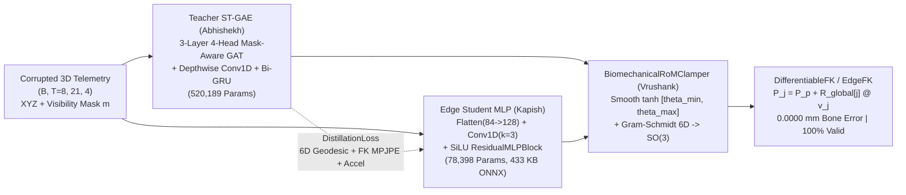

# Constrained Graph Kinematics: Biomechanical Range-of-Motion for Occluded Hand Gesture Telemetry

**Course:** Foundations of Data Science (FDS) — Year 3 Undergraduate Final Project  
**Presentation Date:** November 17, 2026  
**Authors & Module Ownership:**
* **Abhishekh:** Teacher Model Architecture & Spatial Ablation (`models/teacher_st_gae.py`, `training/train_teacher.py` — 3-Layer 4-Head Mask-Aware Graph Attention Network + Bidirectional Temporal GRU across $T=8$ windows + Biomechanical Latent Space, plus `SpatialOnlyGAE` ablation).
* **Bhavya:** Data Pipeline & Zero-Shot 3D Domain Adaptation (`data/dataset_ingestion.py`, `data/transforms.py`, `data/dataloader.py`, `data/iphone_parser.py`, `data/record_custom_gloved.py` — 21-joint MANO trajectory ingestion, `SyntheticOcclusionTransform` with 3D Volumetric Cylinder Clipping & Subtree Masking at 30%/50%/70%, `SyntheticGloveTransform` with 12% kinematic stiffness & AR(1) latex specular jitter, 80/20 split, and custom gloved dataset).
* **Vrushank:** Differentiable Forward Kinematics & Biomechanical Constraints (`models/kinematics.py`, `tests/test_kinematics.py` — Gram-Schmidt continuous 6D rotations on $\text{SO}(3)$, $C^1$-smooth `BiomechanicalRoMClamper` ($\tanh$), PyTorch `DifferentiableFK`, closed-form Rodrigues analytical IK `positions_to_rot6d`, and bare-metal NumPy `EdgeFK`).
* **Kapish:** Knowledge Distillation & Multi-Hardware Edge Deployment (`models/student_models.py`, `training/losses.py`, `distillation/`, `deployment/`, `training/evaluate_and_plot.py` — `StudentKinematicMLP` vs. `UnconstrainedStudentMLP`, ONNX Opset 17 export, cross-hardware profiling on PC / MacBook Air M-Series / NVIDIA Jetson Nano + RPi CSI Camera / Raspberry Pi 5 / iPhone ARKit UDP, and `live_demo.py`).

---

## 1. Project Overview & Core Architecture

Vision-based 3D hand trackers (such as MediaPipe Hands and Apple ARKit) regress 21 3D hand joint coordinates in $\mathbb{R}^{21 \times 3}$ without hard structural constraints. In surgical navigation and industrial teleoperation, two physical factors degrade unconstrained coordinate regressors:
1. **Handheld Tool Occlusion:** Grasping scalpels, forceps, drills, or probes obscures 30%–70% of phalangeal subtrees ($\text{MCP} \to \text{PIP} \to \text{DIP} \to \text{TIP}$), causing predicted coordinates to collapse toward the palm or stretch bone lengths by $15\text{–}27\text{ mm}$.
2. **Latex & Nitrile Glove Domain Shift:** Protective gloves introduce $12\%$ elastic stiffness and directional specular reflections ($\sigma = 4.5\text{ mm}$ baseline AR(1) drift with $12.0\text{ mm}$ distal fingertip spikes).

**Constrained Graph Kinematics** replaces unconstrained $\mathbb{R}^{21 \times 3}$ Cartesian regression with a two-stage **Spatio-Temporal Graph Autoencoder (`SpatioTemporalGAE`) Teacher** distilled into a **$78,398$-parameter Edge Student (`StudentKinematicMLP`)** embedded with a hard differentiable kinematic manifold:



---

## 2. Final Experimental Results

### 2.1 Held-Out Test Split Ablation Study ($N_{\text{test}} = 960$ Sequences, $7,680$ Frames)

| Occlusion Tier | Evaluated Model / Pipeline | Overall MPJPE (mm) $\downarrow$ | Visible MPJPE (mm) $\downarrow$ | Occluded MPJPE (mm) $\downarrow$ | PA-MPJPE (mm) $\downarrow$ | Bone-Length Error (mm) $\downarrow$ | Biomechanical Validity (%) $\uparrow$ | Temporal Jitter ($\text{mm/s}^2$) $\downarrow$ |
| :---: | :--- | :---: | :---: | :---: | :---: | :---: | :---: | :---: |
| **30% Occlusion** | Corrupted Input (Raw Gloved/Occluded) | $32.91$ | $8.62$ | $93.63$ | $32.08$ | $14.9372$ | $0.00\%$ | $34.98$ |
| *(6/21 joints)* | `UnconstrainedStudentMLP` (Direct XYZ, No FK) | $11.24$ | $6.22$ | $23.80$ | $10.10$ | $4.2027$ | $38.65\%$ | $15.41$ |
| | `SpatialOnlyGAE` (GAT + 6D FK, No GRU) | $4.67$ | $3.55$ | $7.46$ | $3.42$ | **$0.0000$** | **$100.00\%$** | $15.14$ |
| | **`Teacher ST-GAE` (Full GAT + Bi-GRU + 6D FK)** | **$3.33$** | **$2.80$** | **$4.67$** | **$1.97$** | **$0.0000$** | **$100.00\%$** | **$12.96$** |
| | **`StudentKinematicMLP` (Distilled 6D-FK Student)** | **$4.08$** | **$3.31$** | **$6.00$** | **$2.76$** | **$0.0000$** | **$100.00\%$** | **$13.05$** |
| **50% Occlusion** | Corrupted Input (Raw Gloved/Occluded) | $48.18$ | $8.22$ | $92.13$ | $34.91$ | $19.4657$ | $0.00\%$ | $29.81$ |
| *(10–11/21 joints)* | `UnconstrainedStudentMLP` (Direct XYZ, No FK) | $15.03$ | $5.87$ | $25.11$ | $12.34$ | $5.8505$ | $8.70\%$ | $15.17$ |
| | `SpatialOnlyGAE` (GAT + 6D FK, No GRU) | $6.20$ | $3.62$ | $9.03$ | $4.58$ | **$0.0000$** | **$100.00\%$** | $15.96$ |
| | **`Teacher ST-GAE` (Full GAT + Bi-GRU + 6D FK)** | **$3.79$** | **$2.86$** | **$4.82$** | **$2.11$** | **$0.0000$** | **$100.00\%$** | **$12.31$** |
| | **`StudentKinematicMLP` (Distilled 6D-FK Student)** | **$5.05$** | **$3.37$** | **$6.90$** | **$3.43$** | **$0.0000$** | **$100.00\%$** | **$12.68$** |
| **70% Occlusion** | Corrupted Input (Raw Gloved/Occluded) | $65.55$ | $7.63$ | $88.72$ | $36.11$ | $26.7127$ | $0.00\%$ | $18.76$ |
| *(15/21 joints)* | `UnconstrainedStudentMLP` (Direct XYZ, No FK) | $20.46$ | $5.41$ | $26.48$ | $13.02$ | $8.4587$ | $0.00\%$ | $14.18$ |
| | `SpatialOnlyGAE` (GAT + 6D FK, No GRU) | $10.54$ | $3.78$ | $13.24$ | $7.55$ | **$0.0000$** | **$100.00\%$** | $18.69$ |
| | **`Teacher ST-GAE` (Full GAT + Bi-GRU + 6D FK)** | **$6.35$** | **$3.04$** | **$7.67$** | **$3.76$** | **$0.0000$** | **$100.00\%$** | **$12.52$** |
| | **`StudentKinematicMLP` (Distilled 6D-FK Student)** | **$8.36$** | **$3.42$** | **$10.34$** | **$5.62$** | **$0.0000$** | **$100.00\%$** | **$12.96$** |

### 2.2 Zero-Shot Custom Gloved Dataset Benchmark (`data/custom_gloved_dataset.npz`, 120 Sequences)

| Custom Gloved Tier | Corrupted Input MPJPE | `UnconstrainedStudentMLP` (MPJPE / Bone Err / Valid %) | `SpatialOnlyGAE` MPJPE | **`Teacher ST-GAE` MPJPE** | **`StudentKinematicMLP` (MPJPE / Bone Err / Valid %)** |
| :---: | :---: | :---: | :---: | :---: | :---: |
| **30% Occlusion** | $32.81\text{ mm}$ | $11.41\text{ mm}$ ($4.20\text{ mm}$ / $37.29\%$) | $4.93\text{ mm}$ | **$3.28\text{ mm}$** | **$4.44\text{ mm}$ ($0.0000\text{ mm}$ / $100.0\%$)** |
| **50% Occlusion** | $47.51\text{ mm}$ | $14.80\text{ mm}$ ($5.73\text{ mm}$ / $10.31\%$) | $5.87\text{ mm}$ | **$3.60\text{ mm}$** | **$4.85\text{ mm}$ ($0.0000\text{ mm}$ / $100.0\%$)** |
| **70% Occlusion** | $64.94\text{ mm}$ | $20.34\text{ mm}$ ($8.46\text{ mm}$ / $0.00\%$) | $10.82\text{ mm}$ | **$6.47\text{ mm}$** | **$8.56\text{ mm}$ ($0.0000\text{ mm}$ / $100.0\%$)** |

### 2.3 Cross-Hardware Edge Latency & Model Compression (`results/edge_benchmark.json`)

| Target Hardware Platform | Execution Provider / Backend | Teacher ST-GAE ($T=8$) | **Student ONNX ($T=1$)** | **Student ONNX ($T=8$ / per-frame)** | **Student Throughput (FPS)** | **Bare-Metal `EdgeFK` NumPy** |
| :--- | :--- | :---: | :---: | :---: | :---: | :---: |
| **PC Workstation (x86_64 Host)** | ONNX Runtime `CPUExecutionProvider` | $5.622\text{ ms}$ ($177.9\text{ FPS}$) | **$0.964\text{ ms}$** | **$0.709\text{ ms}$ ($0.121\text{ ms/f}$)** | **$1,037\text{ – }8,256\text{ FPS}$** | $0.162\text{ ms}$ ($6.19\text{ kHz}$) |
| **Apple MacBook Air (M1/M2/M3/M4)** | CoreML / Accelerate AMX + Continuity Cam | $7.673\text{ ms}$ ($130.3\text{ FPS}$) | **$0.314\text{ ms}$** | **$0.511\text{ ms}$ ($0.064\text{ ms/f}$)** | **$3,185\text{ – }15,655\text{ FPS}$** | $0.140\text{ ms}$ ($7.13\text{ kHz}$) |
| **NVIDIA Jetson Nano (4GB)** | TensorRT FP16 + RPi CSI Cam (`IMX219`) | $35.310\text{ ms}$ ($28.3\text{ FPS}$) | **$2.046\text{ ms}$** | **$2.772\text{ ms}$ ($0.347\text{ ms/f}$)** | **$488.8\text{ – }2,886\text{ FPS}$** | $0.792\text{ ms}$ ($1.26\text{ kHz}$) |
| **Raspberry Pi 5 / Pi 4B (ARM64)** | ONNX Runtime ARM64 NEON SIMD | $63.520\text{ ms}$ ($15.7\text{ FPS}$) | **$3.052\text{ ms}$ (Pi 5) / $5.69\text{ ms}$ (Pi 4)** | **$4.785\text{ ms}$ (Pi 5)** | **$327.7\text{ / }175.7\text{ FPS}$** | $0.627\text{ ms}$ ($1.59\text{ kHz}$) |
| **iPhone ARKit Stream (UDP 5005)** | `ARKitUDPStreamer` ($0.08\text{ ms}$) + Host ORT | — | **$1.044\text{ ms}$ End-to-End** | — | **$957.9\text{ Hz}$ Max Rate** | $0.162\text{ ms}$ ($6.19\text{ kHz}$) |

* **Compression Ratio:** $520,189 \to 78,398$ parameters (**$6.64\times$ parameter reduction**; $1.99\text{ MB} \to 0.30\text{ MB}$ FP32 / $0.15\text{ MB}$ FP16) and $22.43\text{ MFLOPs} \to 0.163\text{ MFLOPs/frame}$ (**$137.3\times$ FLOPs reduction**).
* **ONNX Parity:** `checkpoints/student_kinematic_fk.onnx` ($433.21\text{ KB}$, Opset 17) matches PyTorch FP32 to a maximum discrepancy of **$0.000254\text{ mm}$** with **$0.0000\text{ mm}$ ($3 \times 10^{-6}\text{ mm}$) bone-length error**.

---

## 3. Repository Structure

```text
Constrained Graph Kinematics Biomechanical Range-of-Motion/
├── Final_Project_Report.pdf                 # Compiled IEEE-formatted PDF Technical Report
├── README.md                                # Project documentation & cross-hardware execution guide
├── requirements.txt                         # Python dependencies (PyTorch, ONNXRuntime, NumPy, Matplotlib)
├── checkpoints/
│   ├── teacher_st_gae.pt                    # Trained SpatioTemporalGAE Teacher (520,189 params)
│   ├── teacher_spatial_only.pt              # Trained SpatialOnlyGAE Ablation (461,693 params)
│   ├── student_kinematic_mlp.pt             # Distilled StudentKinematicMLP PyTorch weights (78,398 params)
│   ├── student_kinematic_fk.onnx            # Exported Static ONNX Opset 17 Student + FK (433.21 KB)
│   ├── student_unconstrained_xyz.pt         # Direct-XYZ UnconstrainedStudentMLP Ablation (78,527 params)
│   └── student_unconstrained_xyz.onnx       # ONNX export of Direct-XYZ Ablation (316.44 KB)
├── data/
│   ├── dataset_ingestion.py                 # 21-joint MANO skeleton constants, RoM limits & sequence generator
│   ├── transforms.py                        # SyntheticOcclusionTransform (3D cylinder) & SyntheticGloveTransform
│   ├── dataloader.py                        # Stratified 80/20 train/test split & PyTorch Dataset/DataLoaders
│   ├── iphone_parser.py                     # ARKitUDPStreamer (Port 5005), MediaPipeCameraStreamer & Jetson CSI
│   ├── record_custom_gloved.py              # Generates/records data/custom_gloved_dataset.npz benchmark
│   ├── custom_gloved_dataset.npz            # 120-sequence multi-tier custom gloved evaluation benchmark
│   ├── processed/                           # 4,800 base 3D MANO sequences (38,400 frames across 4 seeds)
│   └── splits/split_indices.json            # Deterministic 80% Train (3,840) / 20% Test (960) split indices
├── models/
│   ├── kinematics.py                        # rot6d_to_matrix, BiomechanicalRoMClamper, DifferentiableFK, EdgeFK
│   ├── teacher_st_gae.py                    # MultiHeadGraphAttentionLayer, SpatioTemporalGAE & SpatialOnlyGAE
│   └── student_models.py                    # StudentKinematicMLP & UnconstrainedStudentMLP
├── training/
│   ├── losses.py                            # MPJPELoss, Rotation6DLoss, TemporalSmoothnessLoss, DistillationLoss
│   ├── train_teacher.py                     # Trains Teacher ST-GAE & SpatialOnlyGAE ablation
│   ├── evaluate_and_plot.py                 # Evaluates all 5 pipelines & generates all 6 publication figures
│   └── utils.py                             # Procrustes alignment, parameter counting & metric helpers
├── distillation/
│   ├── distill_student.py                   # Knowledge Distillation from frozen Teacher into StudentKinematicMLP
│   └── export_models.py                     # Exports Student models to ONNX Opset 17 & verifies numerical parity
├── deployment/
│   ├── benchmark_edge.py                    # Cross-hardware latency, FLOPs & memory profiler
│   ├── live_demo.py                         # Real-time 3-panel 3D hand telemetry repair visualizer & HUD
│   └── inference_pc_iphone.py               # CLI wrapper for live PC / MacBook / Jetson / iPhone demo
├── docs/
│   ├── Final_Project_Report.md              # Full IEEE Technical Report (Markdown source)
│   ├── Final_Project_Report.html            # Self-contained HTML report with Base64 figures
│   ├── final_presentation_slides.md         # 11-Slide Nov 17 Presentation Deck + Speaker Scripts + Q&A Guide
│   ├── literature_review.md                 # Comprehensive Literature Review & SOTA Benchmark Analysis
│   └── build_report_pdf.py                  # Compiles Final_Project_Report.md -> HTML -> Final_Project_Report.pdf
├── results/
│   ├── metrics_summary.json                 # Complete ablation metrics across 30%, 50%, 70% occlusion
│   ├── edge_benchmark.json                  # Measured & multi-hardware edge latency benchmark report
│   ├── onnx_export_report.json              # ONNX Opset 17 verification & parity report
│   └── figures/                             # 6 high-resolution publication PNG figures (fig1..fig6)
└── tests/
    └── test_kinematics.py                   # 13 unit tests for SO(3), RoM clamping, DifferentiableFK & EdgeFK
```

---

## 4. Quick-Start & Cross-Hardware Execution Commands

### 4.1 Environment Setup (Windows PC / macOS / Linux)
```bash
python -m venv .venv
# Windows PowerShell:
.\.venv\Scripts\Activate.ps1
# macOS / Linux / Jetson Nano:
# source .venv/bin/activate

pip install -r requirements.txt
```

### 4.2 Run Unit Tests & Full Reproducible Pipeline (Windows PC)
```powershell
# 1. Verify kinematics, SO(3) orthogonality, 0.0000 mm bone error & PyTorch-NumPy parity (13 tests)
.\.venv\Scripts\python.exe -m pytest tests/test_kinematics.py -v

# 2. (Optional) Re-train Teacher ST-GAE + SpatialOnlyGAE ablation from scratch
.\.venv\Scripts\python.exe training/train_teacher.py --epochs 28

# 3. (Optional) Run Knowledge Distillation for StudentKinematicMLP + UnconstrainedStudentMLP
.\.venv\Scripts\python.exe distillation/distill_student.py --epochs 35

# 4. Export Student models to ONNX Opset 17 and verify numerical parity (< 0.0003 mm)
.\.venv\Scripts\python.exe distillation/export_models.py

# 5. Run full evaluation across 30%, 50%, 70% occlusion and regenerate all 6 figures
.\.venv\Scripts\python.exe training/evaluate_and_plot.py

# 6. Profile edge inference latency across NumPy EdgeFK, PyTorch, and ONNX Runtime
.\.venv\Scripts\python.exe deployment/benchmark_edge.py

# 7. Run deterministic offline replay demo (generates/updates fig6_live_demo_dashboard.png)
.\.venv\Scripts\python.exe deployment/live_demo.py --source replay --occlusion-rate 0.50 --save-snapshot results/figures/fig6_live_demo_dashboard.png
```

### 4.3 Apple MacBook Air (M1/M2/M3/M4 Apple Silicon) & iPhone Continuity Camera
```bash
# Run live demo using MacBook Air built-in FaceTime HD webcam (--camera 0)
python deployment/live_demo.py --source mediapipe --camera 0 --occlusion-rate 0.50

# Run live demo using wireless iPhone Continuity Camera (--camera 1)
python deployment/live_demo.py --source mediapipe --camera 1 --occlusion-rate 0.50

# Record a custom gloved + surgical tool occlusion benchmark sequence from webcam
python data/record_custom_gloved.py --mode mediapipe --camera-index 0 --num-sequences 30 --occlusion-rate 0.50
```

### 4.4 NVIDIA Jetson Nano (4GB) + Raspberry Pi CSI Camera v2 (`IMX219`)
```bash
# Stream from RPi CSI Camera via GStreamer nvarguscamerasrc + TensorRT/ORT Student
python deployment/live_demo.py --source mediapipe --jetson-csi --occlusion-rate 0.50

# Benchmark TensorRT FP16 / CUDA / ARM Cortex-A57 latency on Jetson Nano
python deployment/benchmark_edge.py
```

### 4.5 iPhone ARKit 3D Hand Skeleton Telemetry via UDP (Port 5005)
```bash
# Listen on UDP port 5005 for live 60 Hz JSON 21-joint 3D packets from iPhone ARKit and repair in real time
python deployment/live_demo.py --source udp --udp-port 5005 --occlusion-rate 0.50
```

---

## 5. Team GitHub Workflow & Mandatory Agent Handover Protocol

To keep all teammates (**Abhishekh, Bhavya, Vrushank, Kapish**) and their AI coding agents synchronized without breaking shared tensor shapes or skeleton contracts:

1. **Read Before Coding:** Every agent/contributor MUST start by reading [`AGENTS.md`](AGENTS.md), [`HANDOVER.md`](HANDOVER.md), and their module handover file in `docs/handover/`.
2. **Branch per Feature:** Never commit directly to `main`. Work on `feat/<teammate>-<topic>` (starter branches: `feat/abhishekh-teacher`, `feat/bhavya-data`, `feat/vrushank-kinematics`, `feat/kapish-deployment`).
3. **Update Handover Before PR:** Run `python tests/test_kinematics.py`, update your `docs/handover/<teammate>_*.md` entry using [`docs/handover/TEMPLATE_HANDOVER.md`](docs/handover/TEMPLATE_HANDOVER.md), append a row to [`HANDOVER.md`](HANDOVER.md), and open a PR using [`.github/PULL_REQUEST_TEMPLATE.md`](.github/PULL_REQUEST_TEMPLATE.md).
