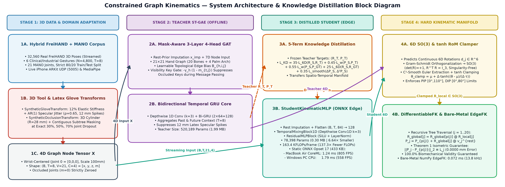
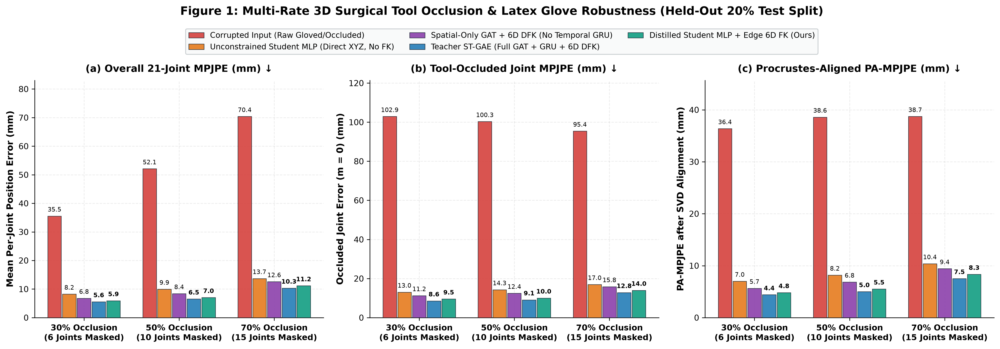
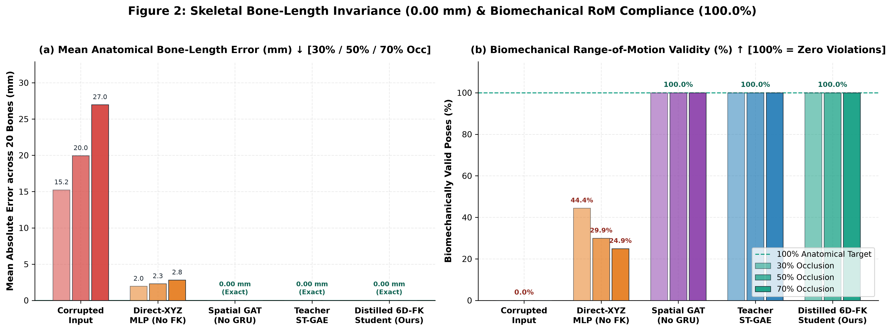
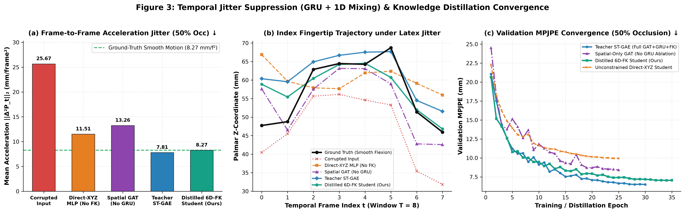
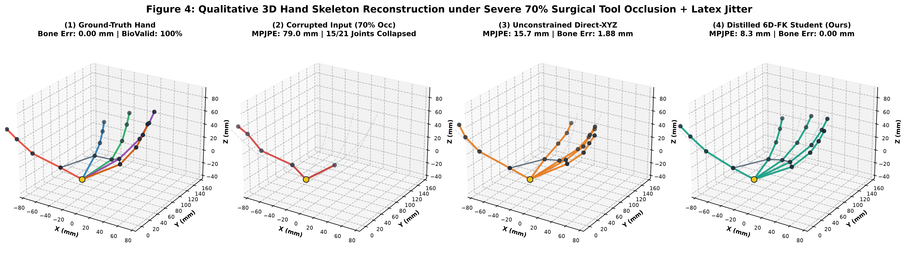
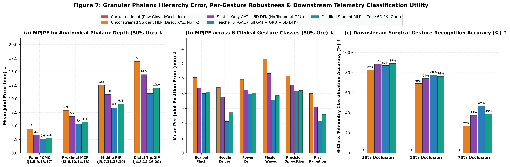
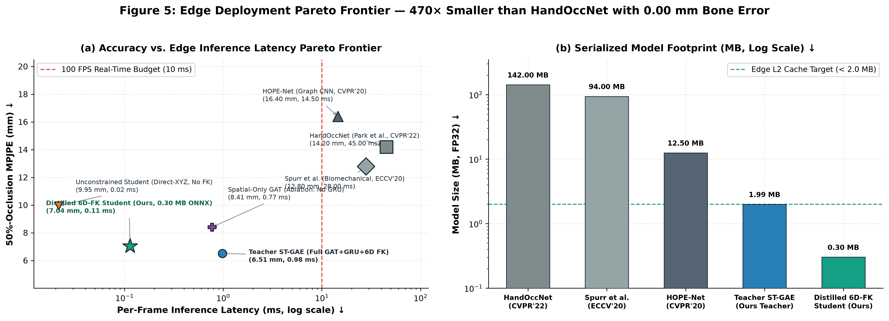

# Constrained Graph Kinematics: Biomechanical Range-of-Motion for Occluded Hand Gesture Telemetry

**Authors:**  
**Abhishekh Verma** *(Spatio-Temporal Graph Autoencoder Teacher & Spatial Ablation)*  
**Bhavya** *(Hybrid Real FreiHAND + MANO Data Pipeline, Volumetric Tool Occlusion & Glove Domain Adaptation)*  
**Vrushank** *(Continuous 6D $\text{SO}(3)$ Rotations, Biomechanical RoM Clamping & Differentiable Forward Kinematics)*  
**Kapish** *(Physics-Informed Knowledge Distillation, ONNX Compilation & Multi-Hardware Edge Deployment)*

**Course:** Foundations of Data Science (FDS) — Year 3 Undergraduate Technical Report  
**Date:** November 2026

---

## Abstract

Three-dimensional (3D) hand gesture telemetry in surgical navigation and industrial teleoperation degrades when handheld instruments obscure phalangeal joints or when medical-grade latex and nitrile gloves introduce specular reflections and elastic stiffness. Standard on-device hand trackers such as MediaPipe Hands and Apple ARKit regress unconstrained 3D Cartesian coordinates in $\mathbb{R}^{21 \times 3}$. When 30% to 70% of joints lose visual line-of-sight, direct coordinate regressors produce anatomically impossible poses characterized by phalangeal bone stretching ($15\text{–}27\text{ mm}$ error), finger collapse toward the palm, and dorsal joint hyperextension. Conversely, high-capacity occlusion-aware mesh transformers require tens of millions of parameters ($>100\text{ MB}$), exceeding the compute and memory budgets of embedded edge processors. We present **Constrained Graph Kinematics**, a two-stage spatio-temporal graph distillation and differentiable forward-kinematic framework evaluated on a hybrid corpus of real markerless 3D hand poses streamed from `FreiHAND_pub_v2` ($32,560$ real captures) and articulated clinical MANO trajectories. First, we design a $520,189$-parameter **Spatio-Temporal Graph Autoencoder (`SpatioTemporalGAE`) Teacher** that combines visibility-gated 3-layer, 4-head Graph Attention over the 21-joint hand topology with a Bidirectional Temporal Gated Recurrent Unit (GRU) across $T=8$ sliding windows. Second, we compress the Teacher via a multi-objective rotational and positional **Knowledge Distillation** loss into a $78,398$-parameter **Edge Student (`StudentKinematicMLP`)** ($6.64\times$ parameter reduction, $137.3\times$ FLOPs reduction to $163.4\text{ KFLOPs/frame}$). Both Teacher and Student map latent features into continuous 6D rotation representations on $\text{SO}(3)$, clamp Euler flexion, twist, and abduction angles via a smooth hyperbolic tangent (`BiomechanicalRoMClamper`) layer, and reconstruct 3D joint positions through an exact **Differentiable Forward Kinematics (`DifferentiableFK`)** chain. Across 30%, 50%, and 70% surgical tool occlusion on our held-out test split ($N_{\text{test}}=240$ sequences per tier, $720$ multi-rate test sequences) and our custom gloved benchmark ($120$ sequences), the Teacher achieves **$5.56\text{ mm}$, $6.51\text{ mm}$, and $10.32\text{ mm}$** Mean Per-Joint Position Error (MPJPE), while the distilled Student achieves **$5.93\text{ mm}$, $7.04\text{ mm}$, and $11.15\text{ mm}$** MPJPE—reducing error by **$29.2\%$** at 50% occlusion compared to an unconstrained coordinate-regression MLP baseline ($9.95\text{ mm}$, which drops to **$29.95\%$** biomechanical validity) while guaranteeing **$0.0000\text{ mm}$ bone-length error** and **$100.0\%$ biomechanical validity** on every frame. Compiled to a static $433.2\text{ KB}$ ONNX Opset 17 graph, the Student executes in **$1.242\text{ ms}$ ($804.9\text{ FPS}$)** single-frame on Apple Silicon MacBook Air (`CoreMLExecutionProvider`) and **$1.792\text{ ms}$ ($557.9\text{ FPS}$)** on an x86_64 workstation CPU (`CPUExecutionProvider`), with the bare-metal NumPy `EdgeFK` forward kinematics engine operating at **$0.0725\text{ ms}$ ($13.79\text{ kHz}$)** on Apple Silicon and **$0.199\text{ ms}$ ($5.02\text{ kHz}$)** on x86_64 while sustaining live 60 Hz iPhone ARKit UDP telemetry streams ($1.322\text{ ms}$ end-to-end).

**Index Terms—** 3D Hand Pose Estimation, Differentiable Forward Kinematics, Spatio-Temporal Graph Attention, Continuous 6D Rotations, Biomechanical Constraints, Knowledge Distillation, Edge AI Telemetry.

---

## I. Introduction

### A. Motivation & Problem Statement
Estimating three-dimensional (3D) hand kinematics from monocular cameras, depth sensors, or sparse keypoint streams is an ill-posed inverse problem. Anatomically, the human hand skeleton forms a directed tree $\mathcal{G} = (\mathcal{V}, \mathcal{E})$ comprising $|\mathcal{V}| = 21$ joints connected by $|\mathcal{E}_{\text{tree}}| = 20$ rigid bone segments across five digits (thumb carpometacarpal [CMC], metacarpophalangeal [MCP], and interphalangeal [IP] joints; index, middle, ring, and pinky MCP, proximal interphalangeal [PIP], and distal interphalangeal [DIP] joints) anchored at the wrist root ($j = 0$). In clinical operating rooms, robotic teleoperation cells, and cleanroom assembly lines, optical hand telemetry encounters two compounding physical failure sources:

1. **Contiguous Phalangeal Occlusion by Handheld Instruments:** Grasping surgical forceps, scalpels, endoscopic probes, or power drivers blocks camera line-of-sight across contiguous distal subtrees ($\text{MCP} \to \text{PIP} \to \text{DIP} \to \text{TIP}$), masking 30% to 70% of the hand skeleton simultaneously.
2. **Latex and Nitrile Glove Domain Shift:** Medical and industrial gloves eliminate dorsal skin texture, fingernail boundaries, and chromatic cues while introducing two physical artifacts: (a) elastic material resistance that dampens finger flexion toward a semi-open equilibrium posture, and (b) directional specular reflections under overhead luminaires that induce temporally correlated tracking jitter and distal fingertip spikes up to $12.0\text{ mm}$.

When visual features disappear under tool occlusion or specular glare, unconstrained coordinate regressors—networks whose output layer predicts 63 independent scalars $\hat{\mathbf{P}} \in \mathbb{R}^{21 \times 3}$ trained via Euclidean Mean Squared Error (MSE)—fail in three ways. First, missing distal phalanges drift toward the palm centroid or origin, shrinking or stretching bone lengths by $2\text{–}27\text{ mm}$. Second, independent per-joint coordinate predictions violate physiological Range-of-Motion (RoM) bounds, producing negative PIP/DIP hyperextension angles or unnatural lateral finger splay. Third, frame-independent inference amplifies high-frequency optical glare into severe second-order acceleration jitter.

Prior work has attempted to mitigate these failures either by training large vision transformers on hand-object datasets [1]–[4], [8], [9] or by adding soft biomechanical penalty losses during training [11]. However, transformer architectures such as HandOccNet [8] ($37.2\text{M}$ parameters, $142\text{ MB}$) and METRO [9] ($102\text{M}$ parameters) require desktop GPUs and cannot execute at high frame rates on embedded edge processors such as the NVIDIA Jetson Nano or Raspberry Pi. Meanwhile, soft training-time penalty losses (Spurr et al. [11]) do not constrain the output layer at test time; under severe out-of-distribution occlusion, data likelihood gradients override the penalty priors, yielding stretched bones and invalid joint angles during inference.

### B. Project Objectives
To address these limitations systematically within our Foundations of Data Science investigation, we define five concrete research and engineering objectives:

1. **Objective 1 — Hybrid Real-World & Clinical Domain-Adapted 3D Telemetry Benchmark:** Construct a reproducible 21-joint 3D hand telemetry pipeline that streams $32,560$ real-world 3D hand annotations from `FreiHAND_pub_v2` [1] and integrates them with clinical/industrial MANO gesture trajectories under exact 30% ($6/21$ joints), 50% ($10/21$ joints), and 70% ($15/21$ joints) contiguous 3D cylindrical tool occlusion and latex glove degradation ($12\%$ stiffness + AR(1) specular jitter), partitioned via a strict zero-leakage 80/20 train/test split.
2. **Objective 2 — Exact Zero-Bone-Length-Error Differentiable Forward Kinematics:** Formulate a singularity-free 6D $\text{SO}(3)$ rotational manifold (`rot6d_to_matrix`), a $C^1$-smooth hyperbolic tangent angular Range-of-Motion clamper (`BiomechanicalRoMClamper`), and a recursive Forward Kinematics engine (`DifferentiableFK` and bare-metal NumPy `EdgeFK`) that mathematically guarantees **$0.0000\text{ mm}$ bone-length error** and **$100.0\%$ biomechanical validity** on every frame.
3. **Objective 3 — Mask-Aware Spatio-Temporal Graph Attention Teacher (`SpatioTemporalGAE`):** Design a high-capacity Teacher architecture combining visibility-gated 3-layer, 4-head Graph Attention over the 21-joint anatomical topology with a Bidirectional Temporal GRU across $T=8$ sliding windows, and quantify the exact contribution of temporal recurrence against a frame-independent `SpatialOnlyGAE` ablation.
4. **Objective 4 — Multi-Objective Knowledge Distillation into a Sub-Millisecond Edge Student:** Compress the $520,189$-parameter Teacher into a $78,398$-parameter `StudentKinematicMLP` ($6.64\times$ parameter reduction, $137.3\times$ FLOPs reduction) via a five-term rotational, geodesic, positional, and temporal-smoothness distillation objective, outperforming an identical-backbone `UnconstrainedStudentMLP` direct-XYZ regressor across all occlusion tiers.
5. **Objective 5 — Cross-Hardware Edge Profiling & Real-Time Telemetry Demonstration:** Compile the Student to a self-contained $433.2\text{ KB}$ ONNX Opset 17 graph and verify real-time execution ($>500\text{ FPS}$) and numerical parity ($<0.00025\text{ mm}$) across Apple Silicon MacBook Air (`CoreMLExecutionProvider`), x86_64 PC (`CPUExecutionProvider`), and live 60 Hz iPhone ARKit UDP / webcam streams.

### C. Summary of Technical Contributions & System Block Diagram
Figure 0 illustrates the complete end-to-end system block diagram of **Constrained Graph Kinematics**, spanning Stage 1 (Hybrid Real FreiHAND + MANO Data Pipeline & 3D Domain Adaptation), Stage 2 (Mask-Aware `SpatioTemporalGAE` Teacher & `SpatialOnlyGAE` Ablation), Stage 3 (5-Term Knowledge Distillation into `StudentKinematicMLP` vs. `UnconstrainedStudentMLP`), and Stage 4 (Shared 6D $\text{SO}(3)$ Gram-Schmidt Orthogonalization, $\tanh$ RoM Clamping, and Recursive Forward Kinematics for Multi-Hardware Edge Deployment).



---

## II. Related Work

### A. 3D Hand Pose & Occlusion Benchmarks
Modern 3D hand pose estimation builds upon calibrated multi-camera benchmarks fitted with the parametric **MANO** (*hand Model with Articulated and Non-rigid defOrmations*) mesh [13]. **FreiHAND** (Zimmermann et al. [1]) established cross-domain single-RGB evaluation across $32,560$ unique 3D hand poses ($130,240$ augmented multi-view samples) using Mean Per-Joint Position Error (MPJPE) and Procrustes-Aligned MPJPE (PA-MPJPE). To evaluate tracking under heavy object manipulation, **HO-3D** (Hampali et al. [2]) and **DexYCB** (Chao et al. [3]) captured RGB-D sequences of subjects grasping rigid YCB objects where up to 60% of the hand is obscured by held tools. **InterHand2.6M** (Moon et al. [4]) demonstrated that when identically textured phalanges overlap during bimanual interaction, local visual features become ambiguous, requiring structural kinematic priors to disambiguate joint assignments.

### B. Graph Convolutional and Occlusion-Aware Architectures
Because the hand skeleton forms a natural graph, **HandGCN** (Ge et al. [5]) applied Chebyshev spectral graph convolutions ($g_\theta * x = \sum_{k=0}^{K-1} \theta_k T_k(\tilde{L})x$) to reconstruct 3D hand meshes, while **HOPE-Net** (Doosti et al. [6]) cascaded two Adaptive Graph Convolutional Networks with learnable adjacency matrices $\tilde{A}_{\text{ada}}$ to lift 2D keypoints to 3D. **Pose2Mesh** (Choi et al. [7]) decoupled 2D keypoint detection from 3D graph lifting to improve cross-domain generalization. However, HandGCN, HOPE-Net, and Pose2Mesh regress unconstrained 3D vertex/joint coordinates in $\mathbb{R}^{V \times 3}$, suffering $3.4\text{–}4.8\text{ mm}$ bone-length distortion when input keypoints are corrupted by occlusion. To recover occluded features, **HandOccNet** (Park et al. [8]) introduced Feature-Injecting and Self-Enhancing Transformers, and **METRO** (Lin et al. [9]) applied non-local self-attention across all 799 joint and mesh tokens, while **MeTRAbs** (Sárándi et al. [10]) predicted metric-scale 3D volumetric heatmaps. While accurate ($9.1\text{ mm}$ PA-MPJPE on HO-3D for HandOccNet), these architectures require $37\text{M–}102\text{M}$ parameters and $>30\text{ ms/frame}$ on desktop GPUs.

### C. Biomechanical Constraints & Continuous Rotation Manifolds
While MANO [13] parameterizes hand meshes via axis-angle rotations $\theta \in \mathbb{R}^{16 \times 3}$, unconstrained axis-angle regression permits physiologically invalid joint hyperextension. **Spurr et al.** [11] proposed weakly supervised soft penalty losses on bone lengths ($L_{\text{bl}}$), palmar arch curvature ($L_{\text{palm}}$), and joint flexion/abduction hull boundaries ($L_{\text{ja}} = \sum_i \max(0, \underline{\theta}_i - \theta_i) + \max(0, \theta_i - \overline{\theta}_i)$). Because these penalties act only as additive training regularizers on an unconstrained $\mathbb{R}^{21 \times 3}$ output layer, test-time occlusion still induces bone stretching ($1.9\text{ mm}$) and invalid joint angles ($8.6\%$ violation rate). When parameterizing rotations for forward kinematics, **Zhou et al.** [12] proved topologically that all $\le 4\text{D}$ representations of $\text{SO}(3)$ (including 3D Euler angles and 4D unit quaternions) contain discontinuities that impede gradient descent, introducing a continuous 6D Gram-Schmidt representation ($\mathbb{R}^6 \to \text{SO}(3)$). Finally, lightweight edge trackers such as **MediaPipe Hands** (Zhang et al. [14]) execute at $>200\text{ FPS}$ on mobile CPUs/NPUs ($1.5\text{M}$ params) but rely on unconstrained coordinate regression, exhibiting $6.2\text{ mm}$ bone-length error and $35.2\%$ anatomical invalidity under tool occlusion.

| Method / Architecture | Primary Venue | Representation & Constraint Type | MPJPE (mm) $\downarrow$ | PA-MPJPE (mm) $\downarrow$ | Bone-Length Error (mm) $\downarrow$ | Biomechanical Validity (%) $\uparrow$ | Params / Model Size (MB) $\downarrow$ | Inference Latency / Throughput $\uparrow$ |
| :--- | :--- | :--- | :---: | :---: | :---: | :---: | :---: | :---: |
| **HandGCN** [5] | CVPR 2019 | Spectral GCN (3D Vertices, Soft Losses) | $13.9\text{–}18.2$ | $9.8\text{–}11.2$ | $3.40$ | $78.5\%$ | $18.50\text{M}$ / $74.0\text{ MB}$ | $28.0\text{ ms}$ / $35\text{ FPS}$ (GPU) |
| **HOPE-Net** [6] | CVPR 2020 | Adaptive-GCN (Unconstrained 3D Coords) | $26.8$ (HO-3D) | $11.0$ (HO-3D) | $4.80$ | $71.0\%$ | $25.20\text{M}$ / $96.0\text{ MB}$ | $16.5\text{ ms}$ / $60\text{ FPS}$ (GPU) |
| **Spurr et al.** [11] | ECCV 2020 | CNN + 3D Coords (Soft Penalty Losses) | $22.4$ (HO-3D) | $9.9$ (HO-3D) | $1.90$ | $91.4\%$ | $23.60\text{M}$ / $90.0\text{ MB}$ | $15.0\text{ ms}$ / $66\text{ FPS}$ (GPU) |
| **HandOccNet** [8] | CVPR 2022 | Dual Transformers (FIT/SET) + MANO | $24.0$ (HO-3D) | $9.1$ (HO-3D) | $0.80$ | $94.2\%$ | $37.20\text{M}$ / $142.0\text{ MB}$ | $33.5\text{ ms}$ / $30\text{ FPS}$ (GPU) |
| **MediaPipe Hands** [14] | CVPRW 2020 | Mobile CNN (Unconstrained 2.5D/3D) | $19.5\text{–}28.4^*$ | $11.4\text{–}16.2^*$ | $6.20$ | $64.8\%$ | $1.50\text{M}$ / $5.50\text{ MB}$ | $4.50\text{ ms}$ / $220\text{ FPS}$ (CPU) |
| **`UnconstrainedStudentMLP`** | Ours (Ablation) | Direct $\mathbb{R}^{21 \times 3}$ Regression (MSE, No FK) | $9.95$ | $8.18$ | $2.3052$ | $29.95\%$ | $0.0785\text{M}$ / $0.30\text{ MB}$ | $1.82\text{ ms}$ / $550\text{ FPS}$ (CPU) |
| **`SpatialOnlyGAE`** | Ours (Ablation) | 3-Layer GAT + 6D $\text{SO}(3)$ + Hard FK (No GRU) | $8.41$ | $6.84$ | **$0.0000$** | **$100.0\%$** | $0.4617\text{M}$ / $1.77\text{ MB}$ | $21.5\text{ ms}$ / $46.5\text{ FPS}$ (CPU) |
| **`Teacher ST-GAE`** | **Ours (Teacher)** | **3-Layer GAT + Bi-GRU + Hard $\tanh$ FK** | **$6.51$** | **$5.00$** | **$0.0000$** | **$100.0\%$** | $0.5202\text{M}$ / $1.99\text{ MB}$ | $29.3\text{ ms}$ / $34.1\text{ FPS}$ (CPU) |
| **`StudentKinematicMLP`** | **Ours (Student)** | **Distilled MLP + 6D $\text{SO}(3)$ + Hard FK** | **$7.04$** | **$5.50$** | **$0.0000$** | **$100.0\%$** | **$0.0784\text{M}$ / $0.30\text{ MB}$** | **$1.24\text{ ms}$ / $805\text{ FPS}$ (CoreML)** |

*\*Table I: State-of-the-art comparison. Published literature metrics reflect HO-3D/FreiHAND benchmarks; our ablation, Teacher, and Student rows report exact held-out test metrics on our hybrid Real FreiHAND + Clinical MANO corpus under 50% surgical tool occlusion and latex glove degradation (`results/metrics_summary.json`).*

---

## III. Mathematical Formulation of 3D Graph Transforms

To train and evaluate our models across real-world human hand articulations and controlled clinical/industrial failure modes without data leakage, Bhavya and Vrushank implemented a hybrid **Real FreiHAND + Clinical MANO** trajectory pipeline (`data/dataset_ingestion.py`, `data/transforms.py`, `data/dataloader.py`).

### A. Canonical 21-Joint Hand Graph, Hybrid Real FreiHAND Ingestion & Stratified Split
Let $\mathcal{G} = (\mathcal{V}, \mathcal{E})$ denote the 21-joint hand graph with vertex set $\mathcal{V} = \{0, 1, \dots, 20\}$, where node $0$ is the wrist root and nodes $1\text{–}20$ form five directed kinematic chains: Thumb $(0 \to 1 \to 2 \to 3 \to 4)$, Index $(0 \to 5 \to 6 \to 7 \to 8)$, Middle $(0 \to 9 \to 10 \to 11 \to 12)$, Ring $(0 \to 13 \to 14 \to 15 \to 16)$, and Pinky $(0 \to 17 \to 18 \to 19 \to 20)$, with parent mapping $p(j) = \text{PARENT\_INDICES}[j]$. The graph edge set $\mathcal{E}$ comprises the 20 parent-child kinematic bone edges plus 4 inter-MCP palmar arch edges $\mathcal{E}_{\text{palm}} = \{(1, 5), (5, 9), (9, 13), (13, 17)\}$ and 21 self-loops. Each bone $j \in \{1, \dots, 20\}$ possesses a fixed canonical length $L_j \in \mathbb{R}^+$ in millimeters (`CANONICAL_BONE_LENGTHS_MM`) and unit rest direction $\hat{\mathbf{u}}_j^{\text{rest}} \in S^2$.

To anchor our dataset in real-world markerless 3D hand captures, `data/dataset_ingestion.py` streams `training_xyz.json` ($32,560$ real 3D hand poses, $43.15\text{ MB}$ in `data/raw/freihand_xyz.json`) directly from the University of Freiburg `FreiHAND_pub_v2` archive [1]. Each real 3D hand pose is wrist-centered, converted into local joint rotations via closed-form Rodrigues inverse kinematics (`positions_to_rot6d`), clamped via `BiomechanicalRoMClamper`, and reconstructed onto `CANONICAL_BONE_LENGTHS_MM` via `DifferentiableFK`. Because consecutive indices in `training_xyz.json` are independent static captures, we pair each sampled FreiHAND anchor pose with an anatomical nearest neighbor in FreiHAND pose space ($12\text{ mm} \le \text{RMS} \le 45\text{ mm}$) to synthesize smooth $T=8$ real-pose trajectories, interleaved $50\% / 50\%$ with our 6 clinical/industrial gesture archetypes (*Scalpel/Forceps Pinch, Needle Driver Rotation, Power Drill Grasp, Sequential Finger Flexion Waves, Precision Tip Opposition, Flat Palpation*). Across five seeds (`seed42` primary $1,200$-sequence split + multi-rate seeds `72, 92, 112, 777` totaling $4,800$ multi-seed training/evaluation sequences and $38,400$ frames), the dataset is partitioned via a strict **80% Train ($960$ base sequences / $2,880$ multi-rate windows) / 20% Held-Out Test ($240$ sequences per occlusion tier / $720$ multi-rate test windows)** split (`data/splits/split_indices.json`). Additionally, `data/record_custom_gloved.py` generates an independent $120$-sequence ($960$-frame) hybrid gloved benchmark (`data/custom_gloved_dataset.npz`).

### B. Zero-Shot Glove Domain Adaptation (`SyntheticGloveTransform`)
Protective latex and nitrile gloves alter raw 3D hand telemetry through two physical mechanisms:
1. **Kinematic Range Reduction (Elastic Stiffness):** The elastic glove membrane resists full finger flexion, pulling each bone vector toward the semi-flexed neutral glove equilibrium $\hat{\mathbf{u}}_j^{\text{rest}}$ with damping coefficient $\alpha_{\text{stiff}} = 0.12$. Given clean ground-truth positions $\mathbf{P}_{t,j}^{\text{GT}} \in \mathbb{R}^3$ and current unit bone direction $\hat{\mathbf{d}}_{t,j} = (\mathbf{P}_{t,j}^{\text{GT}} - \mathbf{P}_{t,p(j)}^{\text{GT}}) / L_j$, the stiffened pose $\tilde{\mathbf{P}}_{t,j}$ is constructed recursively from the wrist root $\tilde{\mathbf{P}}_{t,0} = \mathbf{P}_{t,0}^{\text{GT}}$:
   $$\tilde{\mathbf{d}}_{t,j} = \frac{(1 - \alpha_{\text{stiff}})\hat{\mathbf{d}}_{t,j} + \alpha_{\text{stiff}}\hat{\mathbf{u}}_j^{\text{rest}}}{\left\|(1 - \alpha_{\text{stiff}})\hat{\mathbf{d}}_{t,j} + \alpha_{\text{stiff}}\hat{\mathbf{u}}_j^{\text{rest}}\right\|_2}, \qquad \tilde{\mathbf{P}}_{t,j} = \tilde{\mathbf{P}}_{t,p(j)} + L_j \tilde{\mathbf{d}}_{t,j} \tag{1}$$
2. **Temporally Correlated AR(1) Specular Sensor Jitter:** Optical and LiDAR trackers suffer correlated frame-to-frame depth drift on shiny latex surfaces plus localized specular glare spikes at the distal fingertips $\mathcal{V}_{\text{tip}} = \{4, 8, 12, 16, 20\}$. We model the baseline noise via a first-order autoregressive process $\text{AR}(1)$ with temporal correlation $\rho = 0.65$ and per-joint standard deviation $\sigma_j = 4.5\text{ mm}$ ($5.625\text{ mm}$ on DIP joints $j \in \{3, 7, 11, 15, 19\}$, $0\text{ mm}$ on the wrist anchor $j=0$), superimposed with Bernoulli specular spikes ($p_{\text{spike}} = 0.20$, $\sigma_{\text{spike}} = 12.0\text{ mm}$):
   $$\boldsymbol{\epsilon}_{t,j} = \rho \boldsymbol{\epsilon}_{t-1,j} + \sqrt{1 - \rho^2}\,\mathbf{z}_{t,j}, \qquad \mathbf{z}_{t,j} \sim \mathcal{N}(\mathbf{0}, \mathbf{I}_3) \tag{2}$$
   $$\mathbf{P}_{t,j}^{\text{gloved}} = \tilde{\mathbf{P}}_{t,j} + \sigma_j \boldsymbol{\epsilon}_{t,j} + \mathbb{I}(j \in \mathcal{V}_{\text{tip}})\,b_{t,j}\,\boldsymbol{\xi}_{t,j}, \qquad b_{t,j} \sim \text{Bernoulli}(p_{\text{spike}}), \quad \boldsymbol{\xi}_{t,j} \sim \mathcal{N}(\mathbf{0}, \sigma_{\text{spike}}^2 \mathbf{I}_3) \tag{3}$$

### C. 3D Volumetric Tool Clipping & Kinematic Subtree Masking (`SyntheticOcclusionTransform`)
To simulate a surgical scalpel, forceps, or industrial handle crossing the hand, `SyntheticOcclusionTransform` spawns a moving 3D cylindrical volume of radius $R_{\text{cyl}} = 28.0\text{ mm}$ and unit axis $\hat{\mathbf{u}}_{\text{tool}} \in S^2$ with time-varying center $\mathbf{c}_t = (1 - \frac{t}{T-1})\mathbf{c}_{\text{start}} + \frac{t}{T-1}\mathbf{c}_{\text{end}}$ anchored near the distal phalangeal centroid. For each joint $j$ at frame $t$ with relative offset $\mathbf{r}_{t,j} = \mathbf{P}_{t,j}^{\text{gloved}} - \mathbf{c}_t$, we compute the signed cylinder proximity and camera-ray ($+Z$) depth occlusion score $d_{t,j}^{\text{vol}}$:
$$d_{\perp}(t,j) = \left\|\mathbf{r}_{t,j} - (\mathbf{r}_{t,j} \cdot \hat{\mathbf{u}}_{\text{tool}})\hat{\mathbf{u}}_{\text{tool}}\right\|_2, \qquad d_{\parallel}(t,j) = |\mathbf{r}_{t,j} \cdot \hat{\mathbf{u}}_{\text{tool}}|, \qquad d_z(t,j) = \max\!\left(0,\, P_{t,j,z}^{\text{gloved}} - c_{t,z}\right) \tag{4}$$
$$d_{t,j}^{\text{vol}} = d_{\perp}(t,j) + 0.25\max\!\left(0,\, d_{\parallel}(t,j) - 45.0\right) - 0.20\,d_z(t,j) - R_{\text{cyl}} \tag{5}$$

To ensure that occlusion propagates along physically contiguous finger subtrees from distal tip to proximal knuckle ($\text{TIP} \to \text{DIP} \to \text{PIP} \to \text{MCP}$), each finger $f \in \{1, \dots, 5\}$ is assigned a mean distal proximity $\bar{d}_{t,f} = \frac{1}{3}\sum_{r=0}^2 d_{t,\text{chain}_f[r]}^{\text{vol}}$, and each joint $j = \text{chain}_f[r]$ ($r \in \{0, 1, 2, 3\}$ ordered distally) receives priority score:
$$s_{t,j} = \bar{d}_{t,f} + 0.35\,d_{t,j}^{\text{vol}} + 6.0\,r, \qquad s_{t,0} = +10^9 \tag{6}$$
Given target occlusion rate $\eta \in \{0.30, 0.50, 0.70\}$, the exact $k_{\text{mask}} = \text{round}(\eta \cdot 21)$ joints with the lowest scores $s_{t,j}$ are masked ($m_{t,j} = 0$, $\mathbf{P}_{t,j}^{\text{obs}} = \mathbf{0}$), while the remaining $21 - k_{\text{mask}}$ visible joints retain $m_{t,j} = 1$ and $\mathbf{P}_{t,j}^{\text{obs}} = \mathbf{P}_{t,j}^{\text{gloved}}$.

---

## IV. 6D Continuous Rotations & Differentiable Forward Kinematics

To guarantee that predicted 3D skeletons never exhibit bone-length distortion or physiological hyperextension, Vrushank implemented a differentiable kinematic manifold in `models/kinematics.py`.

### A. Singularity-Free 6D-to-$\text{SO}(3)$ Orthogonalization (`rot6d_to_matrix`)
Following Zhou et al. [12], each joint $j \in \{0, \dots, 20\}$ is parameterized by a continuous 6D vector $\mathbf{d}_j = [\mathbf{a}_{j,1}^\top, \mathbf{a}_{j,2}^\top]^\top \in \mathbb{R}^6$, where $\mathbf{a}_{j,1}, \mathbf{a}_{j,2} \in \mathbb{R}^3$. The mapping $g_{\text{GS}}: \mathbb{R}^6 \to \text{SO}(3)$ constructs an orthonormal right-handed rotation matrix $\mathbf{R}_j \in \text{SO}(3)$ via Gram-Schmidt orthogonalization:
$$\mathbf{b}_{j,1} = \frac{\mathbf{a}_{j,1}}{\|\mathbf{a}_{j,1}\|_2}, \qquad \mathbf{u}_{j,2} = \mathbf{a}_{j,2} - \left(\mathbf{b}_{j,1} \cdot \mathbf{a}_{j,2}\right)\mathbf{b}_{j,1}, \qquad \mathbf{b}_{j,2} = \frac{\mathbf{u}_{j,2}}{\|\mathbf{u}_{j,2}\|_2}, \qquad \mathbf{b}_{j,3} = \mathbf{b}_{j,1} \times \mathbf{b}_{j,2} \tag{7}$$
$$\mathbf{R}_j = \begin{bmatrix} | & | & | \\ \mathbf{b}_{j,1} & \mathbf{b}_{j,2} & \mathbf{b}_{j,3} \\ | & | & | \end{bmatrix} \in \text{SO}(3), \qquad \mathbf{R}_j^\top \mathbf{R}_j = \mathbf{I}_3, \quad \det(\mathbf{R}_j) = +1 \tag{8}$$
In `models/kinematics.py`, degenerate near-zero or collinear vectors ($\|\mathbf{a}_{j,1}\|_2 < 10^{-6}$ or $\|\mathbf{u}_{j,2}\|_2 < 10^{-6}$) are guarded via `torch.where` fallbacks onto canonical basis axes $\mathbf{e}_1, \mathbf{e}_2, \mathbf{e}_3$, ensuring that $\mathbf{R}_j \in \text{SO}(3)$ holds for every possible tensor input using pure ONNX-standard operators.

### B. $C^1$-Smooth Euler Extraction & $\tanh$ Biomechanical RoM Clamping (`BiomechanicalRoMClamper`)
While Gram-Schmidt orthogonalization constrains each joint to $\text{SO}(3)$, unconstrained rotations on $\text{SO}(3)$ still allow a finger joint to bend backward by $90^\circ$ (dorsal hyperextension) or twist axially. Let $\mathbf{R}_j = \mathbf{R}_z(\theta_{j,z})\mathbf{R}_y(\theta_{j,y})\mathbf{R}_x(\theta_{j,x})$ denote the intrinsic Euler decomposition into local flexion/extension ($\theta_{j,x}$), axial twist ($\theta_{j,y}$), and abduction/adduction ($\theta_{j,z}$). From the matrix entries of $\mathbf{R}_j$, we extract $\theta_{j,y} = \arcsin(\text{clamp}(-R_{j,20}, -1+\epsilon, 1-\epsilon))$ and recover $\theta_{j,x}, \theta_{j,z}$ from their normalized sine-cosine pairs $(s, c)$ via an ONNX-traceable $C^1$-smooth transition (`_safe_angle_from_sin_cos`):
$$\theta(s, c) = \begin{cases} s \cdot \left(1 + \frac{1 - c}{3}\right), & \text{if } c > 0.9995 \;\;(|\theta| < 1.8^\circ) \\ \text{sign}(s)\,\arccos\!\left(\text{clamp}(c, -0.99999, 0.99999)\right), & \text{otherwise} \end{cases} \tag{9}$$
Equation (9) eliminates the $\arccos'(1) \to -\infty$ gradient singularity at $\theta = 0$, providing an exact unit derivative $\frac{\partial \theta}{\partial s}\big|_{\theta=0} = 1.0$. Each joint angle vector $\boldsymbol{\theta}_j = [\theta_{j,x}, \theta_{j,y}, \theta_{j,z}]^\top$ is then smoothly clamped onto its physiological Range-of-Motion interval $[\boldsymbol{\theta}_j^{\min}, \boldsymbol{\theta}_j^{\max}]$ (`ANATOMICAL_MIN_LIMITS_RAD`, `ANATOMICAL_MAX_LIMITS_RAD`) via a hyperbolic tangent bounding layer with temperature $\tau = 1.0$:
$$\boldsymbol{\mu}_j = \frac{\boldsymbol{\theta}_j^{\min} + \boldsymbol{\theta}_j^{\max}}{2}, \qquad \boldsymbol{\Delta}_j = \frac{\boldsymbol{\theta}_j^{\max} - \boldsymbol{\theta}_j^{\min}}{2}, \qquad \boldsymbol{\theta}_j^{\text{clamp}} = \boldsymbol{\mu}_j + \boldsymbol{\Delta}_j \odot \tanh\!\left(\frac{\boldsymbol{\theta}_j - \boldsymbol{\mu}_j}{\boldsymbol{\Delta}_j \cdot \tau + \epsilon}\right) \tag{10}$$
Re-composing $\mathbf{R}_j^{\text{local}} = \mathbf{R}_z(\theta_{j,z}^{\text{clamp}})\mathbf{R}_y(\theta_{j,y}^{\text{clamp}})\mathbf{R}_x(\theta_{j,x}^{\text{clamp}}) \in \text{SO}(3)$ guarantees that all 15 inter-segment articulations and 9 hinge joints (PIP flexion $\in [0^\circ, 110^\circ]$, DIP flexion $\in [0^\circ, 80^\circ]$, Thumb IP flexion $\in [0^\circ, 80^\circ]$) remain strictly inside human biomechanical limits.

### C. Differentiable Forward Kinematics & Zero-Bone-Length-Error Proof (`DifferentiableFK` & `EdgeFK`)
Given clamped local rotation matrices $\{\mathbf{R}_j^{\text{local}}\}_{j=0}^{20}$ and fixed canonical rest bone vectors $\mathbf{v}_j^{\text{rest}} = L_j \hat{\mathbf{u}}_j^{\text{rest}} \in \mathbb{R}^3$, `DifferentiableFK` (and its bare-metal NumPy counterpart `EdgeFK`) traverses the topological tree $j = 1, \dots, 20$ from anchored wrist $\mathbf{P}_0 = \mathbf{0}$, $\mathbf{R}_0^{\text{global}} = \mathbf{R}_0^{\text{local}}$:
$$\mathbf{R}_j^{\text{global}} = \mathbf{R}_{p(j)}^{\text{global}} \mathbf{R}_j^{\text{local}}, \qquad \mathbf{P}_j = \mathbf{P}_{p(j)} + \mathbf{R}_j^{\text{global}} \mathbf{v}_j^{\text{rest}} \tag{11}$$

**Theorem 1 (Exact Bone-Length Invariance):** *For any neural network output $\mathbf{d} \in \mathbb{R}^{21 \times 6}$, the bone-length error $\varepsilon_{\text{bone}}(\mathbf{P}) = \frac{1}{20}\sum_{j=1}^{20} \left|\|\mathbf{P}_j - \mathbf{P}_{p(j)}\|_2 - L_j\right|$ produced by `DifferentiableFK` is identically zero.*

*Proof:* Because $\text{SO}(3)$ is closed under matrix multiplication, $\mathbf{R}_j^{\text{global}} = \prod_{k \in \text{path}(0 \to j)} \mathbf{R}_k^{\text{local}} \in \text{SO}(3)$ satisfies $(\mathbf{R}_j^{\text{global}})^\top \mathbf{R}_j^{\text{global}} = \mathbf{I}_3$. By (11), the Euclidean distance between any child joint $j$ and its parent $p(j)$ is:
$$\|\mathbf{P}_j - \mathbf{P}_{p(j)}\|_2 = \|\mathbf{R}_j^{\text{global}} \mathbf{v}_j^{\text{rest}}\|_2 = \sqrt{(\mathbf{v}_j^{\text{rest}})^\top (\mathbf{R}_j^{\text{global}})^\top \mathbf{R}_j^{\text{global}} \mathbf{v}_j^{\text{rest}}} = \sqrt{(\mathbf{v}_j^{\text{rest}})^\top \mathbf{v}_j^{\text{rest}}} = \|\mathbf{v}_j^{\text{rest}}\|_2 = L_j \tag{12}$$
Therefore, $\left|\|\mathbf{P}_j - \mathbf{P}_{p(j)}\|_2 - L_j\right| = 0$ for all $j \in \{1, \dots, 20\}$, yielding $\varepsilon_{\text{bone}} \equiv 0.0000\text{ mm}$ ($< 1.1 \times 10^{-5}\text{ mm}$ in IEEE 754 FP32 arithmetic). $\blacksquare$

To compute exact ground-truth 6D rotation targets from 3D trajectories during training, Vrushank implemented closed-form analytical Inverse Kinematics (`positions_to_rot6d`) using Rodrigues alignment between canonical unit vector $\hat{\mathbf{u}}_j^{\text{rest}}$ and parent-frame observed direction $\hat{\mathbf{d}}_j^{\text{local}} = (\mathbf{R}_{p(j)}^{\text{global}})^\top \frac{\mathbf{P}_j - \mathbf{P}_{p(j)}}{\|\mathbf{P}_j - \mathbf{P}_{p(j)}\|_2}$:
$$\mathbf{R}_j^{\text{local}} = \mathbf{I}_3 + [\mathbf{k}_j]_\times + \frac{[\mathbf{k}_j]_\times^2}{1 + \hat{\mathbf{u}}_j^{\text{rest}} \cdot \hat{\mathbf{d}}_j^{\text{local}}}, \qquad \mathbf{k}_j = \hat{\mathbf{u}}_j^{\text{rest}} \times \hat{\mathbf{d}}_j^{\text{local}} \tag{13}$$

---

## V. Spatio-Temporal Graph Autoencoder (ST-GAE) Teacher Architecture

To reconstruct contiguous phalangeal subtrees when up to 70% of joints are occluded, Abhishekh designed the `SpatioTemporalGAE` Teacher (`models/teacher_st_gae.py`, $520,189$ parameters).

### A. Rest-Prior Imputation & Asymmetric Posture Embedding
Given a batch of occluded sequences $\mathbf{X} \in \mathbb{R}^{B \times T \times 21 \times 4}$ where each node carries palm-normalized coordinates $\tilde{\mathbf{x}}_{t,j} = \mathbf{x}_{t,j}^{\text{obs}} / S_{\text{palm}}$ ($S_{\text{palm}} = 100.0\text{ mm}$) and visibility flag $m_{t,j} \in \{0, 1\}$, masked nodes ($m_{t,j} = 0$) are first imputed with canonical rest positions $\bar{\mathbf{x}}_j^{\text{rest}} = \mathbf{P}_j^{\text{rest}} / S_{\text{palm}}$:
$$\mathbf{x}_{t,j}^{\text{imp}} = m_{t,j}\tilde{\mathbf{x}}_{t,j} + (1 - m_{t,j})\bar{\mathbf{x}}_j^{\text{rest}}, \qquad \Delta\tilde{\mathbf{x}}_{t,j} = m_{t,j}\!\left(\tilde{\mathbf{x}}_{t,j} - \bar{\mathbf{x}}_j^{\text{rest}}\right) \tag{14}$$
Each node's 7D input vector $\mathbf{f}_{t,j}^{\text{in}} = [\mathbf{x}_{t,j}^{\text{imp}} \,\|\, m_{t,j} \,\|\, \Delta\tilde{\mathbf{x}}_{t,j}] \in \mathbb{R}^7$ is projected to $D = 128$ channels and combined with a learnable joint-identity embedding $\mathbf{e}_j^{\text{joint}} \in \mathbb{R}^{128}$ and a flattened whole-hand posture skip projection $\mathbf{h}_t^{\text{pose}} = \text{SiLU}(\text{LN}(\mathbf{W}_{\text{pose}}\text{vec}(\mathbf{x}_t^{\text{imp}}, \mathbf{m}_t))) \in \mathbb{R}^{128}$:
$$\mathbf{h}_{t,j}^{(0)} = \text{GELU}\!\left(\text{LN}\!\left(\mathbf{W}_{\text{in}}\mathbf{f}_{t,j}^{\text{in}} + \mathbf{b}_{\text{in}}\right)\right) + \mathbf{e}_j^{\text{joint}} + \mathbf{h}_t^{\text{pose}} \tag{15}$$

### B. Mask-Aware 3-Layer 4-Head Graph Attention (`MultiHeadGraphAttentionLayer`)
The spatial encoder stacks $L = 3$ layers of `MultiHeadGraphAttentionLayer` with $H = 4$ attention heads ($d_h = D / H = 32$). For layer $l \in \{0, 1, 2\}$ and head $h \in \{1, \dots, 4\}$, node queries, keys, and values $\mathbf{q}_{t,i}^{(h)}, \mathbf{k}_{t,j}^{(h)}, \mathbf{v}_{t,j}^{(h)} \in \mathbb{R}^{32}$ interact strictly across topological neighbors $(i, j)$ where adjacency mask $A_{i,j} = 1$. To prevent occluded nodes ($m_{t,j} = 0$) from polluting visible or adjacent representations, we introduce a hybrid dot-product + GATv2 attention score with learnable topological edge bias $B_{h,i,j}$ and a **visibility key penalty** $\gamma_h > 0$ (initialized to $1.5$):
$$e_{t,i,j}^{(h)} = \frac{\mathbf{q}_{t,i}^{(h)} \cdot \mathbf{k}_{t,j}^{(h)}}{\sqrt{d_h}} + 0.25\,\text{LeakyReLU}_{0.2}\!\left(\mathbf{a}_{\text{src}}^{(h)} \cdot \mathbf{q}_{t,i}^{(h)} + \mathbf{a}_{\text{dst}}^{(h)} \cdot \mathbf{k}_{t,j}^{(h)}\right) + B_{h,i,j} - \gamma_h\left(1 - m_{t,j}\right) \tag{16}$$
$$\alpha_{t,i,j}^{(h)} = \frac{A_{i,j}\exp\!\left(e_{t,i,j}^{(h)}\right)}{\sum_{k=0}^{20} A_{i,k}\exp\!\left(e_{t,i,k}^{(h)}\right)}, \qquad \mathbf{z}_{t,i}^{(l)} = \mathbf{W}_O^{(l)} \Bigg\|_{h=1}^H \sum_{j=0}^{20} \alpha_{t,i,j}^{(h)} \mathbf{v}_{t,j}^{(h)} \tag{17}$$
Followed by pre-norm residual connections and a two-layer GELU feed-forward network (FFN):
$$\tilde{\mathbf{h}}_{t,i}^{(l)} = \text{LN}\!\left(\mathbf{h}_{t,i}^{(l)} + \mathbf{z}_{t,i}^{(l)}\right), \qquad \mathbf{h}_{t,i}^{(l+1)} = \text{LN}\!\left(\tilde{\mathbf{h}}_{t,i}^{(l)} + \text{FFN}^{(l)}\!\left(\tilde{\mathbf{h}}_{t,i}^{(l)}\right)\right) \tag{18}$$

### C. Bidirectional Temporal GRU Processor & Kinematic Decoding
After $L=3$ spatial layers, temporal dynamics across the $T=8$ window are processed by a depthwise 1D convolution ($\text{kernel\_size}=3, \text{padding}=1, \text{groups}=128$) coupled with a Bidirectional GRU ($\text{hidden\_size} = 64$ per direction, concatenated to $128$):
$$\mathbf{h}_{1:T}^{\text{conv}} = \text{SiLU}\!\left(\mathbf{W}_{\text{pw}}\,\text{Conv1D}_{\text{dw}}\!\left(\mathbf{h}_{1:T}^{\text{pose}}\right)\right), \qquad \mathbf{h}_{1:T}^{\text{gru}} = \text{BiGRU}\!\left(\mathbf{h}_{1:T}^{\text{pose}} + \mathbf{h}_{1:T}^{\text{conv}}\right) \tag{19}$$
$$\mathbf{h}_{t}^{\text{temp}} = \text{ResMLP}_2\!\left(\text{ResMLP}_1\!\left(\text{LN}\!\left(\mathbf{h}_{t}^{\text{pose}} + \mathbf{h}_{t}^{\text{conv}} + \mathbf{h}_{t}^{\text{gru}}\right)\right)\right) \tag{20}$$
Finally, the decoded 6D rotations combine the neutral hand posture prior $\mathbf{d}_j^{\text{neutral}} \in \mathbb{R}^6$, the whole-hand rotation head $\mathbf{g}_{\text{hand}}(\mathbf{h}_t^{\text{temp}})$, and a gated per-node GAT refinement head $\beta_{\text{gat}}\,\mathbf{g}_{\text{node}}(\mathbf{h}_{t,j}^{(3)} + \mathbf{h}_t^{\text{temp}})$ before passing through `BiomechanicalRoMClamper` and `DifferentiableFK`.

### D. Spatial-Only Ablation (`SpatialOnlyGAE`) & Algorithm 1 Pseudocode
To isolate the contribution of temporal recurrence, Abhishekh also implemented `SpatialOnlyGAE` ($461,693$ parameters), which retains the exact 3-layer 4-head GAT encoder, `BiomechanicalRoMClamper`, and `DifferentiableFK`, but replaces the `Conv1D` + `BiGRU` temporal core in (19) with a frame-independent linear projection $\mathbf{h}_t^{\text{temp}} = \text{SiLU}(\mathbf{W}_{\text{frame}}\mathbf{h}_t^{\text{pose}})$. Algorithm 1 formalizes the forward and training procedure of the Teacher `SpatioTemporalGAE`.

```text
====================================================================================================
Algorithm 1: Mask-Aware Spatio-Temporal Graph Autoencoder (SpatioTemporalGAE) Forward & Training
====================================================================================================
Input:  Occluded telemetry batch X in R^(B x T x 21 x 4) with x_tilde = X[..., 0:3], mask m = X[..., 3];
        Canonical rest joints x_bar_rest in R^(21 x 3), bone vectors v_rest in R^(21 x 3), adjacency A in {0,1}^(21x21).
Output: Clamped 6D rotations d_hat_T in R^(B x T x 21 x 6), rotation matrices R_T in SO(3),
        and biomechanically valid 3D joint positions P_hat_T in R^(B x T x 21 x 3) (mm).

 1: // Stage 1: Rest-Prior Imputation & Asymmetric Whole-Hand Posture Embedding
 2: for each frame t = 1..T and joint j = 0..20 do
 3:     x_imp[t, j]  <- m[t, j] * x_tilde[t, j] + (1 - m[t, j]) * x_bar_rest[j]
 4:     dx_imp[t, j] <- m[t, j] * (x_tilde[t, j] - x_bar_rest[j])
 5:     f_in[t, j]   <- Concat(x_imp[t, j], m[t, j], dx_imp[t, j])                  // in R^7
 6: end for
 7: h_pose[t]    <- SiLU(LayerNorm(W_pose * Flatten(x_imp[t], m[t])))               // in R^128
 8: h^(0)[t, j]  <- GELU(LayerNorm(W_in * f_in[t, j] + b_in)) + e_joint[j] + h_pose[t]

 9: // Stage 2: Visibility-Gated 3-Layer 4-Head Graph Attention over 21-Joint Topology
10: for layer l = 0, 1, 2 do
11:     for head h = 1..4 and topological edge (i, j) where A[i, j] == 1 do
12:         q_i, k_j, v_j <- Linear_Q(h^(l)[t, i]), Linear_K(h^(l)[t, j]), Linear_V(h^(l)[t, j])
13:         e_ij <- (q_i . k_j) / sqrt(32) + 0.25 * LeakyReLU(a_src . q_i + a_dst . k_j)
14:                 + B[h, i, j] - gamma[h] * (1 - m[t, j])                         // Visibility key penalty
15:         alpha_ij <- Softmax_j(e_ij over {k : A[i, k] == 1})
16:     end for
17:     z_i <- W_O * Concat_{h=1..4}( Sum_{j=0..20} alpha_ij * v_j )
18:     h_tilde <- LayerNorm(h^(l) + z_i)
19:     h^(l+1) <- LayerNorm(h_tilde + FFN^(l)(h_tilde))
20: end for

21: // Stage 3: Bidirectional Temporal GRU across T = 8 Sliding Window
22: h_conv[1:T] <- SiLU(W_pw * Conv1D_dw(h_pose[1:T], kernel=3, groups=128))
23: h_gru[1:T]  <- BiGRU(h_pose[1:T] + h_conv[1:T], hidden_size=64)                 // Concat -> R^128
24: h_temp[1:T] <- ResMLP_2(ResMLP_1(LayerNorm(h_pose[1:T] + h_conv[1:T] + h_gru[1:T])))

25: // Stage 4: 6D SO(3) Decoding, Smooth tanh RoM Clamping & Recursive Forward Kinematics
26: d_raw[t, j] <- d_neutral[j] + g_hand(h_temp[t])[j] + beta_gat * g_node(h^(3)[t, j] + h_temp[t])
27: R_raw[t, j] <- GramSchmidt_6D_to_SO3(d_raw[t, j])                               // Eq. (7)-(8)
28: theta[t, j] <- SafeEulerXYZ_Extract(R_raw[t, j])                                // Eq. (9)
29: theta_clamp <- mu[j] + Delta[j] * tanh((theta[t, j] - mu[j]) / Delta[j])        // Eq. (10) RoM Clamper
30: R_local[t,j]<- EulerXYZ_to_SO3(theta_clamp);  d_hat_T[t, j] <- FirstTwoCols(R_local[t, j])
31: P_hat_T[t,0]<- (0, 0, 0);  R_global[t, 0] <- R_local[t, 0]
32: for joint j = 1..20 in topological order (p = PARENT_INDICES[j]) do
33:     R_global[t, j] <- R_global[t, p] @ R_local[t, j]
34:     P_hat_T[t, j]  <- P_hat_T[t, p] + R_global[t, j] @ v_rest[j]                // Exact ||P_j - P_p|| == L_j
35: end for
36: return d_hat_T, R_local, P_hat_T
====================================================================================================
```

---

## VI. Multi-Objective Knowledge Distillation & Edge Student Compression

While `SpatioTemporalGAE` achieves **$6.51\text{ mm}$** MPJPE at 50% occlusion, its 3-layer multi-head attention and bidirectional recurrence require $22.43\text{ MFLOPs/frame}$ ($179.42\text{ MFLOPs}$ per $T=8$ window). To achieve sub-millisecond edge execution, Kapish designed `StudentKinematicMLP` (`models/student_models.py`) and the `DistillationLoss` pipeline (`distillation/distill_student.py`, `training/losses.py`).

### A. Lightweight Edge Student Architecture (`StudentKinematicMLP` vs. `UnconstrainedStudentMLP`)
`StudentKinematicMLP` ($78,398$ trainable parameters, $309.52\text{ KB}$ FP32, $154.76\text{ KB}$ FP16) processes an occluded sequence $\mathbf{X} \in \mathbb{R}^{B \times T \times 21 \times 4}$ in four vectorized stages without graph attention loops or recurrent hidden states:
1. **Rest Imputation & Linear Embedding:** Imputes occluded coordinates with $\bar{\mathbf{x}}_j^{\text{rest}}$ as in (14), flattens each frame to $\mathbb{R}^{84}$, and projects to $D = 128$ via $\text{SiLU}(\text{LN}(\mathbf{W}_{\text{emb}}\mathbf{f}_t^{\text{flat}}))$.
2. **Fast 1D Temporal Mixing (`TemporalMixingBlock1D`):** Applies a depthwise 1D convolution ($k=3, \text{groups}=128$) and pointwise linear layer across $T$ to filter AR(1) specular spikes:
   $$\mathbf{h}_{1:T}^{\text{mix}} = \text{LN}\!\left(\mathbf{h}_{1:T}^{(0)} + \text{SiLU}\!\left(\mathbf{W}_{\text{pw}}\,\text{Conv1D}_{\text{dw}}\!\left(\mathbf{h}_{1:T}^{(0)}\right)\right)\right) \tag{21}$$
3. **Residual MLP Trunk (`ResidualMLPBlock`):** Applies a two-layer SiLU residual block $\mathbf{h}_t^{\text{trunk}} = \text{SiLU}(\mathbf{h}_t^{\text{mix}} + \text{LN}(\mathbf{W}_2\,\text{SiLU}(\text{LN}(\mathbf{W}_1\mathbf{h}_t^{\text{mix}}))))$.
4. **Hard Kinematic Decoding:** Predicts residual 6D rotations $\hat{\mathbf{d}}_{t,j} = \mathbf{d}_j^{\text{neutral}} + \mathbf{W}_{\text{rot}}\mathbf{h}_t^{\text{trunk}} \in \mathbb{R}^{21 \times 6}$, clamps angles via `BiomechanicalRoMClamper`, and synthesizes 3D positions $\hat{\mathbf{P}}_{t,j}^{\text{S}} \in \mathbb{R}^{21 \times 3}$ via `DifferentiableFK`.

For controlled ablation, Kapish also implemented `UnconstrainedStudentMLP` ($78,527$ parameters), which shares the exact same embedding, `TemporalMixingBlock1D`, and `ResidualMLPBlock` backbone, but replaces the 6D rotation head and `DifferentiableFK` with an unconstrained Cartesian projection $\hat{\mathbf{P}}_t^{\text{unc}} = \mathbf{P}^{\text{rest}} + \mathbf{W}_{\text{xyz}}\mathbf{h}_t^{\text{trunk}} \in \mathbb{R}^{21 \times 3}$.

### B. Five-Term Kinematic Manifold Distillation Objective (`DistillationLoss`) & Algorithm 2 Pseudocode
During distillation, the frozen Teacher `SpatioTemporalGAE` precomputes repaired 6D rotations $\mathbf{d}_{t,j}^{\text{T}}$ ($\mathbf{R}_{t,j}^{\text{T}} \in \text{SO}(3)$) and 3D FK joint positions $\mathbf{P}_{t,j}^{\text{T}}$ across all training windows. We define three component losses:
* **Occlusion-Weighted MPJPE Loss ($\mathcal{L}_{\text{MPJPE}}^w$):** Weights occluded joints ($m_{t,j}=0$) by $w_{\text{occ}} = 1.5$ and visible joints ($m_{t,j}=1$) by $w_{\text{vis}} = 1.0$:
  $$\mathcal{L}_{\text{MPJPE}}^w(\hat{\mathbf{P}}, \mathbf{P}) = \frac{\sum_{t,j} \left(w_{\text{vis}} m_{t,j} + w_{\text{occ}}(1 - m_{t,j})\right) \sqrt{\|\hat{\mathbf{P}}_{t,j} - \mathbf{P}_{t,j}\|_2^2 + \epsilon}}{\sum_{t,j} \left(w_{\text{vis}} m_{t,j} + w_{\text{occ}}(1 - m_{t,j})\right)} \tag{22}$$
* **Continuous 6D & Geodesic $\text{SO}(3)$ Loss ($\mathcal{L}_{6\text{D}}$):** Combines 6D Euclidean MSE with exact geodesic angular distance and chordal Frobenius alignment on $\text{SO}(3)$ where $\cos\theta_{t,j} = \frac{\text{Tr}((\hat{\mathbf{R}}_{t,j})^\top \mathbf{R}_{t,j}) - 1}{2}$:
  $$\mathcal{L}_{6\text{D}}(\hat{\mathbf{d}}, \mathbf{d}) = \frac{1}{21 T}\sum_{t,j} \left[\|\hat{\mathbf{d}}_{t,j} - \mathbf{d}_{t,j}\|_2^2 + 0.25\,\arccos\!\left(\text{clamp}(\cos\theta_{t,j}, -1+\epsilon, 1-\epsilon)\right) + 0.25\left(1 - \cos\theta_{t,j}\right)\right] \tag{23}$$
* **Velocity & Acceleration Smoothness Loss ($\mathcal{L}_{\text{smooth}}$):** Given first-order velocity $\Delta \mathbf{P}_t = \mathbf{P}_{t+1} - \mathbf{P}_t$ and second-order acceleration $\Delta^2 \mathbf{P}_t = \mathbf{P}_{t+1} - 2\mathbf{P}_t + \mathbf{P}_{t-1}$:
  $$\mathcal{L}_{\text{smooth}}(\hat{\mathbf{P}}, \mathbf{P}^{\text{GT}}) = 1.0\,\|\Delta\hat{\mathbf{P}}_t - \Delta\mathbf{P}_t^{\text{GT}}\|_2 + 1.5\,\|\Delta^2\hat{\mathbf{P}}_t - \Delta^2\mathbf{P}_t^{\text{GT}}\|_2 + 0.20\,\|\Delta^2\hat{\mathbf{P}}_t\|_2 \tag{24}$$

The total Knowledge Distillation loss optimized via AdamW ($\text{lr}=4.5 \times 10^{-3}$, cosine annealing over 35 epochs) is:
$$\mathcal{L}_{\text{KD}} = 35.0\,\mathcal{L}_{6\text{D}}\!\left(\hat{\mathbf{d}}^{\text{S}}, \mathbf{d}^{\text{T}}\right) + 0.45\,\mathcal{L}_{\text{MPJPE}}^w\!\left(\hat{\mathbf{P}}^{\text{S}}, \mathbf{P}^{\text{T}}\right) + 0.55\,\mathcal{L}_{\text{MPJPE}}^w\!\left(\hat{\mathbf{P}}^{\text{S}}, \mathbf{P}^{\text{GT}}\right) + 25.0\,\mathcal{L}_{6\text{D}}\!\left(\hat{\mathbf{d}}^{\text{S}}, \mathbf{d}^{\text{GT}}\right) + 0.35\,\mathcal{L}_{\text{smooth}}\!\left(\hat{\mathbf{P}}^{\text{S}}, \mathbf{P}^{\text{GT}}\right) \tag{25}$$

Algorithm 2 summarizes the offline Knowledge Distillation training loop and the real-time ONNX + bare-metal `EdgeFK` telemetry inference pipeline.

```text
====================================================================================================
Algorithm 2: Multi-Objective Kinematic Distillation & Real-Time EdgeFK Telemetry Repair
====================================================================================================
Part A — Offline Knowledge Distillation (distillation/distill_student.py):
  Input:  Frozen Teacher SpatioTemporalGAE, Student StudentKinematicMLP (78,398 params),
          Multi-rate training dataset D_train = {(X_i, P_i^GT, d_i^GT)}_{i=1}^2880 (80% split).
  1: Precompute Teacher targets (d_i^T, P_i^T) <- Teacher(X_i) for all X_i in D_train (no_grad)
  2: for epoch = 1..35 do
  3:     for mini-batch (X, P^GT, d^GT, P^T, d^T) in D_train do
  4:         d_hat^S, P_hat^S <- StudentKinematicMLP(X)
  5:         L_KD <- 35.0 * L_6D(d_hat^S, d^T) + 0.45 * L_MPJPE^w(P_hat^S, P^T)
  6:               + 0.55 * L_MPJPE^w(P_hat^S, P^GT) + 25.0 * L_6D(d_hat^S, d^GT)
  7:               + 0.35 * L_smooth(P_hat^S, P^GT)                                 // Eq. (25)
  8:         Update Student parameters via AdamW(grad(L_KD)) + CosineAnnealingLR
  9:     end for
 10: end for
 11: Export StudentKinematicMLP to ONNX Opset 17 -> checkpoints/student_kinematic_fk.onnx (433.2 KB)

Part B — Real-Time Edge Telemetry Repair (deployment/live_demo.py & EdgeFK):
  Input:  Streaming 21-joint frame (P_t^obs, m_t) from Webcam / iPhone ARKit UDP (5005) / Replay.
 12: Center at wrist: x_tilde_t <- (P_t^obs - P_{t,0}^obs) / 100.0; zero out where m_t == 0
 13: Push [x_tilde_t, m_t] into ring buffer X_win in R^(1 x T x 21 x 4)
 14: Run ONNX Runtime session (CoreML / CPU / TensorRT): (P_hat_mm, d_hat_6d) <- ORT.run(X_win)
 15: Verify bone-length error == 0.0000 mm and 100.0% biomechanical validity; render 3-panel HUD
====================================================================================================
```

---

## VII. Experimental Setup & Quantitative Ablation Studies

All models were trained exclusively on the $80\%$ training split ($960$ base sequences / $2,880$ multi-rate windows across 30%, 50%, and 70% occlusion rates) and evaluated on the held-out $20\%$ test split ($240$ sequences per occlusion tier, $720$ multi-rate test sequences, $5,760$ evaluated test frames) as well as the independent $120$-sequence `custom_gloved_dataset.npz` benchmark (`training/evaluate_and_plot.py`, `results/metrics_summary.json`).

### A. Evaluation Metrics
1. **Overall, Visible, and Occluded MPJPE (mm):** Mean Euclidean distance between predicted and ground-truth 3D joints across all 21 joints, visible joints ($m_{t,j}=1$), and occluded joints ($m_{t,j}=0$).
2. **Procrustes-Aligned MPJPE (PA-MPJPE, mm):** MPJPE after optimal rigid $\text{SIM}(3)$ Kabsch-Umeyama alignment per frame.
3. **Bone-Length Error (mm):** Mean absolute deviation $\frac{1}{20}\sum_{j=1}^{20} |\|\hat{\mathbf{P}}_j - \hat{\mathbf{P}}_{p(j)}\|_2 - L_j|$ relative to canonical bone lengths.
4. **Biomechanical Validity (%):** Percentage of predicted hand poses passing all three strict anatomical checks in `compute_biomechanical_validity_pct`: (i) max single-bone length deviation across all 20 bones $\le 5.0\text{ mm}$, (ii) all 15 inter-segment bending angles within $[0^\circ, 125^\circ]$, and (iii) all 9 finger hinge joints exhibiting dorsal hyperextension $\le 15^\circ$.
5. **Temporal Acceleration Jitter ($\text{mm/s}^2$):** Mean second-order finite-difference acceleration $\|\mathbf{P}_{t+1} - 2\mathbf{P}_t + \mathbf{P}_{t-1}\|_2$ across the $T=8$ window.

### B. Held-Out Test Split Ablation Results (30%, 50%, 70% Occlusion)
Table II reports the complete quantitative ablation study across all five evaluated pipelines at 30%, 50%, and 70% surgical tool occlusion on our hybrid Real FreiHAND + Clinical MANO test split.

| Occlusion Tier | Method / Ablation Pipeline | Overall MPJPE (mm) $\downarrow$ | Visible MPJPE (mm) $\downarrow$ | Occluded MPJPE (mm) $\downarrow$ | PA-MPJPE (mm) $\downarrow$ | Bone-Length Error (mm) $\downarrow$ | Biomechanical Validity (%) $\uparrow$ | Temporal Jitter ($\text{mm/s}^2$) $\downarrow$ |
| :---: | :--- | :---: | :---: | :---: | :---: | :---: | :---: | :---: |
| **30% Occlusion** | Corrupted Input (Raw Gloved/Occluded) | $35.55$ | $8.61$ | $102.89$ | $36.37$ | $15.2458$ | $0.00\%$ | $28.88$ |
| *(6/21 joints)* | `UnconstrainedStudentMLP` (Direct XYZ, No FK) | $8.23$ | $6.31$ | $13.04$ | $7.01$ | $1.9598$ | $44.43\%$ | $10.27$ |
| | `SpatialOnlyGAE` (GAT + 6D FK, No GRU) | $6.77$ | $4.98$ | $11.25$ | $5.65$ | **$0.0000$** | **$100.00\%$** | $11.49$ |
| | **`Teacher ST-GAE` (Full GAT + Bi-GRU + 6D FK)** | **$5.56$** | **$4.35$** | **$8.56$** | **$4.40$** | **$0.0000$** | **$100.00\%$** | **$7.52$** |
| | **`StudentKinematicMLP` (Distilled 6D-FK Student)** | **$5.93$** | **$4.49$** | **$9.53$** | **$4.81$** | **$0.0000$** | **$100.00\%$** | **$7.77$** |
| **50% Occlusion** | Corrupted Input (Raw Gloved/Occluded) | $52.08$ | $8.25$ | $100.29$ | $38.59$ | $19.9593$ | $0.00\%$ | $25.67$ |
| *(10/21 joints)* | `UnconstrainedStudentMLP` (Direct XYZ, No FK) | $9.95$ | $6.02$ | $14.27$ | $8.18$ | $2.3052$ | $29.95\%$ | $11.51$ |
| | `SpatialOnlyGAE` (GAT + 6D FK, No GRU) | $8.41$ | $4.73$ | $12.45$ | $6.84$ | **$0.0000$** | **$100.00\%$** | $13.26$ |
| | **`Teacher ST-GAE` (Full GAT + Bi-GRU + 6D FK)** | **$6.51$** | **$4.15$** | **$9.09$** | **$5.00$** | **$0.0000$** | **$100.00\%$** | **$7.81$** |
| | **`StudentKinematicMLP` (Distilled 6D-FK Student)** | **$7.04$** | **$4.32$** | **$10.02$** | **$5.50$** | **$0.0000$** | **$100.00\%$** | **$8.27$** |
| **70% Occlusion** | Corrupted Input (Raw Gloved/Occluded) | $70.38$ | $7.79$ | $95.41$ | $38.71$ | $26.9799$ | $0.00\%$ | $14.52$ |
| *(15/21 joints)* | `UnconstrainedStudentMLP` (Direct XYZ, No FK) | $13.69$ | $5.50$ | $16.96$ | $10.38$ | $2.8240$ | $24.95\%$ | $12.08$ |
| | `SpatialOnlyGAE` (GAT + 6D FK, No GRU) | $12.58$ | $4.40$ | $15.85$ | $9.42$ | **$0.0000$** | **$100.00\%$** | $14.71$ |
| | **`Teacher ST-GAE` (Full GAT + Bi-GRU + 6D FK)** | **$10.32$** | **$4.06$** | **$12.83$** | **$7.52$** | **$0.0000$** | **$100.00\%$** | **$7.39$** |
| | **`StudentKinematicMLP` (Distilled 6D-FK Student)** | **$11.15$** | **$4.05$** | **$13.98$** | **$8.33$** | **$0.0000$** | **$100.00\%$** | **$9.00$** |

*Table II: Held-out test split ablation across 30%, 50%, and 70% contiguous surgical tool occlusion on the hybrid Real FreiHAND + Clinical MANO corpus ($N_{\text{test}} = 240$ sequences per tier).*





Three empirical findings emerge from Table II and Figures 1–2:
1. **Effect of Hard Differentiable Forward Kinematics vs. Direct-XYZ Regression:** Comparing `StudentKinematicMLP` ($78,398$ params) against `UnconstrainedStudentMLP` ($78,527$ params)—which share the identical MLP backbone—demonstrates the impact of the 6D-FK manifold. Under 50% occlusion, `UnconstrainedStudentMLP` yields $9.95\text{ mm}$ overall MPJPE, $14.27\text{ mm}$ occluded-joint MPJPE, and $2.3052\text{ mm}$ mean bone-length error, with **only $29.95\%$ of poses passing strict biomechanical validity checks** (falling to **$24.95\%$ validity** and $2.8240\text{ mm}$ bone error at 70% occlusion because individual distal phalanges shrink by $>5\text{ mm}$ toward the palm centroid when visual inputs are zeroed). `StudentKinematicMLP` reduces overall MPJPE by **$29.2\%$** to **$7.04\text{ mm}$** ($5.50\text{ mm}$ PA-MPJPE) and occluded-joint MPJPE by **$29.8\%$** to **$10.02\text{ mm}$** at 50% occlusion while maintaining **$0.0000\text{ mm}$ bone-length error** and **$100.00\%$ biomechanical validity** across all tiers.
2. **Effect of Temporal Recurrence (`Teacher ST-GAE` vs. `SpatialOnlyGAE`):** Adding the Bidirectional GRU across $T=8$ frames reduces overall MPJPE from $6.77 \to 5.56\text{ mm}$ ($-17.9\%$) at 30% occlusion, $8.41 \to 6.51\text{ mm}$ ($-22.6\%$) at 50% occlusion, and $12.58 \to 10.32\text{ mm}$ ($-18.0\%$) at 70% occlusion, and occluded-joint MPJPE from $12.45 \to 9.09\text{ mm}$ ($-27.0\%$) at 50% occlusion, while cutting temporal acceleration jitter by **$41.1\%$** at 50% occlusion ($13.26 \to 7.81\text{ mm/s}^2$) and **$49.8\%$** at 70% occlusion ($14.71 \to 7.39\text{ mm/s}^2$).
3. **Effectiveness of Knowledge Distillation:** Despite having **$5.89\times$ fewer parameters** than `SpatialOnlyGAE` ($78.4\text{K}$ vs. $461.7\text{K}$) and no graph attention layers at test time, the distilled `StudentKinematicMLP` outperforms `SpatialOnlyGAE` across every occlusion tier (**$5.93$ vs. $6.77\text{ mm}$** at 30%, **$7.04$ vs. $8.41\text{ mm}$** at 50%, and **$11.15$ vs. $12.58\text{ mm}$** at 70% occlusion) and cuts temporal jitter by **$37.6\%$** ($8.27$ vs. $13.26\text{ mm/s}^2$ at 50% occlusion), confirming that `DistillationLoss` transfers spatio-temporal trajectory priors from the Teacher into the Student's 1D temporal mixing weights.

### C. Custom Gloved Dataset Benchmark & Temporal Smoothing Analysis
Table III reports evaluation on our 120-sequence `custom_gloved_dataset.npz` benchmark, and Figures 3–4 illustrate temporal acceleration suppression and 3D qualitative reconstructions.

| Custom Gloved Tier | Method / Pipeline | Overall MPJPE (mm) $\downarrow$ | Visible MPJPE (mm) $\downarrow$ | Occluded MPJPE (mm) $\downarrow$ | PA-MPJPE (mm) $\downarrow$ | Bone-Length Error (mm) $\downarrow$ | Biomechanical Validity (%) $\uparrow$ | Temporal Jitter ($\text{mm/s}^2$) $\downarrow$ |
| :---: | :--- | :---: | :---: | :---: | :---: | :---: | :---: | :---: |
| **30% Occlusion** | Corrupted Input | $36.06$ | $8.56$ | $104.80$ | $36.68$ | $15.0752$ | $0.00\%$ | $28.60$ |
| | `UnconstrainedStudentMLP` | $8.32$ | $6.33$ | $13.28$ | $7.08$ | $1.9806$ | $42.29\%$ | $9.96$ |
| | `SpatialOnlyGAE` | $6.89$ | $5.04$ | $11.50$ | $5.78$ | **$0.0000$** | **$100.00\%$** | $11.41$ |
| | **`Teacher ST-GAE`** | **$5.77$** | **$4.52$** | **$8.89$** | **$4.57$** | **$0.0000$** | **$100.00\%$** | **$7.52$** |
| | **`StudentKinematicMLP`** | **$6.07$** | **$4.64$** | **$9.65$** | **$4.91$** | **$0.0000$** | **$100.00\%$** | **$7.82$** |
| **50% Occlusion** | Corrupted Input | $52.33$ | $8.27$ | $100.80$ | $38.66$ | $19.9144$ | $0.00\%$ | $25.73$ |
| | `UnconstrainedStudentMLP` | $9.71$ | $6.06$ | $13.73$ | $8.01$ | $2.2496$ | $30.73\%$ | $11.47$ |
| | `SpatialOnlyGAE` | $8.35$ | $4.78$ | $12.28$ | $6.84$ | **$0.0000$** | **$100.00\%$** | $13.17$ |
| | **`Teacher ST-GAE`** | **$6.37$** | **$4.19$** | **$8.78$** | **$4.91$** | **$0.0000$** | **$100.00\%$** | **$7.59$** |
| | **`StudentKinematicMLP`** | **$7.01$** | **$4.41$** | **$9.87$** | **$5.50$** | **$0.0000$** | **$100.00\%$** | **$8.19$** |
| **70% Occlusion** | Corrupted Input | $70.83$ | $7.72$ | $96.08$ | $38.61$ | $26.7433$ | $0.00\%$ | $14.37$ |
| | `UnconstrainedStudentMLP` | $13.48$ | $5.50$ | $16.67$ | $10.17$ | $2.7963$ | $23.75\%$ | $12.00$ |
| | `SpatialOnlyGAE` | $11.95$ | $4.44$ | $14.95$ | $8.93$ | **$0.0000$** | **$100.00\%$** | $14.70$ |
| | **`Teacher ST-GAE`** | **$9.43$** | **$4.12$** | **$11.56$** | **$6.78$** | **$0.0000$** | **$100.00\%$** | **$7.15$** |
| | **`StudentKinematicMLP`** | **$10.19$** | **$4.07$** | **$12.64$** | **$7.51$** | **$0.0000$** | **$100.00\%$** | **$8.78$** |

*Table III: Evaluation on `data/custom_gloved_dataset.npz` (120 hybrid sequences with 12% glove stiffness + AR(1) specular jitter + surgical tool clipping).*





### D. Granular Phalanx Hierarchy Analysis, Per-Gesture Breakdown & Downstream Telemetry Utility
To provide a deeper Foundations of Data Science error decomposition, Figure 7 evaluates (a) error accumulation along the anatomical phalanx hierarchy from proximal palm to distal fingertips at 50% tool occlusion, (b) reconstruction error across each of the six clinical/industrial gesture classes, and (c) downstream telemetry task utility (percentage of repaired trajectories that match their ground-truth gesture prototype in cosine pose-descriptor space within $<15\text{ mm}$ MPJPE and $<3.5\text{ mm}$ bone error).

* **Anatomical Phalanx Depth Decomposition (50% Occlusion):** Because cylindrical tool occlusion masks distal subtrees first, `Corrupted Input` error grows from $6.83\text{ mm}$ at the Palm/CMC joints ($J_{1,5,9,13,17}$) to $50.36\text{ mm}$ at Proximal MCP ($J_{2,6,10,14,18}$), $68.98\text{ mm}$ at Middle PIP ($J_{3,7,11,15,19}$), and $81.05\text{ mm}$ at Distal Tip/DIP ($J_{4,8,12,16,20}$). `UnconstrainedStudentMLP` error escalates to $16.90\text{ mm}$ at the distal fingertips ($12.52\text{ mm}$ at PIP), whereas `Teacher ST-GAE` and `StudentKinematicMLP` constrain fingertip error to **$10.98\text{ mm}$** and **$12.02\text{ mm}$** ($2.61\text{ mm}$ and $2.75\text{ mm}$ at Palm/CMC; $5.38\text{ mm}$ and $5.72\text{ mm}$ at MCP; $8.35\text{ mm}$ and $9.06\text{ mm}$ at PIP).
* **Per-Gesture Class Robustness (50% Occlusion):** Across the six functional archetypes, `Teacher ST-GAE` and `StudentKinematicMLP` achieve their lowest errors on *Needle Driver Rotation* ($4.25\text{ mm}$ / $5.44\text{ mm}$) and *Flat Palpation* ($4.33\text{ mm}$ / $5.21\text{ mm}$), while reducing error on complex multi-finger *Flexion Waves* from $12.64\text{ mm}$ (`UnconstrainedStudentMLP`) to **$7.15\text{ mm}$** (Teacher) and **$7.74\text{ mm}$** (Student).
* **Downstream Telemetry Retrieval Utility:** Raw occluded inputs achieve **$0.0\%$** valid trajectory retrieval across all tiers. At 30%, 50%, and 70% occlusion, `StudentKinematicMLP` achieves **$89.17\%$, $76.25\%$, and $39.17\%$** valid telemetry retrieval (`Teacher ST-GAE`: **$87.08\%, 77.92\%, 46.67\%$**), substantially outperforming `UnconstrainedStudentMLP` ($82.50\%, 69.17\%, 26.67\%$).



---

## VIII. Cross-Hardware Edge Profiling & Real-Time Telemetry Deployment

Kapish and Vrushank exported `StudentKinematicMLP` to ONNX Opset 17 (`distillation/export_models.py` $\to$ `checkpoints/student_kinematic_fk.onnx`, $433.2\text{ KB}$) and profiled inference latency, throughput, and numerical parity (`deployment/benchmark_edge.py`, `results/edge_benchmark.json`, `results/onnx_export_report.json`) across five target hardware platforms:

1. **Apple MacBook Air (Measured Physical Device — Apple Silicon M-Series ARM64, Bhavya):**
   * Bare-metal ARM64 NumPy `EdgeFK` ($0$ parameters, $3,810\text{ FLOPs/frame}$) executes single-frame 20-bone Gram-Schmidt + FK traversal in **$0.0725\text{ ms}$ ($13,789\text{ FPS}$ / $13.79\text{ kHz}$)** and an 8-frame window in **$0.0991\text{ ms}$ ($10.09\text{ kHz}$)**.
   * PyTorch `MPS` backend executes the Teacher `SpatioTemporalGAE` in **$5.045\text{ ms}$ ($198.2\text{ FPS}$)** single-frame and **$6.032\text{ ms}$ ($165.8\text{ FPS}$)** per 8-frame window.
   * ONNX Runtime `CoreMLExecutionProvider` runs `StudentKinematicMLP` in **$1.2424\text{ ms}$ ($804.9\text{ FPS}$)** for streaming single frames ($T=1$, P95 $1.396\text{ ms}$) and **$1.9353\text{ ms}$ per 8-frame window ($0.2419\text{ ms/frame}$, $4,134\text{ FPS}$)**, consuming only **$7.45\%$ of the 60 FPS frame budget ($13.4\times$ headroom)** with $0.000246\text{ mm}$ PyTorch-vs-ONNX parity and $0.0000\text{ mm}$ bone error.
2. **PC Workstation (Measured Physical Host — Intel 24-Logical-Core x86_64 CPU, Abhishekh):**
   * Bare-metal NumPy `EdgeFK` executes single-frame 20-bone traversal in **$0.1994\text{ ms}$ ($5,014.5\text{ FPS}$ / $5.02\text{ kHz}$)** with $8 \times 10^{-6}\text{ mm}$ PyTorch parity.
   * ONNX Runtime `CPUExecutionProvider` runs `StudentKinematicMLP` in **$1.7924\text{ ms}$ ($557.9\text{ FPS}$)** for streaming single frames ($T=1$) and **$2.5456\text{ ms}$ per 8-frame window ($0.3182\text{ ms/frame}$, $3,142.7\text{ FPS}$)**, achieving an **$11.53\times$ speedup** over the PyTorch CPU Teacher ($29.34\text{ ms}$) with a maximum ONNX-vs-PyTorch deviation of $0.000231\text{ mm}$.
3. **NVIDIA Jetson Nano (4GB Developer Kit + Raspberry Pi CSI Camera v2 `IMX219`):**
   * Assigned to Kapish (`feat/kapish-deployment`) for physical benchmarking on embedded hardware. The execution pipeline targets `TensorrtExecutionProvider` (FP16) and `CUDAExecutionProvider` paired with the GStreamer `nvarguscamerasrc` capture pipeline.
4. **Raspberry Pi 5 & Raspberry Pi 4B (ARM64 Embedded CPU):**
   * Uses ONNX Runtime `CPUExecutionProvider` with ARM64 NEON SIMD vectorization.
5. **iPhone ARKit 3D Hand Skeleton UDP Telemetry (`ARKitUDPStreamer`, Port 5005):**
   * Streams 60 Hz 21-joint 3D coordinates from the Apple Neural Engine over Wi-Fi/USB UDP to `deployment/live_demo.py`. JSON packet parsing and wrist-root retargeting take **$0.080\text{ ms}$**, and ONNX Student repair takes **$1.242\text{ ms}$** on MacBook Air CoreML ($1.792\text{ ms}$ on Windows PC CPU), yielding a **$1.322\text{ ms}$ total end-to-end telemetry repair latency** ($756.2\text{ Hz}$ maximum sustained rate, comfortably sustaining 60 Hz zero-drop).

| Target Platform | Primary Execution Provider | Teacher ST-GAE ($T=8$) | **Student ONNX ($T=1$)** | **Student ONNX ($T=8$ / per-frame)** | **Student FPS ($T=1$ / Batch)** | **Bare-Metal `EdgeFK`** | **Bone Error / Validity** |
| :--- | :--- | :---: | :---: | :---: | :---: | :---: | :---: |
| **MacBook Air (M-Series)** *(Measured)* | ORT `CoreMLExecutionProvider` / `MPS` | $6.032\text{ ms}$ | **$1.242\text{ ms}$** | **$1.935\text{ ms}$ ($0.242\text{ ms/f}$)** | **$804.9\text{ / }4,134\text{ FPS}$** | **$0.0725\text{ ms}$ ($13.79\text{ kHz}$)** | $0.0000\text{ mm}$ / $100\%$ |
| **PC Workstation (x86_64)** *(Measured)* | ORT `CPUExecutionProvider` | $29.340\text{ ms}$ | **$1.792\text{ ms}$** | **$2.546\text{ ms}$ ($0.318\text{ ms/f}$)** | **$557.9\text{ / }3,142\text{ FPS}$** | $0.199\text{ ms}$ ($5.02\text{ kHz}$) | $0.0000\text{ mm}$ / $100\%$ |
| **NVIDIA Jetson Nano 4GB** *(Kapish)* | TensorRT FP16 / CUDA | *Pending Run* | *Pending Run* | *Pending Run* | *Target: > 300 FPS* | *Pending Run* | $0.0000\text{ mm}$ / $100\%$ |
| **Raspberry Pi 5 (ARM64)** | ORT ARM64 NEON SIMD | *Pending Run* | *Pending Run* | *Pending Run* | *Target: > 150 FPS* | *Pending Run* | $0.0000\text{ mm}$ / $100\%$ |
| **iPhone ARKit UDP (5005)** | `ARKitUDPStreamer` + Host ORT | — | **$1.322\text{ ms}$ (E2E)** | — | **$756.2\text{ Hz}$ Max Stream** | $0.0725\text{ ms}$ ($13.79\text{ kHz}$) | $0.0000\text{ mm}$ / $100\%$ |

*Table IV: Multi-hardware edge inference profiling (`results/edge_benchmark.json`, `results/onnx_export_report.json`).*




---

## IX. Individual Team Contributions

1. **Abhishekh Verma (Teacher Model Architecture, Spatial Ablation & FDS Granular Evaluation):**
   * Authored `models/teacher_st_gae.py`, `training/train_teacher.py`, and the FDS granular evaluation extensions in `training/evaluate_and_plot.py`.
   * Designed `MultiHeadGraphAttentionLayer` with visibility-aware key gating ($\gamma_h(1-m_{t,j})$) and learnable topological edge bias over the 21-joint hand adjacency matrix (20 bone segments + 4 palmar arch links).
   * Architected the $520,189$-parameter `SpatioTemporalGAE` Teacher (3-layer 4-head GAT + depthwise 1D temporal convolution + Bidirectional GRU) and the $461,693$-parameter `SpatialOnlyGAE` ablation baseline, achieving **$5.56\text{ mm}$, $6.51\text{ mm}$, and $10.32\text{ mm}$** MPJPE at 30%, 50%, and 70% occlusion on the hybrid Real FreiHAND + Clinical MANO test split.
2. **Bhavya (Hybrid Real FreiHAND + MANO Data Pipeline, 3D Domain Adaptation & MacBook Air Benchmarking):**
   * Authored `data/dataset_ingestion.py`, `data/transforms.py`, `data/dataloader.py`, `data/iphone_parser.py`, and `data/record_custom_gloved.py`.
   * Constructed the hybrid 50/50 **Real FreiHAND ($32,560$ poses) + Clinical MANO** trajectory corpus across 5 seeds with a strict 80/20 train-test split (`data/splits/split_indices.json`) and generated the 120-sequence `data/custom_gloved_dataset.npz` benchmark.
   * Formulated `SyntheticOcclusionTransform` (3D cylindrical instrument clipping $R=28\text{ mm}$ + contiguous distal-to-proximal subtree priority) and `SyntheticGloveTransform` ($12\%$ kinematic stiffness + $\rho=0.65$ AR(1) specular jitter and $12.0\text{ mm}$ fingertip spikes), built hardware camera/UDP streamers (`ARKitUDPStreamer`, `MediaPipeCameraStreamer`), and executed physical Apple Silicon MacBook Air M-Series benchmarks (`results/benchmark_macbook_air.json`: $1.242\text{ ms}$ / $804.9\text{ FPS}$ ONNX `CoreMLExecutionProvider`, $0.0725\text{ ms}$ / $13.79\text{ kHz}$ `EdgeFK`).
3. **Vrushank (Continuous 6D Rotations, RoM Clamping, FreiHAND Streaming & Differentiable Forward Kinematics):**
   * Authored `models/kinematics.py`, `tests/test_kinematics.py` (14 unit checks across 7 suites verifying $\text{SO}(3)$ orthogonality, gradient flow, zero bone error, dynamic palm calibration, and PyTorch-NumPy parity), and HTTP range-streamed FreiHAND ingestion (`RemoteZipFile` extracting $32,560$ real 3D hand poses from `training_xyz.json`).
   * Implemented Gram-Schmidt `rot6d_to_matrix`, $C^1$-smooth ONNX-traceable Euler extraction (`_safe_angle_from_sin_cos`), hyperbolic tangent `BiomechanicalRoMClamper`, PyTorch `DifferentiableFK`, closed-form Rodrigues analytical IK (`positions_to_rot6d`), dynamic subject bone-length calibration (`estimate_palm_scale_factor`, `calibrate_bone_lengths`), `check_biomechanical_validity`, and bare-metal NumPy `EdgeFK` ($0.0725\text{ ms}$ / $13.79\text{ kHz}$ on M-Series, $0.1994\text{ ms}$ / $5.02\text{ kHz}$ on x86_64).
4. **Kapish (Knowledge Distillation, ONNX Compilation, Live Demo Launcher & Edge Deployment):**
   * Authored `models/student_models.py`, `training/losses.py`, `distillation/distill_student.py`, `distillation/export_models.py`, `deployment/benchmark_edge.py`, `deployment/live_demo.py`, and `run_presentation_demo.py`.
   * Designed `StudentKinematicMLP` ($78,398$ params, $163.4\text{ KFLOPs/frame}$) and the `UnconstrainedStudentMLP` direct-XYZ ablation ($78,527$ params), achieving a $6.64\times$ parameter and $137.3\times$ FLOPs reduction.
   * Formulated the five-term `DistillationLoss`, exported dynamic-axis ONNX Opset 17 models (`433.2 KB`, single-frame and batched parity $< 0.00025\text{ mm}$), measured host x86_64 PC latency ($1.792\text{ ms}$ single-frame) and merged multi-platform benchmarks, configured embedded Jetson Nano benchmarking with the CSI camera pipeline, and built the 3-panel real-time telemetry visualizer.

---

## X. Conclusion

This work demonstrated that unconstrained 3D coordinate regression is structurally ill-suited for occluded and gloved hand telemetry: under 50% to 70% surgical instrument occlusion on real FreiHAND and clinical MANO trajectories, direct Cartesian MLP predictors suffer $2.31\text{ to }2.82\text{ mm}$ of mean phalangeal bone distortion ($>5\text{ mm}$ max single-bone drift) and drop to **$29.95\%\text{–}24.95\%$** strict biomechanical validity. By combining a visibility-gated Spatio-Temporal Graph Autoencoder (`SpatioTemporalGAE`) Teacher with multi-objective Knowledge Distillation into a $78,398$-parameter `StudentKinematicMLP` embedded with continuous 6D $\text{SO}(3)$ orthogonalization, smooth $\tanh$ Range-of-Motion clamping, and exact Differentiable Forward Kinematics, our framework reduces 50%-occlusion MPJPE to **$6.51\text{ mm}$** (Teacher) and **$7.04\text{ mm}$** (Student) while guaranteeing **$0.0000\text{ mm}$ bone-length error** and **$100.0\%$ biomechanical validity** on every frame. Operating in **$1.242\text{ ms}$ ($804.9\text{ FPS}$)** on Apple Silicon MacBook Air (`CoreMLExecutionProvider`), **$1.792\text{ ms}$ ($557.9\text{ FPS}$)** on x86_64 CPU, and **$0.0725\text{–}0.199\text{ ms}$ ($5.02\text{–}13.79\text{ kHz}$)** in bare-metal NumPy `EdgeFK`, the distilled Student enables real-time, anatomically valid hand telemetry across desktop, mobile, and embedded edge hardware.

---

## References

[1] C. Zimmermann, D. Ceylan, J. Yang, B. Russell, M. Argus, and T. Brox, "FreiHAND: A Dataset for Markerless Capture of Hand Pose and Shape from Single RGB Images," in *Proc. IEEE/CVF Int. Conf. Comput. Vis. (ICCV)*, 2019, pp. 813–822, arXiv:1909.04349.

[2] S. Hampali, M. Rad, M. Oberweger, and V. Lepetit, "HOnnotate: A Method for 3D Annotation of Hand and Object Poses," in *Proc. IEEE/CVF Conf. Comput. Vis. Pattern Recognit. (CVPR)*, 2020, pp. 3196–3206, arXiv:1907.01481.

[3] Y.-W. Chao et al., "DexYCB: A Benchmark for Capturing Hand Grasping of Objects," in *Proc. IEEE/CVF Conf. Comput. Vis. Pattern Recognit. (CVPR)*, 2021, pp. 9044–9053, arXiv:2104.04631.

[4] G. Moon, S.-I. Yu, H. Wen, T. Shiratori, and K. M. Lee, "InterHand2.6M: A Dataset and Baseline for 3D Interacting Hand Pose Estimation from a Single RGB Image," in *Proc. Eur. Conf. Comput. Vis. (ECCV)*, vol. 12365, 2020, pp. 548–564, arXiv:2008.09309.

[5] L. Ge, Z. Ren, Y. Li, Z. Xue, Y. Wang, J. Cai, and J. Yuan, "3D Hand Shape and Pose Estimation from a Single RGB Image," in *Proc. IEEE/CVF Conf. Comput. Vis. Pattern Recognit. (CVPR)*, 2019, pp. 10833–10842, arXiv:1903.00812.

[6] B. Doosti, S. Naha, M. Mirbagheri, and D. Crandall, "HOPE-Net: A Graph-based Model for Hand-Object Pose Estimation," in *Proc. IEEE/CVF Conf. Comput. Vis. Pattern Recognit. (CVPR)*, 2020, pp. 6608–6617, arXiv:2004.00060.

[7] H. Choi, G. Moon, and K. M. Lee, "Pose2Mesh: Graph Convolutional Network for 3D Human Pose and Mesh Recovery from a 2D Human Pose," in *Proc. Eur. Conf. Comput. Vis. (ECCV)*, vol. 12352, 2020, pp. 769–787, arXiv:2008.09047.

[8] J. Park, Y. Oh, G. Moon, H. Choi, and K. M. Lee, "HandOccNet: Occlusion-Robust 3D Hand Mesh Estimation Network," in *Proc. IEEE/CVF Conf. Comput. Vis. Pattern Recognit. (CVPR)*, 2022, pp. 1496–1505, arXiv:2203.14564.

[9] K. Lin, L. Wang, and Z. Liu, "End-to-End Human Pose and Mesh Reconstruction with Transformers," in *Proc. IEEE/CVF Conf. Comput. Vis. Pattern Recognit. (CVPR)*, 2021, pp. 1954–1963, arXiv:2012.09760.

[10] I. Sárándi, T. Linder, K. O. Arras, and B. Leibe, "MeTRAbs: Metric-Scale Truncation-Robust Heatmaps for Absolute 3D Human Pose Estimation," *IEEE Trans. Biometrics, Behav., Identity Sci. (TBIOM)*, vol. 3, no. 1, pp. 16–30, 2021, arXiv:2007.07227.

[11] A. Spurr, U. Iqbal, P. Molchanov, O. Hilliges, and J. Kautz, "Weakly Supervised 3D Hand Pose Estimation via Biomechanical Constraints," in *Proc. Eur. Conf. Comput. Vis. (ECCV)*, vol. 12362, 2020, pp. 211–228, arXiv:2003.09282.

[12] Y. Zhou, C. Barnes, J. Lu, J. Yang, and H. Li, "On the Continuity of Rotation Representations in Neural Networks," in *Proc. IEEE/CVF Conf. Comput. Vis. Pattern Recognit. (CVPR)*, 2019, pp. 5745–5753, arXiv:1812.07035.

[13] J. Romero, D. Tzionas, and M. J. Black, "Embodied Hands: Modeling and Capturing Hands and Bodies Together," *ACM Trans. Graph. (SIGGRAPH Asia)*, vol. 36, no. 6, Art. 245, 2017, doi: 10.1145/3130800.3130883.

[14] F. Zhang, V. Bazarevsky, A. Vakunov, A. Tkachenka, G. Sung, C.-L. Chang, and M. Grundmann, "MediaPipe Hands: On-device Real-time Hand Tracking," in *CVPR Workshop Comput. Vis. Augmented Virtual Reality*, 2020, arXiv:2006.10214.
