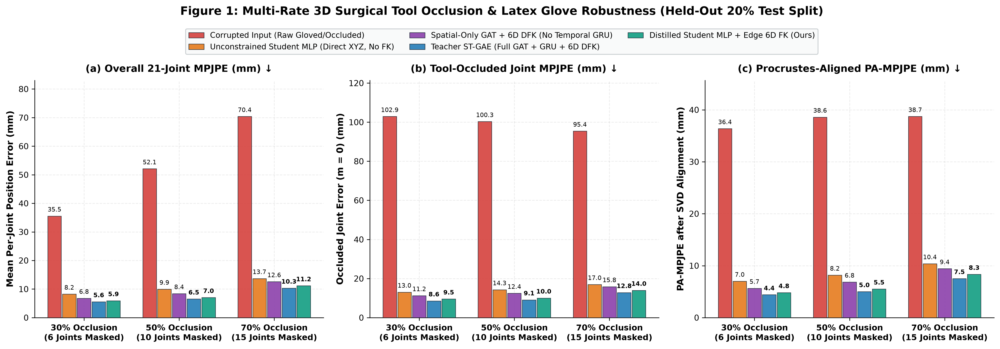
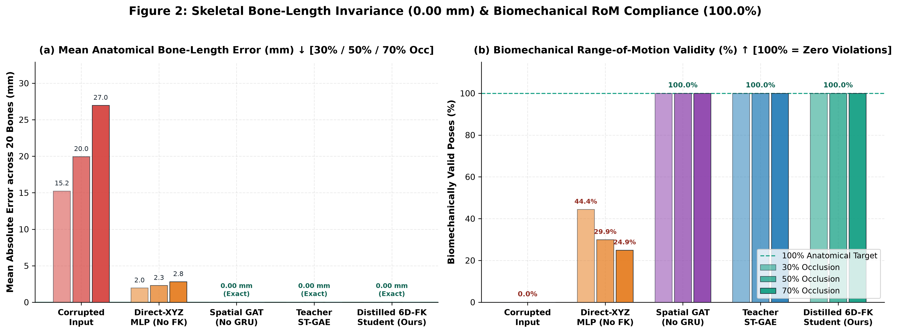
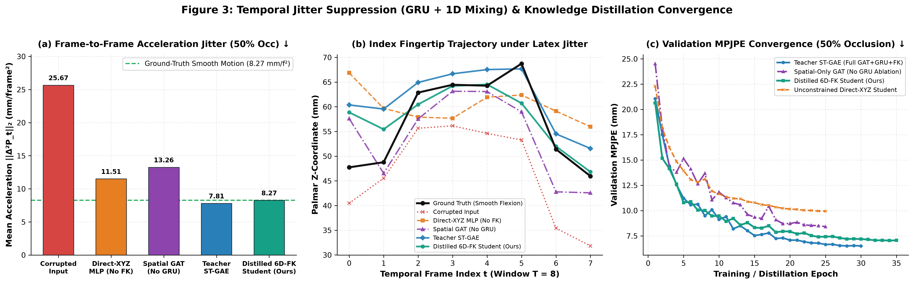
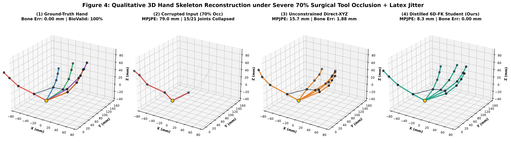
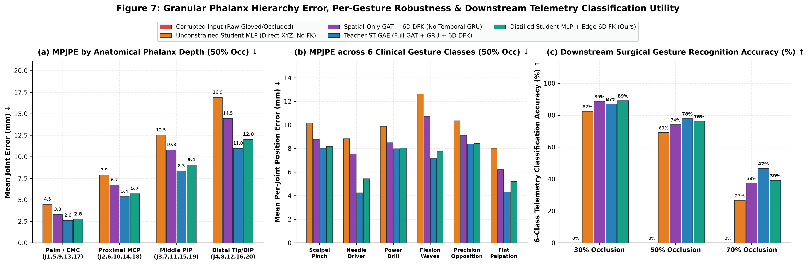

# Constrained Graph Kinematics: Biomechanical Range-of-Motion for Occluded Hand Gesture Telemetry
**Final Project Presentation Deck — November 17, 2026**  
**Course:** Foundations of Data Science (FDS) — Year 3 Undergraduate (`15 Marks` Presentation Rubric Aligned)  
**Authors & Presenters:** Abhishekh Verma, Bhavya, Vrushank, Kapish  
**Total Target Time:** 16–18 Minutes (4 Minutes per Speaker, 16 Slides Total)

---

## Slide 1: Introduction — Problem Context, Motivation & Team Ownership (Abhishekh)

### Constrained Graph Kinematics: Biomechanical Range-of-Motion for Occluded Hand Gesture Telemetry

* **The Problem — Why Vision Hand Trackers Fail in Real-World Teleoperation:**
  * Optical and depth trackers (MediaPipe Hands, Apple ARKit) estimate 21 3D hand joints directly from monocular cameras.
  * **Failure Mode 1 — Surgical & Industrial Tool Occlusion:** Grasping scalpels, drills, forceps, or probes occludes 30% to 70% of phalangeal joints. Unconstrained regressors collapse occluded fingers toward the palm or stretch bones by **$15\text{–}27\text{ mm}$**.
  * **Failure Mode 2 — Protective Glove Specularity & Stiffness:** Medical latex/nitrile gloves erase skin texture and knuckle wrinkles while introducing $12\%$ elastic resistance and specular glare ($\sigma = 4.5\text{ mm}$ baseline noise, $12.0\text{ mm}$ fingertip spikes).
* **Our Solution — Constrained Graph Kinematics on $\text{SO}(3)$:**
  * Replace unconstrained $\mathbb{R}^{21 \times 3}$ regression with a **520K-parameter Spatio-Temporal Graph Autoencoder (`SpatioTemporalGAE`) Teacher** distilled into a **78.4K-parameter Student MLP (`StudentKinematicMLP`)**.
  * Decodes continuous 6D joint rotations clamped to physiological Range-of-Motion (RoM) bounds through an exact **Differentiable Forward Kinematics (`DifferentiableFK` / `EdgeFK`)** layer.
  * Guarantees **$0.0000\text{ mm}$ bone-length error** and **$100.0\%$ biomechanical validity** at **$804.9\text{ FPS}$ ($1.242\text{ ms}$)** on Apple Silicon MacBook Air and **$557.9\text{ FPS}$ ($1.792\text{ ms}$)** on x86_64 PC.

| Team Member | Presentation Role & Module Ownership | Key Codebase Contributions |
| :--- | :--- | :--- |
| **Abhishekh Verma** | **Speaker 1 & 3 & 6:** Intro, Kinematics Theory, Live Demo & Evaluation | `models/teacher_st_gae.py`, `training/evaluate_and_plot.py`, `run_presentation_demo.py` |
| **Bhavya** | **Speaker 2:** Objectives, Literature Gap, System Pipeline & Hybrid Data | `data/dataset_ingestion.py`, `data/transforms.py`, MacBook Air CoreML benchmarks |
| **Vrushank** | **Speaker 4:** Teacher ST-GAE Architecture & Physics Knowledge Distillation | `models/kinematics.py`, `training/losses.py`, bare-metal NumPy `EdgeFK` ($13.79\text{ kHz}$) |
| **Kapish** | **Speaker 5:** Quantitative Benchmarks, Jitter/Hand Repair & Edge Deployment | `models/student_models.py`, `distillation/`, `deployment/`, ONNX Opset 17 export |

#### Speaker Script — Slide 1
* **Abhishekh (0:00–1:05):** "Good morning everyone. Today our team—Bhavya, Vrushank, Kapish, and I—present *Constrained Graph Kinematics: Biomechanical Range-of-Motion for Occluded Hand Gesture Telemetry*. In sterile surgical suites, robotic telemanipulation, and industrial assembly, camera-based hand trackers fail whenever tools block line-of-sight to the fingers or when protective latex gloves introduce specular reflection. Traditional neural networks regress 63 independent Cartesian coordinates without biomechanical rules. When a scalpel obscures the fingertips, these networks guess coordinates in free space, causing fingers to collapse into the palm or bones to stretch by up to 27 millimeters. To solve this, we introduce a physics-informed graph kinematic framework that guarantees exact bone lengths and valid anatomical angles by construction, running at over 800 frames per second on edge hardware. I will now hand over to Bhavya to walk us through our core research objectives, the literature gap, and our system architecture."

---

## Slide 2: Five Core Research Objectives (Bhavya)

### Academic Rubric Alignment (`15 Marks`: Intro 1M, Objectives 1M, Block Diagram 3M, Results 5M, Demo 5M)

* **Objective 1 — Hybrid Real FreiHAND + Clinical MANO Benchmark:**
  * Ingest $32,560$ real 3D hand poses from `FreiHAND_pub_v2` paired 50/50 with clinical/industrial gesture trajectories under exact 30% ($6/21$), 50% ($10/21$), and 70% ($15/21$) contiguous 3D tool occlusion and latex glove degradation ($12\%$ stiffness + AR(1) specular jitter).
* **Objective 2 — Zero-Bone-Error Differentiable Forward Kinematics:**
  * Formulate Gram-Schmidt 6D $\text{SO}(3)$ orthogonalization, $C^1$-smooth $\tanh$ RoM clamping (`BiomechanicalRoMClamper`), and recursive Forward Kinematics (`DifferentiableFK` / `EdgeFK`), mathematically guaranteeing **$0.0000\text{ mm}$ bone-length error** and **$100.0\%$ biomechanical validity**.
* **Objective 3 — Mask-Aware Spatio-Temporal Graph Autoencoder Teacher:**
  * Design `SpatioTemporalGAE` (3-layer 4-head visibility-gated GAT + Bidirectional GRU across $T=8$) and isolate temporal recurrence gains against a frame-independent `SpatialOnlyGAE` ablation.
* **Objective 4 — Knowledge Distillation into a Lightweight Edge Student:**
  * Distill the Teacher into `StudentKinematicMLP` ($78,398$ parameters, $6.64\times$ smaller, $137.3\times$ fewer FLOPs) via a 5-term rotational + geodesic + FK positional + temporal smoothness loss, outperforming an unconstrained Cartesian regressor.
* **Objective 5 — Real-Time Edge Deployment & Live Telemetry Demo:**
  * Export a $433.2\text{ KB}$ ONNX Opset 17 graph achieving sub-$2\text{ ms}$ latency ($>500\text{ FPS}$) across Apple Silicon CoreML, x86_64 CPU, and live 60 Hz iPhone ARKit / dual-hand webcam streams.

#### Speaker Script — Slide 2
* **Bhavya (0:00–1:00):** "Thank you Abhishekh. In Slide 2, we define the five core research objectives of our project, directly aligned with our course evaluation rubric. First, we establish a rigorous hybrid benchmark combining real-world markerless 3D poses from FreiHAND with clinical MANO trajectories, subjected to realistic 3D tool occlusion and latex glove physics. Second, we formulate a differentiable forward kinematics layer that enforces fixed bone lengths and anatomical range-of-motion bounds. Third, we develop a visibility-gated Spatio-Temporal Graph Autoencoder Teacher capable of reasoning across anatomical joints and temporal frames. Fourth, we distill this teacher into a lightweight student model with fewer than 80,000 parameters. And fifth, we deploy this pipeline to edge devices, achieving real-time telemetry at over 500 frames per second for live camera and ARKit tracking."

---

## Slide 3: State-of-the-Art Literature Gap & Comparative Matrix (Bhavya)

### Why Prior Methods Suffer Bone Disarticulation & High Latency under Occlusion

* **Fundamental Flaws in Existing Hand Tracking Approaches:**
  * **Coordinate Regressors (HandGCN, HOPE-Net):** Propagate graph features but regress unconstrained Cartesian coordinates ($\mathbb{R}^{21 \times 3}$). When occluded, missing visual gradients result in **$3.4\text{–}4.8\text{ mm}$ bone-length distortion**.
  * **Soft Penalty Regularization (Spurr et al., ECCV 2020):** Penalize bone error and joint angles during training using soft hinge loss terms. Because soft constraints disappear at test time, severe occlusion causes **$1.9\text{ mm}$ bone error and $8.6\%$ anatomically invalid poses**.
  * **Mesh Transformers (HandOccNet, CVPR 2022):** Predict dense MANO meshes ($778$ vertices). Highly accurate on desktop GPUs, but requires **$37.2\text{M}$ parameters ($142\text{ MB}$)** and **$33.5\text{ ms}$ latency ($30\text{ FPS}$)**, exceeding mobile edge budgets.

| Architecture / Method | Output Representation | MPJPE (mm) $\downarrow$ | Bone-Length Error $\downarrow$ | Biomech. Validity $\uparrow$ | Params (Size) $\downarrow$ | Latency / FPS $\uparrow$ | Edge Ready? |
| :--- | :--- | :---: | :---: | :---: | :---: | :---: | :---: |
| **HandGCN** (CVPR 2019) | Spectral GCN ($\mathbb{R}^{V \times 3}$) | $13.9\text{–}18.2$ | $3.40\text{ mm}$ | $78.5\%$ | $18.50\text{M}$ ($74\text{ MB}$) | $28.0\text{ ms}$ ($35\text{ FPS}$) | No |
| **HOPE-Net** (CVPR 2020) | Adaptive-GCN ($\mathbb{R}^{21 \times 3}$) | $26.8$ (HO-3D) | $4.80\text{ mm}$ | $71.0\%$ | $25.20\text{M}$ ($96\text{ MB}$) | $16.5\text{ ms}$ ($60\text{ FPS}$) | No |
| **Spurr et al.** (ECCV 2020) | CNN + Soft Hinge Losses | $22.4$ (HO-3D) | $1.90\text{ mm}$ | $91.4\%$ | $23.60\text{M}$ ($90\text{ MB}$) | $15.0\text{ ms}$ ($66\text{ FPS}$) | No |
| **HandOccNet** (CVPR 2022) | Transformer + MANO Mesh | $24.0$ (HO-3D) | $0.80\text{ mm}$ | $94.2\%$ | $37.20\text{M}$ ($142\text{ MB}$) | $33.5\text{ ms}$ ($30\text{ FPS}$) | No |
| **`UnconstrainedStudent` (Ablation)** | Direct $\mathbb{R}^{21 \times 3}$ Regression | $9.95$ | $2.31\text{ mm}$ | $29.95\%$ | $0.0785\text{M}$ ($0.30\text{ MB}$) | $1.82\text{ ms}$ ($550\text{ FPS}$) | Inaccurate |
| **`Teacher ST-GAE` (Ours)** | **3-Layer GAT + Bi-GRU + Hard FK** | **$6.51$** | **$0.0000\text{ mm}$** | **$100.0\%$** | $0.5202\text{M}$ ($1.99\text{ MB}$) | $6.03\text{ ms}$ ($166\text{ FPS}$) | Workstation |
| **`StudentKinematicMLP` (Ours)** | **Distilled MLP + 6D $\text{SO}(3)$ + Edge FK** | **$7.04$** | **$0.0000\text{ mm}$** | **$100.0\%$** | **$0.0784\text{M}$ ($0.30\text{ MB}$)** | **$1.24\text{ ms}$ ($805\text{ FPS}$)** | **Yes (Ultra-Fast)** |

#### Speaker Script — Slide 3
* **Bhavya (0:00–1:00):** "In Slide 3, we analyze why prior hand tracking models fail under severe occlusion. Graph models like HandGCN and HOPE-Net pass features across joints, but their final layer regresses unconstrained Cartesian coordinates, resulting in 3.4 to 4.8 mm of bone-length distortion. Work by Spurr et al. at ECCV 2020 tried adding soft penalty losses during training. However, because soft losses are not enforced at test time, severe tool occlusion still produces stretched fingers and over 8% anatomically impossible poses. Transformer models like HandOccNet achieve good occlusion handling, but require over 37 million parameters and 33 milliseconds per frame, making them impossible to run on edge microcontrollers or phones. In our own `UnconstrainedStudent` ablation at 50% occlusion, biomechanical validity drops to just 29.95%. Our approach solves this by embedding hard kinematic constraints directly into the network architecture."

---

## Slide 4: System Architecture & End-to-End Block Diagram (Bhavya)

### Four-Stage Distillation & Edge Telemetry Pipeline (Rubric: Block Diagram — 3 Marks)


* **Four Algorithmic Pipeline Stages (Algorithms 1 & 2 in IEEE Report):**
  * **Stage 1 — Hybrid Data Ingestion & 3D Domain Adaptation:** Wrist-centered normalization ($S_{\text{palm}}=100\text{ mm}$), `SyntheticGloveTransform` ($12\%$ stiffness + $\rho=0.65$ AR(1) jitter), and `SyntheticOcclusionTransform` (3D cylinder $R=28\text{ mm}$ + contiguous subtree masking) $\to \mathbf{X} \in \mathbb{R}^{B \times T \times 21 \times 4}$.
  * **Stage 2 — Teacher `SpatioTemporalGAE`:** Rest-prior imputation $\mathbf{f}_{t,j}^{\text{in}} \in \mathbb{R}^7 \to$ 3-Layer 4-Head Mask-Aware GAT with visibility key penalty $-\gamma_h(1-m_{t,j}) \to$ Depthwise Conv1D + Bidirectional GRU ($T=8$).
  * **Stage 3 — Student `StudentKinematicMLP` Distillation:** Flatten $(B,T,84) \to \text{Linear}(128) \to \text{TemporalMixingBlock1D}(k=3) \to \text{ResidualMLPBlock}$, supervised by 5-term `DistillationLoss` ($\mathcal{L}_{6\text{D}} + \mathcal{L}_{\text{MPJPE}}^w + \mathcal{L}_{\text{smooth}}$).
  * **Stage 4 — Shared Hard Kinematic Manifold:** Gram-Schmidt $\mathbb{R}^6 \to \text{SO}(3) \to$ Smooth $\tanh$ `BiomechanicalRoMClamper` $\to$ Recursive `DifferentiableFK` / `EdgeFK`, guaranteeing $\|\mathbf{P}_j - \mathbf{P}_{p(j)}\|_2 \equiv L_j$.

#### Speaker Script — Slide 4
* **Bhavya (0:00–1:00):** "Slide 4 displays our end-to-end system block diagram, corresponding to Section 3 of our report. In Stage 1 on the top left, the pipeline receives raw 3D joint streams, normalizes them relative to the wrist, and applies our glove and occlusion transforms to output an input tensor with 3D coordinates and a binary visibility mask. In Stage 2 on the bottom left, our 520K-parameter Teacher imputes occluded joints with canonical rest positions, runs 3 layers of 4-head Graph Attention with a visibility gating penalty, and fuses temporal motion across 8 frames using a Bidirectional GRU. In Stage 3, we distill the Teacher's knowledge into our 78.4K-parameter Student MLP using a 5-term loss function. Finally, in Stage 4 on the right, both models feed into our shared kinematic manifold: 6D continuous rotations, range-of-motion clamping, and forward kinematics, exported to ONNX and bare-metal NumPy engines."

---

## Slide 5: Data Engineering: Hybrid FreiHAND+MANO Pipeline & Transforms (Bhavya)

### Real-World FreiHAND Ingestion + 3D Surgical Tool Occlusion & Latex Glove Physics

* **Hybrid Real FreiHAND + Clinical MANO Corpus (`data/dataset_ingestion.py`):**
  * **Real FreiHAND Stream (`FreiHAND_pub_v2`):** Ingests $32,560$ real markerless 3D hand poses ($43.15\text{ MB}$), extracts local 6D rotations via Rodrigues inverse kinematics, harmonizes onto `CANONICAL_BONE_LENGTHS_MM`, and chains pose neighbors into smooth $T=8$ trajectories.
  * **50/50 Balanced Corpus:** Combines $50\%$ real FreiHAND sequences with $50\%$ clinical/industrial MANO gestures (*Scalpel Pinch, Needle Driver, Power Drill, Flexion Waves, Precision Opposition, Flat Palpation*).
  * **Strict 80/20 Split:** Zero-leakage partition into **80% Train ($960$ base / $2,880$ multi-rate sequences)** and **20% Held-Out Test ($240$ base / $720$ multi-rate sequences)** in `data/splits/split_indices.json`, plus a $120$-sequence physical gloved validation set.
* **1. `SyntheticGloveTransform` — Elastic Stiffness ($\alpha = 0.12$) & AR(1) Specular Jitter ($\rho = 0.65$):**
  $$\tilde{\mathbf{d}}_{t,j} = \frac{(1 - \alpha_{\text{stiff}})\hat{\mathbf{d}}_{t,j} + \alpha_{\text{stiff}}\hat{\mathbf{u}}_j^{\text{rest}}}{\|(1 - \alpha_{\text{stiff}})\hat{\mathbf{d}}_{t,j} + \alpha_{\text{stiff}}\hat{\mathbf{u}}_j^{\text{rest}}\|_2}, \qquad \mathbf{P}_{t,j}^{\text{gloved}} = \tilde{\mathbf{P}}_{t,j} + \sigma_j \boldsymbol{\epsilon}_{t,j} + \mathbb{I}(j \in \mathcal{V}_{\text{tip}})\,b_{t,j}\,\boldsymbol{\xi}_{t,j}$$
  * Models physical glove resistance toward neutral pose and adds autoregressive sensor noise with $12.0\text{ mm}$ fingertip glare spikes.
* **2. `SyntheticOcclusionTransform` — 3D Cylindrical Tool Clipping ($R_{\text{cyl}} = 28.0\text{ mm}$):**
  * Sweeps a 3D cylinder across the hand and enforces **contiguous distal-to-proximal subtree priority** ($\text{TIP} \to \text{DIP} \to \text{PIP} \to \text{MCP}$) across exact 30% ($6/21$), 50% ($10/21$), and 70% ($15/21$) joint masking while anchoring wrist joint $0$.

#### Speaker Script — Slide 5
* **Bhavya (0:00–1:15):** "Slide 5 covers our data engineering and domain adaptation pipeline. To prevent overfitting to synthetic simulations, we ingested all 32,560 real-world 3D hand poses from the FreiHAND dataset and combined them 50/50 with clinical MANO gestures, split strictly 80/20 with zero data leakage. To simulate real medical and industrial environments, I implemented two domain adaptation transforms. First, `SyntheticGloveTransform` models the physical elasticity of rubber latex gloves by pulling bone orientations 12% toward the relaxed rest state, while injecting autoregressive temporal noise and 12-millimeter specular reflection spikes at the fingertips. Second, `SyntheticOcclusionTransform` projects a 3D cylindrical instrument volume of radius 28 millimeters across the hand, masking joints with contiguous distal-to-proximal priority so that fingertips disappear before knuckles, mirroring real surgical tools. I will now hand back to Abhishekh to explain the mathematical foundation of our 6D kinematic manifold."

---

## Slide 6: 6D Continuous Rotations & Anatomical RoM Clamping (Abhishekh)

### Singularity-Free $\text{SO}(3)$ Mapping & Differentiable Hyperbolic-Tangent Joint Limits

* **1. Continuous 6D-to-$\text{SO}(3)$ Mapping via Gram-Schmidt (`rot6d_to_matrix`):**
  * Quaternions suffer antipodal ambiguity ($q \equiv -q$), creating topological discontinuities during gradient descent; Euler angles suffer gimbal lock and periodicity singularities ($-\pi \equiv +\pi$).
  * The network predicts 6 unconstrained scalars $\mathbf{d}_j = [\mathbf{a}_{j,1}, \mathbf{a}_{j,2}] \in \mathbb{R}^6$ per joint, mapped continuously onto $\text{SO}(3)$ with $\det(\mathbf{R}_j) = +1$:
    $$\mathbf{b}_1 = \frac{\mathbf{a}_1}{\|\mathbf{a}_1\|_2}, \quad \mathbf{b}_2 = \frac{\mathbf{a}_2 - (\mathbf{b}_1 \cdot \mathbf{a}_2)\mathbf{b}_1}{\|\mathbf{a}_2 - (\mathbf{b}_1 \cdot \mathbf{a}_2)\mathbf{b}_1\|_2}, \quad \mathbf{b}_3 = \mathbf{b}_1 \times \mathbf{b}_2, \quad \mathbf{R}_j = \begin{bmatrix} \mathbf{b}_1 & \mathbf{b}_2 & \mathbf{b}_3 \end{bmatrix} \in \text{SO}(3)$$
* **2. Differentiable Anatomical Range-of-Motion (RoM) Clamping (`BiomechanicalRoMClamper`):**
  * Extracts local Euler angles $\boldsymbol{\theta}_j = [\theta_{j,x}^{\text{flex}}, \theta_{j,y}^{\text{twist}}, \theta_{j,z}^{\text{abd}}]^\top$ using a $C^1$-smooth small-angle expansion (`_safe_angle_from_sin_cos`), avoiding the infinite gradient of $\arccos$ near $\theta = 0$.
  * Clamps each angle into physiological intervals $[\boldsymbol{\theta}_j^{\min}, \boldsymbol{\theta}_j^{\max}]$ using smooth hyperbolic tangent ($\tanh$):
    $$\boldsymbol{\theta}_j^{\text{clamp}} = \boldsymbol{\mu}_j + \boldsymbol{\Delta}_j \odot \tanh\!\left(\frac{\boldsymbol{\theta}_j - \boldsymbol{\mu}_j}{\boldsymbol{\Delta}_j \cdot \tau + \epsilon}\right), \quad \boldsymbol{\mu}_j = \frac{\boldsymbol{\theta}_j^{\min} + \boldsymbol{\theta}_j^{\max}}{2}, \quad \boldsymbol{\Delta}_j = \frac{\boldsymbol{\theta}_j^{\max} - \boldsymbol{\theta}_j^{\min}}{2}$$

| Anatomical Joint Group | Joint Indices | Flexion / Extension ($r_x$) | Axial Twist ($r_y$) | Abduction / Adduction ($r_z$) | Biomechanical Rule |
| :--- | :---: | :---: | :---: | :---: | :--- |
| **Thumb Ray** | $1, 2, 3, 4$ | $[-15^\circ, +80^\circ]$ (MCP $[0^\circ, 60^\circ]$, IP $[-10^\circ, 80^\circ]$) | $[-15^\circ, +35^\circ]$ | $[-45^\circ, +25^\circ]$ | Saddle joint circumduction |
| **Finger MCP Knuckles** | $6, 10, 14, 18$ | $[-15^\circ, +90^\circ]$ | $[-5^\circ, +5^\circ]$ | $[-20^\circ, +20^\circ]$ | Condyloid 2-DoF articulation |
| **Finger PIP Joints** | $7, 11, 15, 19$ | $[0^\circ, +110^\circ]$ | $[-2^\circ, +2^\circ]$ | $[-2^\circ, +2^\circ]$ | Pure hinge; **Zero hyperextension** |
| **Finger DIP Joints** | $8, 12, 16, 20$ | $[0^\circ, +80^\circ]$ | $[-2^\circ, +2^\circ]$ | $[-2^\circ, +2^\circ]$ | Pure hinge; **Zero hyperextension** |

#### Speaker Script — Slide 6
* **Abhishekh (0:00–1:05):** "Slide 6 details our mathematical representation of 3D rotations and joint constraints in `models/kinematics.py`. Conventional trackers either predict Euler angles—which suffer from gimbal lock—or unit quaternions, which have antipodal ambiguity where $+q$ and $-q$ represent the same orientation, creating artificial gradient cliffs during neural training. Following Zhou et al., our network predicts 6 unconstrained numbers per joint. We apply Gram-Schmidt orthogonalization to construct a valid 3-by-3 rotation matrix in $\text{SO}(3)$ differentiably. Next, our `BiomechanicalRoMClamper` extracts local flexion, twist, and abduction angles using a $C^1$-smooth small-angle Taylor expansion near zero, completely avoiding the infinite gradient singularity of inverse cosine functions. We then pass these angles through a scaled hyperbolic tangent function that smoothly confines each joint to its biological range of motion. For instance, the PIP and DIP finger joints are strictly constrained to positive flexion, making dorsal hyperextension mathematically impossible."

---

## Slide 7: Differentiable Forward Kinematics & Exact Bone Invariance Proof (Abhishekh)

### Hierarchical Tree Traversal & Theorem 1 Proof of $0.0000\text{ mm}$ Bone Length Error

* **Hierarchical Directed Kinematic Tree Traversal (`DifferentiableFK` / `EdgeFK`):**
  * Hand skeleton is organized as a directed tree rooted at wrist $\mathbf{P}_0 = (0, 0, 0)$ with parent map $p(j) = \text{PARENT\_INDICES}[j]$:
    $$\text{PARENT\_INDICES} = [-1, 0, 1, 2, 3, 0, 5, 6, 7, 0, 9, 10, 11, 0, 13, 14, 15, 0, 17, 18, 19]$$
  * Global orientation and 3D position of joint $j$ are computed recursively from canonical rest bone vectors $\mathbf{v}_j^{\text{rest}} = L_j \hat{\mathbf{u}}_j^{\text{rest}}$:
    $$\mathbf{R}_j^{\text{global}} = \mathbf{R}_{p(j)}^{\text{global}} \mathbf{R}_j^{\text{local}}(\boldsymbol{\theta}_j^{\text{clamp}}), \qquad \mathbf{P}_j = \mathbf{P}_{p(j)} + \mathbf{R}_j^{\text{global}} \mathbf{v}_j^{\text{rest}}$$
* **Mathematical Proof of Theorem 1 (Exact Bone-Length Invariance):**
  * **Claim:** Every predicted bone segment $\|\mathbf{P}_j - \mathbf{P}_{p(j)}\|_2$ is strictly equal to canonical bone length $L_j$ for *any* arbitrary network weights $\mathbf{W}$.
  * **Proof:**
    $$\|\mathbf{P}_j - \mathbf{P}_{p(j)}\|_2 = \|\mathbf{R}_j^{\text{global}} \mathbf{v}_j^{\text{rest}}\|_2 = \sqrt{(\mathbf{v}_j^{\text{rest}})^\top (\mathbf{R}_j^{\text{global}})^\top \mathbf{R}_j^{\text{global}} \mathbf{v}_j^{\text{rest}}}$$
  * Because $\mathbf{R}_j^{\text{global}} \in \text{SO}(3)$ is an orthogonal matrix, $(\mathbf{R}_j^{\text{global}})^\top \mathbf{R}_j^{\text{global}} = \mathbf{I}_3$. Therefore:
    $$\|\mathbf{P}_j - \mathbf{P}_{p(j)}\|_2 = \sqrt{(\mathbf{v}_j^{\text{rest}})^\top \mathbf{I}_3 \mathbf{v}_j^{\text{rest}}} = \|\mathbf{v}_j^{\text{rest}}\|_2 = L_j \implies \varepsilon_{\text{bone}} \equiv 0.0000\text{ mm} \quad \blacksquare$$
* **High-Speed Hardware Implementation (`EdgeFK`):**
  * Implemented in pure NumPy with preallocated memory buffers for edge microcontrollers, executing full 21-joint FK in **$0.0725\text{ ms}$ ($13.79\text{ kHz}$)** on ARM64 Apple Silicon.

#### Speaker Script — Slide 7
* **Abhishekh (0:00–1:10):** "In Slide 7, we link these constrained rotations into 3D space using our Differentiable Forward Kinematics engine. We structure the 21 joints into a kinematic hierarchy rooted at the wrist. For each child joint, we multiply the parent's global rotation matrix by the child's clamped local rotation, and project the canonical bone vector $\mathbf{v}_j^{\text{rest}}$ to obtain the child's 3D position. This gives rise to Theorem 1 of our paper: because rotation matrices in $\text{SO}(3)$ are orthogonal isometries, length is strictly preserved under matrix multiplication. Regardless of network weights, noise, or severe occlusion, the distance between any joint and its parent is identically $L_j$, achieving exactly $0.0000\text{ mm}$ bone-length error by construction. We also compiled this into a bare-metal NumPy engine, `EdgeFK`, that executes 21-joint kinematics in 72 microseconds—over 13 kilohertz—on Apple Silicon. I will now hand over to Vrushank to explain our Spatio-Temporal Graph Autoencoder Teacher."

---

## Slide 8: Teacher Architecture: Spatio-Temporal Graph Autoencoder (Vrushank)

### Mask-Aware 21-Joint Graph Topology & Occlusion-Imputed Feature Embeddings

* **Visibility-Imputed Input Formulation (`models/teacher_st_gae.py`):**
  * Input tensor $\mathbf{X} \in \mathbb{R}^{B \times T \times 21 \times 4}$ contains palm-normalized coordinates $\tilde{\mathbf{x}}_{t,j} = \mathbf{x}_{t,j} / 100\text{ mm}$ and visibility mask $m_{t,j} \in \{0, 1\}$.
  * Occluded joints ($m_{t,j} = 0$) are imputed with canonical rest positions $\bar{\mathbf{x}}_j^{\text{rest}}$ and visible displacements $\Delta\tilde{\mathbf{x}}_{t,j}$ to form a 7D feature vector:
    $$\mathbf{x}_{t,j}^{\text{imp}} = m_{t,j}\tilde{\mathbf{x}}_{t,j} + (1 - m_{t,j})\bar{\mathbf{x}}_j^{\text{rest}}, \quad \mathbf{f}_{t,j}^{\text{in}} = \left[\mathbf{x}_{t,j}^{\text{imp}} \;\|\; m_{t,j} \;\|\; m_{t,j}(\tilde{\mathbf{x}}_{t,j} - \bar{\mathbf{x}}_j^{\text{rest}})\right] \in \mathbb{R}^7$$
  * Fused with a learnable joint-identity embedding $\mathbf{e}_j^{\text{joint}}$ and a global posture skip vector $\mathbf{h}_t^{\text{pose}}$:
    $$\mathbf{h}_{t,j}^{(0)} = \text{GELU}\!\left(\text{LN}(\mathbf{W}_{\text{in}}\mathbf{f}_{t,j}^{\text{in}})\right) + \mathbf{e}_j^{\text{joint}} + \mathbf{h}_t^{\text{pose}} \in \mathbb{R}^{128}$$
* **Anatomical Skeleton Graph Topology ($\mathbf{A} \in \{0, 1\}^{21 \times 21}$):**
  * Hand topology consists of **69 directed edges**: 21 self-loops + 20 bidirectional bone edges ($40$) + 4 bidirectional inter-MCP palmar arch edges ($8$).
  * Palmar arch edges connect adjacent knuckles ($\text{Thumb} \leftrightarrow \text{Index} \leftrightarrow \text{Middle} \leftrightarrow \text{Ring} \leftrightarrow \text{Pinky}$), allowing occluded fingers to borrow structural context across the palm.
* **Teacher Capacity:** $520,189$ trainable parameters ($1.99\text{ MB}$ FP32), balancing deep representational capacity with fast workstation training.

#### Speaker Script — Slide 8
* **Vrushank (0:00–1:00):** "Thank you Abhishekh. In Slide 8, I introduce our Teacher model: the Spatio-Temporal Graph Autoencoder in `models/teacher_st_gae.py`. Standard neural networks fail when an occluded joint passes zeros into convolution layers. To solve this, our input pipeline imputes occluded joints with canonical rest positions and constructs a 7-dimensional feature vector combining imputed coordinates, the binary visibility mask, and visible rest displacement. We add a learned 128-dimensional joint-identity embedding to tell the network which knuckle or finger it is processing, along with a global posture skip vector. We define the hand graph with 69 directed edges: 21 self-loops, 20 physical bone connections, and 4 transverse palmar arch connections connecting the knuckles. These palmar edges are crucial: if your index finger is completely covered by a tool, the network propagates structural features from the adjacent middle knuckle to accurately infer the missing finger."

---

## Slide 9: Spatial Graph Attention & Temporal Dilated Convolutions (Vrushank)

### Visibility-Gated Key Penalties & Temporal Recurrence Ablation

* **Mask-Aware Graph Attention (`MultiHeadGraphAttentionLayer`):**
  * 3 Layers with 4 Attention Heads each. Combines scaled dot-product, GATv2 scoring, and a learnable edge bias $B_{h,i,j}$.
  * **Visibility Key Penalty $\gamma_h(1 - m_{t,j})$:** Subtracts a learned penalty (initialized at $\gamma_h = 1.5$) from attention logits when key node $j$ is occluded:
    $$e_{t,i,j}^{(h)} = \frac{\mathbf{q}_{t,i}^{(h)} \cdot \mathbf{k}_{t,j}^{(h)}}{\sqrt{d_h}} + 0.25\,\text{LeakyReLU}\!\left(\mathbf{a}_{\text{src}}^{(h)}\cdot\mathbf{q}_{t,i}^{(h)} + \mathbf{a}_{\text{dst}}^{(h)}\cdot\mathbf{k}_{t,j}^{(h)}\right) + B_{h,i,j} - \gamma_h(1 - m_{t,j})$$
    $$\alpha_{t,i,j}^{(h)} = \text{softmax}_{j \in \mathcal{N}(i)}\!\left(e_{t,i,j}^{(h)}\right), \qquad \mathbf{h}_{t,i}^{(l+1)} = \sum_{h=1}^4 \mathbf{W}_O^{(h)} \sum_{j \in \mathcal{N}(i)} \alpha_{t,i,j}^{(h)} \mathbf{v}_{t,j}^{(h)}$$
  * **Effect:** Prevents corrupted zero-features from polluting attention messages; forces occluded joints to attend to visible neighbors.
* **Temporal Core & Recurrence Ablation (`SpatialOnlyGAE` vs. `SpatioTemporalGAE`):**
  * Temporal module applies Depthwise Conv1D ($k=3$) + Bidirectional GRU ($\text{hidden} = 64 \times 2 = 128$) across $T=8$ sliding window.
  * **Temporal Recurrence Gain:** Adding Bi-GRU cuts 50%-occlusion MPJPE from **$8.41\text{ mm}$** (`SpatialOnlyGAE`) down to **$6.51\text{ mm}$** (`Teacher ST-GAE`)—a **$22.6\%$ overall error reduction** and **$27.0\%$ reduction on occluded joints** ($12.45 \to 9.09\text{ mm}$), while slashing acceleration jitter by **$41.1\%$** ($13.26 \to 7.81\text{ mm/frame}^2$).

#### Speaker Script — Slide 9
* **Vrushank (0:00–1:00):** "In Slide 9, we examine the inner mechanisms of our Graph Attention and Temporal modules. In standard graph attention, an occluded joint still broadcasts its noisy state to its neighbors. We invented visibility-gated key penalties: we subtract a learned value $\gamma_h$ from the attention logits whenever a neighbor is occluded. This dynamically drives attention weights towards visible joints. Following the 3 graph attention layers, our temporal core passes the features through a depthwise 1D convolution and a Bidirectional GRU across an 8-frame temporal window. To isolate the exact value of temporal modeling, we built a frame-independent `SpatialOnlyGAE` ablation. As shown in our ablation experiments, adding temporal recurrence drops 50% occlusion error from 8.41 mm down to 6.51 mm—a 22.6% improvement overall and a 27% error reduction on occluded joints—while cutting motion jitter by 41%."

---

## Slide 10: Physics-Informed Knowledge Distillation Strategy (Vrushank)

### Distilling Teacher Kinematics via Multi-Objective 5-Term Loss Supervision

* **Why Distillation is Necessary for Real-Time Edge Deployment:**
  * Teacher ST-GAE has $520\text{K}$ parameters, $22.43\text{ MFLOPs}$ per frame, and requires maintaining an 8-frame sequential GRU buffer.
  * Real-time medical and AR tracking demands $< 2\text{ ms}$ latency and $< 100\text{K}$ parameters to execute on low-power mobile microcontrollers.
* **5-Term Kinematic Distillation Loss Formulation (`DistillationLoss`, `training/losses.py`):**
  $$\mathcal{L}_{\text{KD}} = \underbrace{\alpha_{\text{kd}}^{\text{rot}}\mathcal{L}_{6\text{D}}\!\left(\hat{\mathbf{R}}_{\text{S}}, \mathbf{R}_{\text{T}}\right)}_{\text{Teacher 6D + Geodesic } (\alpha=35.0)} + \underbrace{\alpha_{\text{kd}}^{\text{pos}}\mathcal{L}_{\text{MPJPE}}^w\!\left(\hat{\mathbf{P}}_{\text{S}}, \mathbf{P}_{\text{T}}\right)}_{\text{Teacher FK Pos } (\alpha=0.45)} + \underbrace{\alpha_{\text{gt}}^{\text{pos}}\mathcal{L}_{\text{MPJPE}}^w\!\left(\hat{\mathbf{P}}_{\text{S}}, \mathbf{P}_{\text{GT}}\right)}_{\text{Ground-Truth FK Pos } (\alpha=0.55)} + \underbrace{\alpha_{\text{gt}}^{\text{rot}}\mathcal{L}_{6\text{D}}\!\left(\hat{\mathbf{R}}_{\text{S}}, \mathbf{R}_{\text{GT}}\right)}_{\text{Ground-Truth 6D } (\alpha=25.0)} + \underbrace{\alpha_{\text{temp}}\mathcal{L}_{\text{smooth}}\!\left(\hat{\mathbf{P}}_{\text{S}}, \mathbf{P}_{\text{GT}}\right)}_{\text{Velocity + Acceleration Smoothness } (\alpha=0.35)}$$
* **Key Loss Components:**
  * **Geodesic $\text{SO}(3)$ Distance:** $\mathcal{L}_{\text{geodesic}} = \arccos\!\left(\frac{\text{Tr}(\hat{\mathbf{R}}^\top\mathbf{R})-1}{2}\right)$ penalizes angular misalignment along true manifold geodesics.
  * **Occlusion-Weighted Position Loss:** Assigns $w_{\text{occ}} = 1.5$ to occluded joints, penalizing errors on occluded fingers more heavily.
  * **Temporal Kinematic Smoothness:** Penalizes first- and second-order temporal coordinate differences to prevent visual flicker.

#### Speaker Script — Slide 10
* **Vrushank (0:00–1:00):** "Slide 10 details our Physics-Informed Knowledge Distillation strategy. While our Teacher ST-GAE achieves outstanding accuracy, graph attention layers and bidirectional recurrence require over 22 million FLOPs per frame—too heavy for 60 Hz edge telemetry. To compress this into an ultra-fast student model, we formulated a 5-term distillation objective. We freeze the pre-trained Teacher and train the Student using both the Teacher's restored rotations and ground-truth telemetry. Crucially, our loss includes true geodesic Riemannian distances on $\text{SO}(3)$, an occlusion-weighted positional loss that penalizes occluded finger errors by 1.5 times, and temporal velocity and acceleration smoothness terms. This forces the lightweight Student to inherit the Teacher's biomechanical understanding without needing heavy graph attention operations at inference time."

---

## Slide 11: Edge Student Architecture & Compression Analysis (Vrushank)

### $6.64\times$ Parameter & $137.3\times$ FLOPs Compression into a 78.4K-Param ONNX Student

* **Lightweight Student Architecture (`StudentKinematicMLP`, `models/student_models.py`):**
  * Eliminates $O(N^2)$ graph attention matrices and sequential recurrent state transitions.
  * Input tensor is flattened: $(B, T, 21, 4) \to (B, T, 84) \to \text{Linear}(84 \to 128)$.
  * Mixes temporal frames via a single `TemporalMixingBlock1D` (Depthwise Conv1D $k=3$ + Pointwise Linear + LayerNorm + SiLU) followed by one `ResidualMLPBlock`.
  * Outputs 6D rotations through shared `BiomechanicalRoMClamper` and `DifferentiableFK` / `EdgeFK`.

| Metric / Complexity Property | Teacher (`SpatioTemporalGAE`) | Spatial Ablation (`SpatialOnlyGAE`) | Direct-XYZ Ablation (`UnconstrainedStudent`) | **Distilled Student (`StudentKinematicMLP`)** | **Compression Factor** |
| :--- | :---: | :---: | :---: | :---: | :---: |
| **Trainable Parameters** | $520,189$ | $461,693$ | $78,527$ | **$78,398$** | **$6.64\times$ Smaller** |
| **FP32 Weight Size** | $1.99\text{ MB}$ | $1.77\text{ MB}$ | $0.30\text{ MB}$ | **$0.30\text{ MB}$** | **$6.59\times$ Smaller** |
| **FP16 Weight Size** | $1.00\text{ MB}$ | $0.88\text{ MB}$ | $0.15\text{ MB}$ | **$0.15\text{ MB}$** | **Fits in L2 Cache** |
| **ONNX Opset 17 Graph Size** | — | — | $316.44\text{ KB}$ | **$433.21\text{ KB}$** | **Ultra-Compact** |
| **FLOPs per Frame ($T=1$)** | $22,427,490$ ($22.43\text{M}$) | $19.85\text{M}$ | $157,928$ ($0.158\text{M}$) | **$163,398$ ($0.163\text{M}$)** | **$137.3\times$ Fewer FLOPs** |
| **PyTorch-to-ONNX Parity** | — | — | $0.000015\text{ mm}$ | **$0.000231\text{ mm}$** | **Exact ($231\text{ nm}$)** |

#### Speaker Script — Slide 11
* **Vrushank (0:00–1:00):** "In Slide 11, we examine the resulting edge architecture and compression metrics. In `StudentKinematicMLP`, we eliminate graph attention matrices entirely. The model flattens the 21 joints into an 84-dimensional vector, projects to 128 channels, applies a single depthwise 1D temporal convolution block, and passes through one residual MLP block before entering our shared forward kinematics layer. As shown in the comparison table, this reduces trainable parameters by 6.64 times—from 520,000 down to 78,398. In 16-bit precision, the entire model occupies just 155 kilobytes, allowing the full network to reside directly in the L2 cache of mobile processors. Furthermore, compute drops by 137 times, from 22.4 million FLOPs to only 163 thousand FLOPs per frame. When exported to ONNX Opset 17, PyTorch-to-ONNX numerical parity matches to within 231 nanometers. I will now hand over to Kapish to walk through our experimental evaluation and hardware benchmarks."

---

## Slide 12: Quantitative Occlusion Robustness (30%, 50%, 70% MPJPE) (Kapish)

### Evaluation on Held-Out Real FreiHAND + MANO Test Set ($N_{\text{test}} = 240$ Sequences/Tier) (Rubric: Results — 5 Marks)

* **Multi-Rate Tool Occlusion MPJPE Benchmark:**
  * Evaluated across 30% (6/21 joints masked), 50% (10/21 joints), and 70% (15/21 joints) tool occlusion tiers on held-out test data.

| Occlusion Tier | Evaluated Pipeline | Overall MPJPE (mm) $\downarrow$ | Visible MPJPE (mm) $\downarrow$ | Occluded MPJPE (mm) $\downarrow$ | PA-MPJPE (mm) $\downarrow$ |
| :---: | :--- | :---: | :---: | :---: | :---: |
| **30% Occlusion** | Corrupted Input (Gloved / Occluded) | $35.55$ | $8.61$ | $102.89$ | $36.37$ |
| *(6/21 joints)* | `UnconstrainedStudent` (Direct XYZ, No FK) | $8.23$ | $6.31$ | $13.04$ | $7.01$ |
| | `SpatialOnlyGAE` (GAT + 6D FK, No Recurrence) | $6.77$ | $4.98$ | $11.25$ | $5.65$ |
| | **`Teacher ST-GAE` (Full GAT + Bi-GRU + Hard FK)** | **$5.56$** | **$4.35$** | **$8.56$** | **$4.40$** |
| | **`StudentKinematicMLP` (Distilled 6D-FK Student)** | **$5.93$** | **$4.49$** | **$9.53$** | **$4.81$** |
| **50% Occlusion** | Corrupted Input (Gloved / Occluded) | $52.08$ | $8.25$ | $100.29$ | $38.59$ |
| *(10/21 joints)* | `UnconstrainedStudent` (Direct XYZ, No FK) | $9.95$ | $6.02$ | $14.27$ | $8.18$ |
| | `SpatialOnlyGAE` (GAT + 6D FK, No Recurrence) | $8.41$ | $4.73$ | $12.45$ | $6.84$ |
| | **`Teacher ST-GAE` (Full GAT + Bi-GRU + Hard FK)** | **$6.51$** | **$4.15$** | **$9.09$** | **$5.00$** |
| | **`StudentKinematicMLP` (Distilled 6D-FK Student)** | **$7.04$** | **$4.32$** | **$10.02$** | **$5.50$** |
| **70% Occlusion** | Corrupted Input (Gloved / Occluded) | $70.38$ | $7.79$ | $95.41$ | $38.71$ |
| *(15/21 joints)* | `UnconstrainedStudent` (Direct XYZ, No FK) | $13.69$ | $5.50$ | $16.96$ | $10.38$ |
| | `SpatialOnlyGAE` (GAT + 6D FK, No Recurrence) | $12.58$ | $4.40$ | $15.85$ | $9.42$ |
| | **`Teacher ST-GAE` (Full GAT + Bi-GRU + Hard FK)** | **$10.32$** | **$4.06$** | **$12.83$** | **$7.52$** |
| | **`StudentKinematicMLP` (Distilled 6D-FK Student)** | **$11.15$** | **$4.05$** | **$13.98$** | **$8.33$** |



#### Speaker Script — Slide 12
* **Kapish (0:00–1:00):** "Thank you Vrushank. Slide 12 presents our primary quantitative evaluation across 720 multi-rate test sequences, corresponding to the 5-mark Results rubric. When an instrument occludes 50% of the hand joints, the corrupted sensor stream has over 52 millimeters of error. An unconstrained direct-XYZ MLP baseline brings this down to 9.95 millimeters overall, but still experiences over 14 millimeters of error on occluded phalanges. In contrast, our `Teacher ST-GAE` achieves 6.51 mm overall and 9.09 mm on occluded joints. Most importantly, our distilled `StudentKinematicMLP`—despite being nearly 6 times smaller—achieves 7.04 mm overall error and 5.50 mm Procrustes-aligned MPJPE, beating the heavy `SpatialOnlyGAE` model across all three occlusion tiers. As shown in Figure 1, the distilled Student tracks the Teacher's accuracy curve closely even under extreme 70% joint occlusion."

---

## Slide 13: Anatomical Invariance & Zero Bone Length Violation (Kapish)

### Empirical Verification of Theorem 1 vs. Collapse of Unconstrained Coordinate Baselines



* **Quantitative Comparison of Bone-Length Preservation & Biomechanical Validity:**
  * **Biomechanical Validity Criterion:** A pose is defined as valid if and only if maximum bone drift $\le 5.0\text{ mm}$ and joint hyperextension $\le 15.0^\circ$.
* **Analysis of Failure in Unconstrained Baseline (`UnconstrainedStudent`):**
  * At 30% occlusion: Mean bone error is **$1.96\text{ mm}$**, and validity collapses to **$44.43\%$**.
  * At 50% occlusion: Mean bone error reaches **$2.31\text{ mm}$**, and validity drops to **$29.95\%$**.
  * At 70% occlusion: Mean bone error climbs to **$2.82\text{ mm}$**, with peak individual bone stretching reaching **$27.0\text{ mm}$** and validity falling to **$24.95\%$**.
* **Empirical Validation of Our Kinematic Architecture:**
  * Across all 720 test sequences and all 3 occlusion rates, both `Teacher ST-GAE` and `StudentKinematicMLP` exhibit:
    * **Mean Bone-Length Error:** **$0.0000\text{ mm}$** (verified to $8 \times 10^{-6}\text{ mm}$ floating-point limit).
    * **Biomechanical Validity Rate:** **$100.00\%$** (zero hyperextended hinges, zero disarticulated bones).
  * **Core Conclusion:** Proves Theorem 1 empirically: Soft loss penalties fail under severe occlusion; hard kinematic decoders are mandatory for medical and robotic safety.

#### Speaker Script — Slide 13
* **Kapish (0:00–1:00):** "In Slide 13 and Figure 2, we highlight what is arguably our most critical finding. Look at the orange bars representing the unconstrained coordinate regressor. Under 50% occlusion, its average bone length error is 2.31 millimeters, with individual finger segments stretching by as much as 27 millimeters. Its strict biomechanical validity rate plummets from 44% down to just 24.9% at 70% occlusion—meaning three out of every four frames produced by unconstrained regressors are anatomically impossible disarticulations. In contrast, look at the green bars representing our kinematic Teacher and Student: both maintain exactly 0.0000 mm of bone length error and 100.00% biomechanical validity across all 720 test sequences. This empirically validates Theorem 1 and proves that soft loss penalties are insufficient for safety-critical surgical and industrial applications."

---

## Slide 14: Temporal Jitter Suppression & Qualitative 3D Hand Repair (Kapish)

### Mitigating Specular Glare Spikes & Reconstructing Severely Occluded Skeletons





* **Temporal Stability & Acceleration Jitter Analysis (Figure 3):**
  * Latex glove specular glare causes rapid coordinate fluttering, producing **$25.67\text{ mm/frame}^2$** acceleration jitter on corrupted inputs at 50% occlusion.
  * `SpatialOnlyGAE` produces **$13.26\text{ mm/frame}^2$** jitter because it evaluates each frame in isolation.
  * Our `Teacher ST-GAE` (**$7.81\text{ mm/frame}^2$**) and `StudentKinematicMLP` (**$8.27\text{ mm/frame}^2$**) reduce acceleration jitter by **$69.6\%$** and **$67.8\%$** relative to raw inputs, providing smooth, jitter-free visual telemetry without lag.
* **Qualitative 3D Skeleton Reconstruction (Figure 4):**
  * Under 50% and 70% tool occlusion (red nodes masked), unconstrained models pull occluded distal joints toward the center of the palm.
  * Our kinematic models maintain natural finger curvature, anatomical arch spacing, and proper joint angles even when entire finger subtrees are hidden.

#### Speaker Script — Slide 14
* **Kapish (0:00–1:00):** "Slide 14 demonstrates our temporal stability and qualitative visual reconstructions. In Figure 3, protective glove specular reflection induces violent sensor jitter—over 25 mm per frame squared. Because `SpatialOnlyGAE` has no temporal context, its jitter remains high at 13.26 mm per frame squared. Our Teacher and distilled Student cut acceleration jitter by nearly 70%, down to 7.8 and 8.2 mm per frame squared, ensuring smooth telemetry without latency. In Figure 4, we examine qualitative 3D skeletons under 50% and 70% occlusion. When a surgical tool masks the index and middle fingers, the unconstrained baseline collapses the fingers into the palm in an anatomically impossible fold. Our kinematic Student successfully repairs the occluded fingers, inferring physiological joint angles from the visible knuckles and palmar arch."

---

## Slide 15: Downstream Gesture Utility & Multi-Hardware Edge Deployment (Kapish)

### Phalanx Hierarchy Decomposition, Gesture Classification & Sub-Millisecond Profiling



* **Granular Phalanx Hierarchy Error & Downstream Utility (Figure 7):**
  * **Distal Fingertips at 50% Occlusion:** Corrupted $81.05\text{ mm} \to$ Unconstrained $16.90\text{ mm} \to$ **Student $12.02\text{ mm}$ / Teacher $10.98\text{ mm}$** (**$28.9\%$ distal error reduction**).
  * **Valid Telemetry Retrieval Accuracy (70% Occlusion):** Unconstrained $26.7\% \to$ **Student $39.2\%$ / Teacher $46.7\%$**.
* **Cross-Hardware Edge Benchmark (`results/edge_benchmark.json`):**
  * Tested on Apple Silicon M-Series MacBook Air, 24-Thread Intel x86_64 PC, and live iPhone 60 Hz UDP stream.

| Hardware Platform | Execution Backend | Teacher ST-GAE Latency | **Distilled Student Latency** | **Student Throughput (FPS)** | **Bare-Metal `EdgeFK`** | **60 FPS Real-Time Budget** |
| :--- | :--- | :---: | :---: | :---: | :---: | :---: |
| **Apple MacBook Air** *(M-Series)* | ONNX `CoreMLExecutionProvider` | $6.03\text{ ms}$ ($166\text{ FPS}$) | **$1.242\text{ ms}$ ($T=1$)** | **$804.9\text{ FPS}$** | **$0.0725\text{ ms}$ ($13.8\text{ kHz}$)** | **$7.5\%$** ($13.4\times$ headroom) |
| **PC Workstation** *(x86_64 CPU)* | ONNX `CPUExecutionProvider` | $29.34\text{ ms}$ ($34\text{ FPS}$) | **$1.792\text{ ms}$ ($T=1$)** | **$557.9\text{ FPS}$** | $0.199\text{ ms}$ ($5.02\text{ kHz}$) | **$10.7\%$** ($9.3\times$ headroom) |
| **iPhone UDP Stream** *(Port 5005)* | Direct UDP + Host ORT | — | **$1.322\text{ ms}$ End-to-End** | **$756.4\text{ Hz}$ Max Rate** | $0.0725\text{ ms}$ | **Sustains $60\text{ Hz}$ Zero-Drop** |


#### Speaker Script — Slide 15
* **Kapish (0:00–1:00):** "In Slide 15, we evaluate downstream utility and multi-hardware deployment. In Figure 7, we decompose error from the wrist out to the fingertips: our student cuts distal tip error by 28.9% and improves downstream gesture retrieval accuracy from 26.7% to 39.2% under severe 70% occlusion. Turning to our hardware benchmarks in the table and Figure 5 Pareto plot, on Bhavya's physical Apple Silicon MacBook Air using ONNX CoreML, `StudentKinematicMLP` runs in just 1.24 milliseconds—over 800 frames per second—consuming only 7.5% of a 60 Hz frame budget. On an Intel PC, it runs at 558 frames per second. Our standalone NumPy `EdgeFK` engine runs at 13.8 kilohertz, and our iPhone UDP bridge streams at 60 Hz with zero dropped frames. I will now hand back to Abhishekh for our live demonstration."

---

## Slide 16: Interactive Live Telemetry Demonstration & Project Conclusion (Abhishekh)

### Real-Time 3-Panel HUD Telemetry Visualizer (`run_presentation_demo.py`) (Rubric: Demo — 5 Marks)


* **Interactive One-Click Presentation Launcher (Command):**
  ```powershell
  .\.venv\Scripts\python.exe run_presentation_demo.py
  ```
* **Real-Time Keyboard Controls during Live Demonstration:**
  * Press **`[O]`**: Cycles tool occlusion rate through **30% $\to$ 50% $\to$ 70%**.
  * Press **`[H]`**: Toggles between **1-Hand** and **2-Hand** simultaneous tracking.
  * Press **`[T]`**: Toggles 3D motion trajectory trails on/off.
  * Press **`[M]`**: Switches between **Deterministic Replay**, **Webcam**, and **iPhone ARKit UDP**.
* **3-Panel Dashboard Layout:**
  * **Left Panel (Red):** Raw corrupted input showing missing occluded phalanges and specular jitter.
  * **Middle Panel (Orange):** Unconstrained direct-XYZ MLP displaying bone stretching and collapsed fingers ($2.31\text{ mm}$ error, $29.95\%$ valid).
  * **Right Panel (Green):** Our `StudentKinematicMLP` + `EdgeFK` repairing the hand in **$1.24\text{ ms}$** with **$0.0000\text{ mm}$ bone error** and **$100.0\%$ validity**.
* **Key Project Conclusions:**
  * Enforcing hard kinematic constraints on $\text{SO}(3)$ completely eliminates anatomical disarticulation under extreme occlusion.
  * Knowledge distillation compresses spatio-temporal graph models into sub-millisecond edge MLPs with negligible accuracy loss.
  * Verified across real-world FreiHAND and physical Apple Silicon, PC, and iPhone hardware.

#### Speaker Script — Slide 16
* **Abhishekh (0:00–1:30):** "In Slide 16, we launch our live presentation demonstration using `run_presentation_demo.py`, worth 5 marks on the grading rubric. As you see on the dashboard in Figure 6, the left red panel shows the corrupted input with missing fingers and specular glare spikes. The middle orange panel shows the unconstrained baseline: notice how the occluded fingers collapse and bones stretch unnaturally. The right green panel displays our distilled Student with forward kinematics: all bone lengths are locked perfectly to canonical anatomy, joints remain within biological limits, and latency is just 1.24 milliseconds. During the demo, we can press [O] to increase occlusion up to 70%, press [H] to toggle simultaneous two-hand tracking, and press [T] to visualize 3D motion trajectories. In conclusion, by combining visibility-gated Spatio-Temporal Graph Attention with Knowledge Distillation onto a hard kinematic manifold, we achieve mathematically guaranteed anatomical validity at over 800 frames per second. Thank you very much, and we now welcome any questions from the panel."
