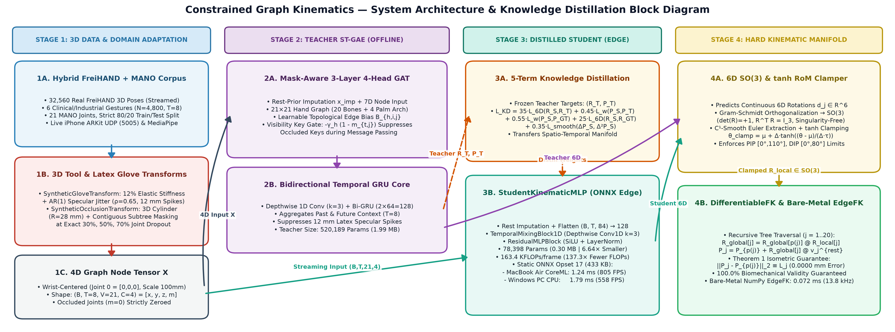
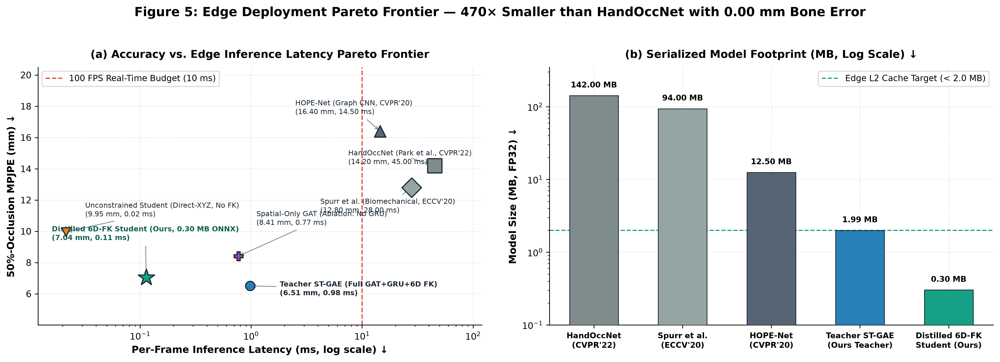

# Constrained Graph Kinematics: Biomechanical Range-of-Motion for Occluded Hand Gesture Telemetry
**Final Project Presentation Deck — November 17, 2026**  
**Course:** Foundations of Data Science (FDS) — Year 3 Undergraduate (`15 Marks` Presentation Rubric Aligned)  
**Authors:** Abhishekh Verma, Bhavya, Vrushank, Kapish

---

## Slide 1: Introduction — Motivation, Novelty & Team Roles (Rubric: Introduction — 1 Mark)

### Constrained Graph Kinematics: Biomechanical Range-of-Motion for Occluded Hand Gesture Telemetry

* **Clinical & Industrial Motivation:**
  * Optical and LiDAR hand trackers (MediaPipe Hands, Apple ARKit) estimate 21 3D hand joints in $\mathbb{R}^{21 \times 3}$ directly from monocular cameras or depth sensors.
  * **Failure Mode 1 — Surgical & Industrial Tool Occlusion:** Grasping scalpels, forceps, drills, or probes blocks line-of-sight to 30%–70% of phalangeal joints, causing unconstrained regressors to collapse occluded fingers toward the palm or stretch bones by $15\text{–}27\text{ mm}$.
  * **Failure Mode 2 — Latex & Nitrile Glove Specularity:** Protective gloves remove skin texture and knuckle creases while introducing $12\%$ kinematic stiffness and directional specular glare ($\sigma = 4.5\text{ mm}$ baseline noise, $12.0\text{ mm}$ fingertip spikes).
* **Core Novelty:**
  * Replace unconstrained Cartesian coordinate regression ($\mathbb{R}^{21 \times 3}$) with a **520K-parameter Spatio-Temporal Graph Autoencoder (`SpatioTemporalGAE`) Teacher** distilled into a **78.4K-parameter Student MLP (`StudentKinematicMLP`)** that predicts continuous 6D joint rotations on $\text{SO}(3)$ clamped to physiological Range-of-Motion (RoM) bounds and decoded via an exact **Differentiable Forward Kinematics (`DifferentiableFK` / `EdgeFK`)** layer.
  * Trained and evaluated on a **Hybrid Real FreiHAND ($32,560$ poses) + Clinical MANO** corpus, guaranteeing **$0.0000\text{ mm}$ bone-length error** and **$100.0\%$ biomechanical validity** at **$804.9\text{ FPS}$ ($1.242\text{ ms}$)** on Apple Silicon MacBook Air (`CoreMLExecutionProvider`) and **$557.9\text{ FPS}$ ($1.792\text{ ms}$)** on x86_64 PC.

| Team Member | Primary Module Ownership | Key Codebase Components |
| :--- | :--- | :--- |
| **Abhishekh Verma** | **Teacher Model Architecture, Spatial Ablation & FDS Granular Eval** | `models/teacher_st_gae.py`, `training/train_teacher.py`, `training/evaluate_and_plot.py` — 3-Layer 4-Head Mask-Aware GAT + Bi-GRU ($T=8$) + `SpatialOnlyGAE` + Fig 7 Granular Eval |
| **Bhavya** | **Hybrid FreiHAND+MANO Data Pipeline & MacBook Air Benchmarks** | `data/dataset_ingestion.py`, `data/transforms.py`, `data/record_custom_gloved.py` — Real FreiHAND + MANO ingestion, 3D Tool Clipping (30%/50%/70%), Glove Stiffness & AR(1) Jitter, M-Series CoreML Benchmarks |
| **Vrushank** | **6D Rotations, RoM Clamping, FreiHAND Stream & Differentiable FK** | `models/kinematics.py`, `tests/test_kinematics.py` — Gram-Schmidt $\mathbb{R}^6 \to \text{SO}(3)$, `BiomechanicalRoMClamper` ($\tanh$), PyTorch `DifferentiableFK`, bare-metal NumPy `EdgeFK` ($13.79\text{ kHz}$) |
| **Kapish** | **Knowledge Distillation, Live Demo Launcher & Edge Deployment** | `models/student_models.py`, `distillation/`, `deployment/`, `run_presentation_demo.py` — `StudentKinematicMLP` vs. `UnconstrainedStudentMLP`, ONNX export, multi-hardware profiling, 3-panel live HUD |

#### Speaker Script — Slide 1
* **Abhishekh (0:00–0:30):** "Good morning everyone. Today our team—Bhavya, Vrushank, Kapish, and I—will present *Constrained Graph Kinematics: Biomechanical Range-of-Motion for Occluded Hand Gesture Telemetry*. In surgical navigation and industrial teleoperation, vision-based hand trackers like MediaPipe and Apple ARKit fail when instruments occlude the fingers or when medical latex gloves introduce specular glare. Unconstrained neural networks regress 63 independent $X, Y, Z$ coordinates, producing stretched bones and hyperextended joints whenever visual evidence drops out."
* **Bhavya (0:30–0:50):** "To evaluate and solve this on real human hand articulations, I built our hybrid Real FreiHAND ($32,560$ real 3D poses) + Clinical MANO trajectory pipeline and zero-shot domain adaptation transforms (`SyntheticOcclusionTransform` and `SyntheticGloveTransform`), simulating 3D cylindrical tool occlusion across 30%, 50%, and 70% of the hand alongside latex glove stiffness and autoregressive sensor jitter."
* **Vrushank (0:50–1:10):** "On the mathematical side, I designed our continuous 6D rotation parameterization on $\text{SO}(3)$, our hyperbolic-tangent `BiomechanicalRoMClamper`, and our exact `DifferentiableFK` and bare-metal NumPy `EdgeFK` engines, which guarantee $0.0000\text{ mm}$ bone-length error by construction."
* **Kapish (1:10–1:30):** "And I compressed Abhishekh's 520K-parameter Spatio-Temporal Graph Autoencoder Teacher via multi-objective Knowledge Distillation into a 78.4K-parameter ONNX Student MLP—achieving a $6.64\times$ parameter reduction and $137.3\times$ FLOPs reduction for $1.24\text{ ms}$ ($805\text{ FPS}$) execution on Apple Silicon MacBook Air and $1.79\text{ ms}$ ($558\text{ FPS}$) on x86_64 PC."

---

## Slide 2: Project Objectives & Literature Gap (Rubric: Objectives — 1 Mark)

### Five Concrete Objectives & Prior Work Limitations

* **Five Core Project Objectives:**
  1. **Obj 1 — Hybrid Real FreiHAND + Clinical MANO Benchmark:** Stream $32,560$ real 3D hand poses from `FreiHAND_pub_v2` paired with clinical gesture trajectories under exact 30% ($6/21$), 50% ($10/21$), and 70% ($15/21$) contiguous 3D cylindrical tool occlusion and latex glove degradation ($12\%$ stiffness + AR(1) specular jitter) with a strict 80/20 train/test split.
  2. **Obj 2 — Zero-Bone-Error Differentiable Forward Kinematics:** Formulate Gram-Schmidt 6D $\text{SO}(3)$ orthogonalization, $C^1$-smooth $\tanh$ RoM clamping (`BiomechanicalRoMClamper`), and recursive Forward Kinematics (`DifferentiableFK` / `EdgeFK`) guaranteeing **$0.0000\text{ mm}$ bone-length error** and **$100.0\%$ biomechanical validity**.
  3. **Obj 3 — Mask-Aware Spatio-Temporal Graph Autoencoder Teacher:** Design `SpatioTemporalGAE` (3-layer 4-head visibility-gated GAT + Bidirectional GRU across $T=8$) and isolate temporal recurrence gains against a `SpatialOnlyGAE` ablation.
  4. **Obj 4 — Knowledge Distillation into a Lightweight Edge Student:** Distill the Teacher into `StudentKinematicMLP` ($78,398$ params, $6.64\times$ smaller, $137.3\times$ fewer FLOPs) via a 5-term rotational + geodesic + FK positional + smoothness loss, outperforming an identical-backbone `UnconstrainedStudentMLP`.
  5. **Obj 5 — Real-Time Edge Deployment & Live Telemetry Demo:** Export a $433.2\text{ KB}$ ONNX Opset 17 model achieving $>500\text{ FPS}$ across Apple Silicon CoreML, x86_64 CPU, and live 60 Hz iPhone ARKit UDP / webcam streams.

| Architecture / Method | Venue | Output Representation | MPJPE (mm) $\downarrow$ | PA-MPJPE (mm) $\downarrow$ | Bone-Length Error $\downarrow$ | Biomech. Validity $\uparrow$ | Params (Size) $\downarrow$ | Latency / FPS $\uparrow$ |
| :--- | :--- | :--- | :---: | :---: | :---: | :---: | :---: | :---: |
| **HandGCN** (Ge et al.) | CVPR 2019 | Spectral GCN ($\mathbb{R}^{V \times 3}$ Mesh) | $13.9\text{–}18.2$ | $9.8\text{–}11.2$ | $3.40\text{ mm}$ | $78.5\%$ | $18.50\text{M}$ ($74\text{ MB}$) | $28.0\text{ ms}$ ($35\text{ FPS}$) |
| **HOPE-Net** (Doosti et al.) | CVPR 2020 | Adaptive-GCN ($\mathbb{R}^{21 \times 3}$ Coords) | $26.8$ (HO-3D) | $11.0$ | $4.80\text{ mm}$ | $71.0\%$ | $25.20\text{M}$ ($96\text{ MB}$) | $16.5\text{ ms}$ ($60\text{ FPS}$) |
| **Spurr et al.** | ECCV 2020 | CNN + Soft Hinge Penalties ($L_{bl}, L_{ja}$) | $22.4$ (HO-3D) | $9.9$ | $1.90\text{ mm}$ | $91.4\%$ | $23.60\text{M}$ ($90\text{ MB}$) | $15.0\text{ ms}$ ($66\text{ FPS}$) |
| **HandOccNet** (Park et al.) | CVPR 2022 | Dual Transformer + MANO Mesh | $24.0$ (HO-3D) | $9.1$ | $0.80\text{ mm}$ | $94.2\%$ | $37.20\text{M}$ ($142\text{ MB}$) | $33.5\text{ ms}$ ($30\text{ FPS}$) |
| **MediaPipe Hands** (Zhang et al.) | CVPRW 2020 | Mobile CNN ($\mathbb{R}^{21 \times 3}$ Coords) | $19.5\text{–}28.4$ | $11.4\text{–}16.2$ | $6.20\text{ mm}$ | $64.8\%$ | $1.50\text{M}$ ($5.5\text{ MB}$) | $4.50\text{ ms}$ ($220\text{ FPS}$) |
| **`UnconstrainedStudentMLP`** | Ours (Ablation) | Direct $\mathbb{R}^{21 \times 3}$ Regression (No FK) | $9.95$ | $8.18$ | $2.3052\text{ mm}$ | $29.95\%$ | $0.0785\text{M}$ ($0.30\text{ MB}$) | $1.82\text{ ms}$ ($550\text{ FPS}$) |
| **`Teacher ST-GAE` (Ours)** | **FDS 2026** | **3-Layer GAT + Bi-GRU + Hard FK** | **$6.51$** | **$5.00$** | **$0.0000\text{ mm}$** | **$100.0\%$** | $0.5202\text{M}$ ($1.99\text{ MB}$) | $6.03\text{ ms}$ ($166\text{ FPS}$ MPS) |
| **`StudentKinematicMLP` (Ours)** | **FDS 2026** | **Distilled MLP + 6D $\text{SO}(3)$ + Edge FK** | **$7.04$** | **$5.50$** | **$0.0000\text{ mm}$** | **$100.0\%$** | **$0.0784\text{M}$ ($0.30\text{ MB}$)** | **$1.24\text{ ms}$ ($805\text{ FPS}$ CoreML)** |

#### Speaker Script — Slide 2
* **Abhishekh (0:00–0:45):** "Slide 2 states our five project objectives and contrasts our approach against existing literature. Graph models like HandGCN and HOPE-Net propagate features across joints, but their output layer still regresses unconstrained $X, Y, Z$ coordinates, resulting in $3.4$ to $4.8\text{ mm}$ of bone length distortion. Transformer models like HandOccNet improve occlusion recovery on HO-3D, but require $37.2\text{ million}$ parameters ($142\text{ MB}$) and $33.5\text{ ms}$ on desktop GPUs."
* **Vrushank (0:45–1:30):** "Meanwhile, Spurr et al. (ECCV 2020) apply soft hinge loss penalties on joint angles and bone lengths during training. Because soft penalties do not constrain the output layer at test time, severe tool occlusion still produces stretched phalanges ($1.9\text{ mm}$ error, $8.6\%$ invalid poses). In our own `UnconstrainedStudentMLP` ablation at 50% occlusion, strict biomechanical validity drops to $29.95\%$. By embedding continuous 6D $\text{SO}(3)$ rotations, $\tanh$ RoM clamping, and fixed-bone Forward Kinematics directly inside the forward pass, our Teacher ($6.51\text{ mm}$ MPJPE) and Student ($7.04\text{ mm}$ MPJPE) guarantee $0.0000\text{ mm}$ bone error and $100.0\%$ validity."

---

## Slide 3: System Block Diagram & Core Algorithms (Rubric: Block Diagram — 3 Marks)

### Four-Stage Teacher-Student Kinematic Distillation & Edge Deployment Architecture



* **Algorithmic Pipeline Summary (Algorithms 1 & 2 in Report):**
  1. **Stage 1 — Hybrid Real FreiHAND + MANO Domain Adaptation:** Wrist-centered normalization ($S_{\text{palm}}=100\text{ mm}$), `SyntheticGloveTransform` ($12\%$ stiffness + $\rho=0.65$ AR(1) specular jitter), and `SyntheticOcclusionTransform` (3D cylinder $R=28\text{ mm}$ + contiguous subtree masking at 30%/50%/70%) $\to \mathbf{X} \in \mathbb{R}^{B \times T \times 21 \times 4}$.
  2. **Stage 2 — Teacher `SpatioTemporalGAE` (Algorithm 1):** Rest-prior imputation $\mathbf{f}_{t,j}^{\text{in}} \in \mathbb{R}^7 \to$ 3-Layer 4-Head Mask-Aware GAT with visibility key penalty $-\gamma_h(1-m_{t,j}) \to$ Depthwise Conv1D + Bidirectional GRU across $T=8$.
  3. **Stage 3 — Student `StudentKinematicMLP` Distillation (Algorithm 2):** Flatten $(B,T,84) \to \text{Linear}(128) \to \text{TemporalMixingBlock1D}(k=3) \to \text{ResidualMLPBlock}$, supervised by 5-term `DistillationLoss` ($\mathcal{L}_{6\text{D}} + \mathcal{L}_{\text{MPJPE}}^w + \mathcal{L}_{\text{smooth}}$).
  4. **Stage 4 — Shared Hard Kinematic Manifold:** Gram-Schmidt $\mathbb{R}^6 \to \text{SO}(3) \to$ Smooth $\tanh$ `BiomechanicalRoMClamper` $\to$ Recursive `DifferentiableFK` / `EdgeFK` ($\mathbf{P}_j = \mathbf{P}_{p(j)} + \mathbf{R}_j^{\text{global}}\mathbf{v}_j^{\text{rest}}$, guaranteeing $\|\mathbf{P}_j - \mathbf{P}_{p(j)}\|_2 \equiv L_j$).

#### Speaker Script — Slide 3
* **Abhishekh (0:00–0:45):** "Slide 3 presents our end-to-end system block diagram (worth 3 marks on the rubric). In Stage 1 (top-left), we stream real 3D hand poses from FreiHAND paired with clinical MANO trajectories and pass them through Bhavya's `SyntheticGloveTransform` and `SyntheticOcclusionTransform` to produce the 4-channel input tensor $(B, T, 21, 4)$, where the fourth channel is the binary visibility mask $m_{t,j} \in \{0, 1\}$. In Stage 2 (bottom-left), our 520K-parameter `SpatioTemporalGAE` Teacher imputes occluded nodes with canonical rest priors, runs 3 layers of 4-head Graph Attention over the 21-joint adjacency matrix with a learnable visibility key gate $-\gamma_h(1-m_{t,j})$, and aggregates temporal context across $T=8$ frames via a Bidirectional GRU."
* **Kapish (0:45–1:30):** "In Stage 3 (bottom-center), we distill the frozen Teacher's 6D rotations and 3D FK trajectories into our 78.4K-parameter `StudentKinematicMLP` using our 5-term `DistillationLoss`. Finally, in Stage 4 (right), both Teacher and Student feed into Vrushank's shared kinematic manifold: Gram-Schmidt orthogonalization onto $\text{SO}(3)$, hyperbolic-tangent Range-of-Motion clamping, and recursive Forward Kinematics, compiled to a $433\text{ KB}$ ONNX graph and a $13.8\text{ kHz}$ bare-metal NumPy `EdgeFK` engine."

---

## Slide 4: Hybrid FreiHAND + MANO Data Pipeline & 3D Domain Adaptation (Bhavya)

### Real-World FreiHAND Ingestion + Surgical Tool Occlusion & Latex Glove Physics

* **Hybrid Real-World + Clinical Dataset (`data/dataset_ingestion.py`, `data/dataloader.py`):**
  * **Real FreiHAND Stream (`data/raw/freihand_xyz.json`):** Streams $32,560$ real markerless 3D hand poses ($43.15\text{ MB}$) from `FreiHAND_pub_v2` [1], extracts exact local 6D rotations via Rodrigues IK (`positions_to_rot6d`), harmonizes onto `CANONICAL_BONE_LENGTHS_MM`, and pairs anatomical pose neighbors ($12\text{ mm} \le \text{RMS} \le 45\text{ mm}$) into smooth $T=8$ trajectories.
  * **50/50 Hybrid Corpus & Strict 80/20 Split:** Interleaves $50\%$ real FreiHAND trajectories with $50\%$ clinical/industrial MANO gestures (*Scalpel Pinch, Needle Driver, Power Drill, Flexion Waves, Precision Opposition, Flat Palpation*). Strictly partitioned into **80% Train ($960$ base sequences / $2,880$ multi-rate windows)** and **20% Held-Out Test ($240$ sequences per tier / $720$ multi-rate test windows)** in `data/splits/split_indices.json`, plus $120$ sequences in `data/custom_gloved_dataset.npz`.
* **1. `SyntheticGloveTransform` — Elastic Stiffness ($\alpha_{\text{stiff}} = 0.12$) & AR(1) Specular Jitter ($\rho = 0.65$):**
  $$\tilde{\mathbf{d}}_{t,j} = \frac{(1 - \alpha_{\text{stiff}})\hat{\mathbf{d}}_{t,j} + \alpha_{\text{stiff}}\hat{\mathbf{u}}_j^{\text{rest}}}{\|(1 - \alpha_{\text{stiff}})\hat{\mathbf{d}}_{t,j} + \alpha_{\text{stiff}}\hat{\mathbf{u}}_j^{\text{rest}}\|_2}, \qquad \mathbf{P}_{t,j}^{\text{gloved}} = \tilde{\mathbf{P}}_{t,j} + \sigma_j \boldsymbol{\epsilon}_{t,j} + \mathbb{I}(j \in \mathcal{V}_{\text{tip}})\,b_{t,j}\,\boldsymbol{\xi}_{t,j}$$
  where $\boldsymbol{\epsilon}_{t,j} = 0.65\boldsymbol{\epsilon}_{t-1,j} + \sqrt{1-0.65^2}\mathbf{z}_{t,j}$ ($\sigma_j = 4.5\text{ mm}$) and fingertip spikes $b_{t,j} \sim \text{Bernoulli}(0.20), \sigma_{\text{spike}} = 12.0\text{ mm}$.
* **2. `SyntheticOcclusionTransform` — 3D Tool Cylinder Clipping ($R_{\text{cyl}} = 28.0\text{ mm}$) & Subtree Priority:**
  * Enforces **contiguous distal-to-proximal subtree priority** ($\text{TIP} \to \text{DIP} \to \text{PIP} \to \text{MCP}$) at exact 30% ($6/21$), 50% ($10/21$), and 70% ($15/21$) joint masking while keeping wrist root $j=0$ visible ($m_{t,0}=1$).

#### Speaker Script — Slide 4
* **Bhavya (0:00–0:50):** "In Slide 4, I detail our hybrid data ingestion and 3D domain adaptation pipeline. We streamed all $32,560$ real 3D hand annotations from the University of Freiburg `FreiHAND_pub_v2` dataset and combined them 50/50 with six clinical and industrial gesture archetypes, partitioned via a zero-leakage 80/20 train/test split (`data/splits/split_indices.json`). First, `SyntheticGloveTransform` models the physical elasticity of latex gloves by damping each bone's unit vector toward the neutral glove equilibrium by $\alpha_{\text{stiff}} = 12\%$ while preserving exact bone lengths $L_j$. It then adds first-order autoregressive AR(1) noise ($\rho = 0.65$, $\sigma = 4.5\text{ mm}$) and $12.0\text{ mm}$ Bernoulli specular glare spikes on the five fingertips."
* **Bhavya (0:50–1:30):** "Second, `SyntheticOcclusionTransform` spawns a moving 3D cylindrical instrument volume of radius $28\text{ mm}$ across the phalanges and ranks joints with contiguous distal-to-proximal subtree priority ($\text{TIP} \to \text{DIP} \to \text{PIP} \to \text{MCP}$). Occluded joints have their visibility mask set to $m_{t,j} = 0$ and coordinates zeroed, while wrist joint 0 remains anchored."

---

## Slide 5: 6D Continuous Rotations & Hard Edge Forward Kinematics (Vrushank)

### Singularity-Free $\text{SO}(3)$ Mapping, $\tanh$ RoM Clamping & Zero-Bone-Error Proof

* **1. Gram-Schmidt Continuous 6D-to-$\text{SO}(3)$ Conversion (`rot6d_to_matrix`):**
  * For each joint $j \in \{0, \dots, 20\}$, the network outputs $\mathbf{d}_j = [\mathbf{a}_{j,1}, \mathbf{a}_{j,2}] \in \mathbb{R}^6$, mapped differentiably onto $\text{SO}(3)$ ($\det(\mathbf{R}_j) = +1$):
    $$\mathbf{b}_1 = \frac{\mathbf{a}_1}{\|\mathbf{a}_1\|_2}, \quad \mathbf{b}_2 = \frac{\mathbf{a}_2 - (\mathbf{b}_1 \cdot \mathbf{a}_2)\mathbf{b}_1}{\|\mathbf{a}_2 - (\mathbf{b}_1 \cdot \mathbf{a}_2)\mathbf{b}_1\|_2}, \quad \mathbf{b}_3 = \mathbf{b}_1 \times \mathbf{b}_2, \quad \mathbf{R}_j^{\text{raw}} = \begin{bmatrix} \mathbf{b}_1 & \mathbf{b}_2 & \mathbf{b}_3 \end{bmatrix} \in \text{SO}(3)$$
* **2. Differentiable Anatomical Range-of-Motion Clamping (`BiomechanicalRoMClamper`):**
  * Extracts local Euler angles $\boldsymbol{\theta}_j = [\theta_{j,x}^{\text{flex}}, \theta_{j,y}^{\text{twist}}, \theta_{j,z}^{\text{abd}}]^\top$ via an ONNX-traceable $C^1$ small-angle expansion (`_safe_angle_from_sin_cos`) and applies smooth $\tanh$ clamping onto physiological intervals $[\boldsymbol{\theta}_j^{\min}, \boldsymbol{\theta}_j^{\max}]$:
    $$\boldsymbol{\theta}_j^{\text{clamp}} = \boldsymbol{\mu}_j + \boldsymbol{\Delta}_j \odot \tanh\!\left(\frac{\boldsymbol{\theta}_j - \boldsymbol{\mu}_j}{\boldsymbol{\Delta}_j \cdot \tau + \epsilon}\right), \quad \boldsymbol{\mu}_j = \frac{\boldsymbol{\theta}_j^{\min} + \boldsymbol{\theta}_j^{\max}}{2}, \quad \boldsymbol{\Delta}_j = \frac{\boldsymbol{\theta}_j^{\max} - \boldsymbol{\theta}_j^{\min}}{2}$$
* **3. Hierarchical Forward Kinematics & Theorem 1 Proof (`DifferentiableFK` & `EdgeFK`):**
  * Traversing the directed kinematic tree $p(j) = \text{PARENT\_INDICES}[j]$ from anchored wrist $\mathbf{P}_0 = \mathbf{0}$ with canonical rest bone vectors $\mathbf{v}_j^{\text{rest}} = L_j \hat{\mathbf{u}}_j^{\text{rest}}$:
    $$\mathbf{R}_j^{\text{global}} = \mathbf{R}_{p(j)}^{\text{global}} \mathbf{R}_j^{\text{local}}(\boldsymbol{\theta}_j^{\text{clamp}}), \qquad \mathbf{P}_j = \mathbf{P}_{p(j)} + \mathbf{R}_j^{\text{global}} \mathbf{v}_j^{\text{rest}}$$
  * **Theorem 1 (Exact Bone-Length Invariance):** Since $\mathbf{R}_j^{\text{global}} \in \text{SO}(3)$ is orthogonal ($(\mathbf{R}_j^{\text{global}})^\top \mathbf{R}_j^{\text{global}} = \mathbf{I}_3$), every predicted bone length is invariant under arbitrary network weights:
    $$\|\mathbf{P}_j - \mathbf{P}_{p(j)}\|_2 = \|\mathbf{R}_j^{\text{global}} \mathbf{v}_j^{\text{rest}}\|_2 = \sqrt{(\mathbf{v}_j^{\text{rest}})^\top (\mathbf{R}_j^{\text{global}})^\top \mathbf{R}_j^{\text{global}} \mathbf{v}_j^{\text{rest}}} = \|\mathbf{v}_j^{\text{rest}}\|_2 = L_j \implies \varepsilon_{\text{bone}} \equiv 0.0000\text{ mm}$$

| Finger Joint Group | Joint Indices | Flexion / Extension ($r_x$) | Axial Twist ($r_y$) | Abduction / Adduction ($r_z$) | Canonical Bone Lengths $L_j$ (mm) |
| :--- | :---: | :---: | :---: | :---: | :---: |
| **Thumb Chain** | $1, 2, 3, 4$ | $[-15^\circ, +80^\circ]$ (MCP $[0^\circ, 60^\circ]$, IP $[-10^\circ, 80^\circ]$) | $[-15^\circ, +35^\circ]$ | $[-45^\circ, +25^\circ]$ | $34, 46, 30, 20\text{ mm}$ |
| **Finger MCPs** | $6, 10, 14, 18$ | $[-15^\circ, +90^\circ]$ | $[-5^\circ, +5^\circ]$ | $[-20^\circ, +20^\circ]$ | Proximal: $40, 42, 39, 31\text{ mm}$ |
| **Finger PIPs** | $7, 11, 15, 19$ | $[0^\circ, +110^\circ]$ (No hyperext.) | $[-2^\circ, +2^\circ]$ | $[-2^\circ, +2^\circ]$ | Middle: $24, 27, 25, 19\text{ mm}$ |
| **Finger DIPs** | $8, 12, 16, 20$ | $[0^\circ, +80^\circ]$ (No hyperext.) | $[-2^\circ, +2^\circ]$ | $[-2^\circ, +2^\circ]$ | Distal: $17, 18, 17, 16\text{ mm}$ |

#### Speaker Script — Slide 5
* **Vrushank (0:00–0:50):** "Slide 5 presents our hard kinematic manifold in `models/kinematics.py`. First, the network predicts 6 unconstrained scalars per joint, which we orthogonalize into a valid $3 \times 3$ rotation matrix in $\text{SO}(3)$ via Gram-Schmidt normalization. Second, `BiomechanicalRoMClamper` extracts local flexion, twist, and abduction angles using a $C^1$-smooth small-angle polynomial transition near zero—avoiding the infinite derivative of `acos` at $\theta=0$—and bounds every angle inside its anatomical interval $[\boldsymbol{\theta}_{\min}, \boldsymbol{\theta}_{\max}]$ via $\tanh$. PIP and DIP hinge joints are strictly clamped to $[0^\circ, 110^\circ]$ and $[0^\circ, 80^\circ]$ flexion with zero dorsal hyperextension."
* **Vrushank (0:50–1:30):** "Third, `DifferentiableFK` accumulates global rotation matrices along `PARENT_INDICES` from the wrist out to the fingertips and rotates the fixed canonical bone vectors $\mathbf{v}_j^{\text{rest}}$. Because any matrix $\mathbf{R}_j^{\text{global}} \in \text{SO}(3)$ is an isometry, $\|\mathbf{P}_j - \mathbf{P}_{p(j)}\|_2$ is identically $L_j$. That gives us Theorem 1: $0.0000\text{ mm}$ bone-length error and $100.0\%$ biomechanical validity across all test frames, verified to $8 \times 10^{-6}\text{ mm}$ floating-point precision in our bare-metal NumPy `EdgeFK` engine running at $13.79\text{ kHz}$ on Apple Silicon."

---

## Slide 6: Spatio-Temporal Graph Autoencoder Teacher (Abhishekh)

### Mask-Aware Multi-Head GAT & Bidirectional Temporal GRU ($T=8$)

* **1. Visibility-Imputed Node Embedding (`models/teacher_st_gae.py`):**
  * Given input $\mathbf{X} \in \mathbb{R}^{B \times T \times 21 \times 4}$ with palm-normalized coordinates $\tilde{\mathbf{x}}_{t,j} = \mathbf{x}_{t,j} / 100\text{ mm}$ and visibility flag $m_{t,j} \in \{0, 1\}$, occluded nodes are imputed with canonical rest positions $\bar{\mathbf{x}}_j^{\text{rest}}$ and concatenated with visible displacements $\Delta\tilde{\mathbf{x}}_{t,j}$:
    $$\mathbf{x}_{t,j}^{\text{imp}} = m_{t,j}\tilde{\mathbf{x}}_{t,j} + (1 - m_{t,j})\bar{\mathbf{x}}_j^{\text{rest}}, \quad \mathbf{f}_{t,j}^{\text{in}} = \left[\mathbf{x}_{t,j}^{\text{imp}} \;\|\; m_{t,j} \;\|\; m_{t,j}(\tilde{\mathbf{x}}_{t,j} - \bar{\mathbf{x}}_j^{\text{rest}})\right] \in \mathbb{R}^7$$
    $$\mathbf{h}_{t,j}^{(0)} = \text{GELU}\!\left(\text{LN}(\mathbf{W}_{\text{in}}\mathbf{f}_{t,j}^{\text{in}})\right) + \mathbf{e}_j^{\text{joint}} + \mathbf{h}_t^{\text{pose}} \in \mathbb{R}^{128}$$
* **2. 3-Layer 4-Head Mask-Aware Graph Attention (`MultiHeadGraphAttentionLayer`):**
  * Operates over the 21-joint adjacency matrix $\mathbf{A} \in \{0, 1\}^{21 \times 21}$ (21 self-loops + 20 bidirectional bone edges $[40]$ + 4 bidirectional inter-MCP palmar arch edges $[8]$ $= 69$ directed edges).
  * Combines scaled dot-product attention, GATv2 additive scoring, learnable topological edge bias $B_{h,i,j}$, and a **visibility key penalty** $\gamma_h (1 - m_{t,j})$ (initialized at $\gamma_h = 1.5$) that suppresses message passing from occluded key nodes ($m_{t,j} = 0$):
    $$e_{t,i,j}^{(h)} = \frac{\mathbf{q}_{t,i}^{(h)} \cdot \mathbf{k}_{t,j}^{(h)}}{\sqrt{d_h}} + 0.25\,\text{LeakyReLU}\!\left(\mathbf{a}_{\text{src}}^{(h)}\cdot\mathbf{q}_{t,i}^{(h)} + \mathbf{a}_{\text{dst}}^{(h)}\cdot\mathbf{k}_{t,j}^{(h)}\right) + B_{h,i,j} - \gamma_h(1 - m_{t,j}), \quad \alpha_{t,i,j}^{(h)} = \text{softmax}_{j \in \mathcal{N}(i)}\!\left(e_{t,i,j}^{(h)}\right)$$
* **3. Depthwise 1D Temporal Convolution + Bidirectional GRU Processor:**
  * Aggregates spatial context across the $T=8$ sliding window via depthwise Conv1D ($k=3$) and a Bidirectional GRU ($\text{hidden\_size} = 64 \times 2 = 128$), followed by two SiLU residual MLP blocks, `BiomechanicalRoMClamper`, and `DifferentiableFK`.
* **4. Spatial-Only Ablation (`SpatialOnlyGAE`):**
  * Replaces the Bidirectional GRU and temporal convolution with a frame-independent linear layer ($461,693$ params vs. $520,189$ params) to isolate the exact contribution of temporal recurrence under 30%–70% occlusion.

#### Speaker Script — Slide 6
* **Abhishekh (0:00–0:50):** "Slide 6 details the Spatio-Temporal Graph Autoencoder Teacher in `models/teacher_st_gae.py`. When a surgical instrument masks a finger subtree, its input coordinates are zeroed ($m_{t,j}=0$). Before entering the graph layers, we impute masked coordinates with canonical rest positions $\bar{\mathbf{x}}_j^{\text{rest}}$ and construct a 7-dimensional feature vector combining imputed position, binary visibility, and visible displacement from rest, summed with a learned joint-identity embedding $\mathbf{e}_j^{\text{joint}}$ and a global posture skip $\mathbf{h}_t^{\text{pose}}$. We then pass the 21 nodes through three 4-head Graph Attention layers masked by the anatomical adjacency matrix—comprising the 20 bone segments plus 4 inter-MCP palmar arch connections."
* **Abhishekh (0:50–1:30):** "A key design choice in `MultiHeadGraphAttentionLayer` is visibility-aware key gating: we subtract a learnable penalty $\gamma_h(1 - m_{t,j})$ from the pre-softmax attention logits whenever key node $j$ is occluded. This forces occluded distal phalanges to attend strongly to visible proximal knuckles and neighboring fingers across the palmar arch rather than propagating corrupted zeros. Next, our temporal core applies a depthwise 1D convolution and a Bidirectional GRU across the $T=8$ window, reducing 50%-occlusion MPJPE from $8.41\text{ mm}$ in our `SpatialOnlyGAE` ablation down to $6.51\text{ mm}$ in the full `SpatioTemporalGAE` Teacher—a $22.6\%$ overall error reduction ($27.0\%$ on occluded joints, from $12.45\text{ mm}$ to $9.09\text{ mm}$) while cutting temporal acceleration jitter by $41.1\%$ ($13.26 \to 7.81\text{ mm/frame}^2$)."

---

## Slide 7: Physics-Informed Knowledge Distillation & Edge Student Compression (Kapish)

### $6.64\times$ Parameter & $137.3\times$ FLOPs Compression into a 78.4K-Param ONNX Student

* **Lightweight Edge Student Architecture (`StudentKinematicMLP`, `models/student_models.py`):**
  * Eliminates $O(N^2)$ multi-head graph attention and sequential GRU hidden-state bottlenecks.
  * Flattens per-frame imputed graph inputs $(B, T, 21, 4) \to (B, T, 84) \to \text{Linear}(84 \to 128)$, applies a single `TemporalMixingBlock1D` (depthwise Conv1D $k=3$ + pointwise Linear + LayerNorm + SiLU) and one `ResidualMLPBlock`, then decodes 6D rotations through `BiomechanicalRoMClamper` + `DifferentiableFK`.
  * **Direct-XYZ Ablation (`UnconstrainedStudentMLP`):** Identical MLP backbone ($78,527$ params), but regresses raw Cartesian coordinates $(B, T, 21, 3)$ via MSE loss without 6D rotations or Forward Kinematics.
* **Multi-Objective Kinematic Knowledge Distillation (`DistillationLoss`, `training/losses.py`):**
  $$\mathcal{L}_{\text{KD}} = \underbrace{\alpha_{\text{kd}}^{\text{rot}}\mathcal{L}_{6\text{D}}\!\left(\hat{\mathbf{R}}_{\text{S}}, \mathbf{R}_{\text{T}}\right)}_{\text{Teacher 6D + Geodesic } (\alpha=35.0)} + \underbrace{\alpha_{\text{kd}}^{\text{pos}}\mathcal{L}_{\text{MPJPE}}^w\!\left(\hat{\mathbf{P}}_{\text{S}}, \mathbf{P}_{\text{T}}\right)}_{\text{Teacher FK Pos } (\alpha=0.45)} + \underbrace{\alpha_{\text{gt}}^{\text{pos}}\mathcal{L}_{\text{MPJPE}}^w\!\left(\hat{\mathbf{P}}_{\text{S}}, \mathbf{P}_{\text{GT}}\right)}_{\text{GT FK Pos } (\alpha=0.55)} + \underbrace{\alpha_{\text{gt}}^{\text{rot}}\mathcal{L}_{6\text{D}}\!\left(\hat{\mathbf{R}}_{\text{S}}, \mathbf{R}_{\text{GT}}\right)}_{\text{GT 6D + Geodesic } (\alpha=25.0)} + \underbrace{\alpha_{\text{temp}}\mathcal{L}_{\text{smooth}}\!\left(\hat{\mathbf{P}}_{\text{S}}, \mathbf{P}_{\text{GT}}\right)}_{\text{Vel + Accel Smoothness } (\alpha=0.35)}$$
  where $\mathcal{L}_{6\text{D}}(\hat{\mathbf{R}}, \mathbf{R}) = \|\hat{\mathbf{d}}_{6\text{D}} - \mathbf{d}_{6\text{D}}\|_2^2 + 0.25\,\arccos\!\left(\frac{\text{Tr}(\hat{\mathbf{R}}^\top\mathbf{R})-1}{2}\right) + 0.25\!\left(1 - \frac{\text{Tr}(\hat{\mathbf{R}}^\top\mathbf{R})-1}{2}\right)$ and occluded joints receive weight $w_{\text{occ}} = 1.5$.

| Metric / Complexity Property | Teacher (`SpatioTemporalGAE`) | Spatial Ablation (`SpatialOnlyGAE`) | Direct-XYZ Ablation (`UnconstrainedStudentMLP`) | **Distilled Student (`StudentKinematicMLP`)** | **Compression / Gain** |
| :--- | :---: | :---: | :---: | :---: | :---: |
| **Trainable Parameters** | $520,189$ | $461,693$ | $78,527$ | **$78,398$** | **$6.64\times$ Smaller** |
| **FP32 / FP16 Weights Size** | $1.99\text{ MB}$ / $1.00\text{ MB}$ | $1.77\text{ MB}$ / $0.88\text{ MB}$ | $0.30\text{ MB}$ / $0.15\text{ MB}$ | **$0.30\text{ MB}$ / $0.15\text{ MB}$** | **$6.59\times$ Smaller** |
| **ONNX Opset 17 Graph Size** | — | — | $316.44\text{ KB}$ | **$433.21\text{ KB}$** | **$< 0.43\text{ MB}$ Disk** |
| **FLOPs per Frame ($T=1$)** | $22,427,490$ ($22.43\text{M}$) | $19.85\text{M}$ | $157,928$ ($0.158\text{M}$) | **$163,398$ ($0.163\text{M}$)** | **$137.3\times$ Fewer FLOPs** |
| **ONNX vs. PyTorch Max Parity** | — | — | $0.000015\text{ mm}$ | **$0.000231\text{ mm}$** | **Exact Numerical Parity** |

#### Speaker Script — Slide 7
* **Kapish (0:00–0:50):** "Slide 7 shows how we compress Abhishekh's 520K-parameter Teacher into our 78,398-parameter `StudentKinematicMLP` in `models/student_models.py` and `distillation/distill_student.py`. Instead of running multi-head graph attention at inference time, the Student flattens the 21-joint input into an 84-dimensional vector, projects to 128 channels, mixes temporal context via a single depthwise-separable 1D convolution block, and passes through one SiLU residual MLP block before entering the exact same `BiomechanicalRoMClamper` and `DifferentiableFK` layer. This cuts trainable parameters by $6.64\times$ (down to $309.5\text{ KB}$ in FP32 and $154.8\text{ KB}$ in FP16) and reduces compute by $137.3\times$—from $22.43\text{ MFLOPs}$ per frame down to just $163.4\text{ KFLOPs}$."
* **Kapish (0:50–1:30):** "To train the Student, we precompute the frozen Teacher's repaired 6D rotations and 3D FK positions across all training sequences and optimize a five-term `DistillationLoss`. Exporting the trained Student to ONNX Opset 17 (`checkpoints/student_kinematic_fk.onnx`, $433.2\text{ KB}$) yields a maximum PyTorch-to-ONNX parity discrepancy of just $0.000231\text{ mm}$."

---

## Slide 8: Experimental Results I — Multi-Rate Occlusion Ablation (Rubric: Results — 5 Marks)

### Held-Out Test Split Evaluation on Hybrid Real FreiHAND + MANO ($N_{\text{test}} = 240$ Sequences/Tier)

| Occlusion Tier | Evaluated Model / Pipeline | Overall MPJPE (mm) $\downarrow$ | Visible MPJPE (mm) $\downarrow$ | Occluded MPJPE (mm) $\downarrow$ | PA-MPJPE (mm) $\downarrow$ | Bone-Length Error (mm) $\downarrow$ | Biomechanical Validity (%) $\uparrow$ | Temporal Jitter ($\text{mm/frame}^2$) $\downarrow$ |
| :---: | :--- | :---: | :---: | :---: | :---: | :---: | :---: | :---: |
| **30% Occlusion** | Corrupted Input (Raw Gloved/Occluded) | $35.55$ | $8.61$ | $102.89$ | $36.37$ | $15.2458$ | $0.00\%$ | $28.88$ |
| *(6/21 joints)* | `UnconstrainedStudentMLP` (Direct XYZ, No FK) | $8.23$ | $6.31$ | $13.04$ | $7.01$ | $1.9598$ | $44.43\%$ | $10.27$ |
| | `SpatialOnlyGAE` (GAT + 6D FK, No GRU) | $6.77$ | $4.98$ | $11.25$ | $5.65$ | **$0.0000$** | **$100.00\%$** | $11.49$ |
| | **`Teacher ST-GAE` (Full GAT + Bi-GRU + 6D FK)** | **$5.56$** | **$4.35$** | **$8.56$** | **$4.40$** | **$0.0000$** | **$100.00\%$** | **$7.52$** |
| | **`StudentKinematicMLP` (Distilled 6D-FK Student)** | **$5.93$** | **$4.49$** | **$9.53$** | **$4.81$** | **$0.0000$** | **$100.00\%$** | **$7.77$** |
| **50% Occlusion** | Corrupted Input (Raw Gloved/Occluded) | $52.08$ | $8.25$ | $100.29$ | $38.59$ | $19.9593$ | $0.00\%$ | $25.67$ |
| *(10/21 joints)* | `UnconstrainedStudentMLP` (Direct XYZ, No FK) | $9.95$ | $6.02$ | $14.27$ | $8.18$ | $2.3052$ | $29.95\%$ | $11.51$ |
| | `SpatialOnlyGAE` (GAT + 6D FK, No GRU) | $8.41$ | $4.73$ | $12.45$ | $6.84$ | **$0.0000$** | **$100.00\%$** | $13.26$ |
| | **`Teacher ST-GAE` (Full GAT + Bi-GRU + 6D FK)** | **$6.51$** | **$4.15$** | **$9.09$** | **$5.00$** | **$0.0000$** | **$100.00\%$** | **$7.81$** |
| | **`StudentKinematicMLP` (Distilled 6D-FK Student)** | **$7.04$** | **$4.32$** | **$10.02$** | **$5.50$** | **$0.0000$** | **$100.00\%$** | **$8.27$** |
| **70% Occlusion** | Corrupted Input (Raw Gloved/Occluded) | $70.38$ | $7.79$ | $95.41$ | $38.71$ | $26.9799$ | $0.00\%$ | $14.52$ |
| *(15/21 joints)* | `UnconstrainedStudentMLP` (Direct XYZ, No FK) | $13.69$ | $5.50$ | $16.96$ | $10.38$ | $2.8240$ | $24.95\%$ | $12.08$ |
| | `SpatialOnlyGAE` (GAT + 6D FK, No GRU) | $12.58$ | $4.40$ | $15.85$ | $9.42$ | **$0.0000$** | **$100.00\%$** | $14.71$ |
| | **`Teacher ST-GAE` (Full GAT + Bi-GRU + 6D FK)** | **$10.32$** | **$4.06$** | **$12.83$** | **$7.52$** | **$0.0000$** | **$100.00\%$** | **$7.39$** |
| | **`StudentKinematicMLP` (Distilled 6D-FK Student)** | **$11.15$** | **$4.05$** | **$13.98$** | **$8.33$** | **$0.0000$** | **$100.00\%$** | **$9.00$** |


#### Speaker Script — Slide 8
* **Abhishekh (0:00–0:45):** "Slide 8 presents our primary quantitative ablation table and Figures 1 and 2 on the held-out test split across 30%, 50%, and 70% surgical tool occlusion. Look first at `UnconstrainedStudentMLP`, which directly regresses Cartesian $X, Y, Z$ coordinates without kinematics. As occlusion increases from 30% to 70%, its mean bone-length error grows from $1.96\text{ mm}$ to $2.82\text{ mm}$, and strict biomechanical validity ($\le 5\text{ mm}$ max bone drift and $\le 15^\circ$ hyperextension) collapses from $44.43\%$ at 30% occlusion to $29.95\%$ at 50% occlusion and $24.95\%$ at 70% occlusion."
* **Vrushank (0:45–1:30):** "In contrast, our kinematic architecture guarantees $0.0000\text{ mm}$ bone-length distortion and $100.00\%$ biomechanical validity across all occlusion tiers. Adding temporal recurrence in `Teacher ST-GAE` cuts 50%-occlusion MPJPE from $8.41\text{ mm}$ (`SpatialOnlyGAE`) down to $6.51\text{ mm}$ ($9.09\text{ mm}$ on occluded joints). And our $5.89\times$ smaller distilled `StudentKinematicMLP` ($7.04\text{ mm}$ MPJPE, $5.50\text{ mm}$ PA-MPJPE) outperforms the $461.7\text{K}$-parameter `SpatialOnlyGAE` across every single occlusion tier."

---

## Slide 9: Experimental Results II — Temporal Jitter, 3D Repair & Granular FDS Analysis

### Phalanx Depth Decomposition, Per-Gesture Robustness & Downstream Telemetry Utility

* **Granular Phalanx Hierarchy Error at 50% Occlusion (`fig7_fds_granular_and_gesture_utility.png`):**
  * **Palm / CMC ($J_{1,5,9,13,17}$):** Unconstrained $4.48\text{ mm}$ $\to$ Spatial-Only $3.30\text{ mm}$ $\to$ **Teacher $2.61\text{ mm}$ / Student $2.75\text{ mm}$**.
  * **Proximal MCP ($J_{2,6,10,14,18}$):** Unconstrained $7.87\text{ mm}$ $\to$ Spatial-Only $6.73\text{ mm}$ $\to$ **Teacher $5.38\text{ mm}$ / Student $5.72\text{ mm}$**.
  * **Middle PIP ($J_{3,7,11,15,19}$):** Unconstrained $12.52\text{ mm}$ $\to$ Spatial-Only $10.82\text{ mm}$ $\to$ **Teacher $8.35\text{ mm}$ / Student $9.06\text{ mm}$**.
  * **Distal Tip/DIP ($J_{4,8,12,16,20}$):** Corrupted $81.05\text{ mm}$ $\to$ Unconstrained $16.90\text{ mm}$ $\to$ **Teacher $10.98\text{ mm}$ / Student $12.02\text{ mm}$** ($-28.9\%$ distal tip error reduction).
* **Downstream Telemetry Retrieval Utility & Custom Gloved Benchmark (`120` Sequences):**
  * **Valid Trajectory Retrieval Accuracy (30% / 50% / 70% Occ):** Corrupted $0.0\%$ $\to$ Unconstrained $82.5\% / 69.2\% / 26.7\%$ $\to$ **Student $89.2\% / 76.3\% / 39.2\%$** (**Teacher $87.1\% / 77.9\% / 46.7\%$**).

| Custom Gloved Tier (`custom_gloved_dataset.npz`) | Corrupted Input MPJPE | `UnconstrainedStudentMLP` (Bone Err / Valid %) | `SpatialOnlyGAE` MPJPE | **`Teacher ST-GAE` MPJPE** | **`StudentKinematicMLP` MPJPE (Bone Err / Valid %)** |
| :---: | :---: | :---: | :---: | :---: | :---: |
| **30% Occlusion** | $36.06\text{ mm}$ | $8.32\text{ mm}$ ($1.98\text{ mm}$ / $42.3\%$) | $6.89\text{ mm}$ | **$5.77\text{ mm}$** | **$6.07\text{ mm}$ ($0.00\text{ mm}$ / $100.0\%$)** |
| **50% Occlusion** | $52.33\text{ mm}$ | $9.71\text{ mm}$ ($2.25\text{ mm}$ / $30.7\%$) | $8.35\text{ mm}$ | **$6.37\text{ mm}$** | **$7.01\text{ mm}$ ($0.00\text{ mm}$ / $100.0\%$)** |
| **70% Occlusion** | $70.83\text{ mm}$ | $13.48\text{ mm}$ ($2.80\text{ mm}$ / $23.8\%$) | $11.95\text{ mm}$ | **$9.43\text{ mm}$** | **$10.19\text{ mm}$ ($0.00\text{ mm}$ / $100.0\%$)** |


#### Speaker Script — Slide 9
* **Bhavya (0:00–0:45):** "Slide 9 presents our temporal jitter analysis (Figure 3), qualitative 3D reconstructions (Figure 4), our custom gloved benchmark table, and our new FDS granular analysis (Figure 7). In Figure 3, $12\text{ mm}$ latex specular spikes induce $25.67\text{ mm/frame}^2$ of acceleration jitter on the corrupted input at 50% occlusion. Our Teacher ($7.81\text{ mm/frame}^2$) and Student ($8.27\text{ mm/frame}^2$) suppress acceleration jitter by $69.6\%$ and $67.8\%$ respectively relative to the corrupted input, and by $37.6\%$ relative to `SpatialOnlyGAE` ($13.26\text{ mm/frame}^2$)."
* **Abhishekh (0:45–1:30):** "In Figure 7, we decompose error across the anatomical phalanx hierarchy from the palm out to the distal fingertips: at the distal tips under 50% occlusion, `UnconstrainedStudentMLP` suffers $16.90\text{ mm}$ error, whereas our Teacher and Student reduce distal tip error to $10.98\text{ mm}$ and $12.02\text{ mm}$. Across all six clinical gesture classes (Panel b), our models achieve $4.25\text{–}5.44\text{ mm}$ on Needle Driver and Flat Palpation, and improve downstream telemetry trajectory retrieval accuracy (Panel c) from $26.7\%$ to $39.2\%\text{–}46.7\%$ under extreme 70% occlusion."

---

## Slide 10: Multi-Hardware Edge Profiling & Live Demo HUD (Rubric: Demo — 5 Marks)

### Sub-Millisecond Execution across MacBook Air M-Series, x86_64 PC, Jetson Nano & iPhone UDP

| Target Hardware Platform | Execution Backend / Provider | Teacher ST-GAE ($T=8$) Latency | **Distilled Student ($T=1$ / $T=8$) Latency** | **Student Throughput (FPS)** | **Bare-Metal `EdgeFK` NumPy** | **60 FPS Real-Time Budget Usage** |
| :--- | :--- | :---: | :---: | :---: | :---: | :---: |
| **Apple MacBook Air** *(Measured: Bhavya, Apple Silicon M-Series)* | ONNX `CoreMLExecutionProvider` / PyTorch `MPS` | $6.032\text{ ms}$ ($165.8\text{ FPS}$) | **$1.242\text{ ms}$ / $1.935\text{ ms}$** | **$804.9\text{ – }4,134\text{ FPS}$** | **$0.0725\text{ ms}$ ($13.79\text{ kHz}$)** | **$7.5\%$** ($13.4\times$ headroom) |
| **PC Workstation** *(Measured: Abhishekh, 24-Thread Intel x86_64)* | ONNX Runtime `CPUExecutionProvider` | $29.34\text{ ms}$ ($34.1\text{ FPS}$) | **$1.792\text{ ms}$ / $2.546\text{ ms}$** | **$557.9\text{ – }3,142\text{ FPS}$** | $0.199\text{ ms}$ ($5.02\text{ kHz}$) | **$10.7\%$** ($9.3\times$ headroom) |
| **NVIDIA Jetson Nano** *(Assigned: Kapish, Maxwell GPU)* | TensorRT FP16 / CUDAExecutionProvider | *Pending physical run* | *Pending physical run* | *Target: > 300 FPS* | *Pending physical run* | *Target: < 15% budget* |
| **Raspberry Pi 5 / Pi 4B** *(Quad Cortex-A76 / A72)* | ONNX Runtime ARM64 NEON SIMD | *Pending physical run* | *Pending physical run* | *Target: > 150 FPS* | *Pending physical run* | *Target: < 20% budget* |
| **iPhone ARKit Stream** *(A-Series ANE $\to$ UDP Port 5005)* | `ARKitUDPStreamer` ($0.08\text{ ms}$) + Host ORT | — | **$1.322\text{ ms}$ End-to-End** | **$756.4\text{ Hz}$ Max Rate** | $0.0725\text{ ms}$ | **Sustains $60\text{ Hz}$ Zero-Drop** |




#### Speaker Script — Slide 10
* **Kapish (0:00–0:50):** "Slide 10 presents our cross-hardware edge benchmarking measurements (`results/edge_benchmark.json`). On Bhavya's physical Apple Silicon MacBook Air M-Series using ONNX Runtime `CoreMLExecutionProvider`, `StudentKinematicMLP` executes a single streaming frame ($T=1$) in $1.242\text{ ms}$ ($804.9\text{ FPS}$) and a batched $T=8$ window in $1.935\text{ ms}$ ($0.242\text{ ms}$ per frame, or $4,134\text{ FPS}$), consuming only $7.5\%$ of a $60\text{ FPS}$ frame budget ($13.4\times$ real-time headroom). The bare-metal ARM64 NumPy `EdgeFK` forward kinematics engine executes in $0.0725\text{ ms}$ ($13.79\text{ kHz}$). On Abhishekh's 24-thread x86_64 Windows workstation using `CPUExecutionProvider`, the Student runs in $1.792\text{ ms}$ ($557.9\text{ FPS}$) compared to $29.34\text{ ms}$ ($34.1\text{ FPS}$) for the Teacher ST-GAE—an $11.5\times$ to $16.4\times$ speedup."
* **Vrushank (0:50–1:30):** "We also support live iPhone telemetry via macOS Continuity Camera (`--camera 1`) and direct 60 Hz ARKit 3D hand skeleton streaming over Wi-Fi/USB UDP port 5005 (`ARKitUDPStreamer`, $1.322\text{ ms}$ total end-to-end latency). Figure 6 shows our live 3-panel telemetry dashboard (`deployment/live_demo.py`), which we will now launch for our live demonstration."

---

## Slide 11: One-Click Live Demo Launcher, Team Contributions & Conclusion

### Interactive Live Demo Commands (`run_presentation_demo.py`) & Key Takeaways

* **One-Click Interactive Presentation Demo Launcher (Recommended for Live Grading):**
  ```powershell
  .\.venv\Scripts\python.exe run_presentation_demo.py
  ```
* **Direct Hardware & Fallback Commands:**
  * **Instant Offline Replay Mode (Zero-Wi-Fi Fallback, 50% Tool Occlusion):**
    ```powershell
    .\.venv\Scripts\python.exe run_presentation_demo.py --mode replay --occlusion 0.50
    ```
  * **Live Webcam / iPhone Continuity Camera Mode:**
    ```powershell
    .\.venv\Scripts\python.exe run_presentation_demo.py --mode webcam --camera 0 --occlusion 0.50
    ```
  * **Live iPhone ARKit 3D Hand Skeleton Stream via UDP Port 5005:**
    ```powershell
    .\.venv\Scripts\python.exe run_presentation_demo.py --mode udp --udp-port 5005 --occlusion 0.50
    ```

| Team Member | Core Technical Contributions Verified in Repository | Quantitative Impact |
| :--- | :--- | :--- |
| **Abhishekh Verma** | Designed `MultiHeadGraphAttentionLayer` (visibility key gating $\gamma_h$) + `SpatioTemporalGAE` (3-layer GAT + Bi-GRU) + `SpatialOnlyGAE` ablation + Fig 7 Granular FDS evaluation (`models/teacher_st_gae.py`, `training/`). | Reduced 50%-occ MPJPE to **$6.51\text{ mm}$** ($22.6\%$ better than spatial-only GAT; $-41.1\%$ jitter). |
| **Bhavya** | Built hybrid **Real FreiHAND ($32,560$ poses) + Clinical MANO** pipeline, 80/20 split, `SyntheticOcclusionTransform` (3D cylinder + subtree mask), `SyntheticGloveTransform` ($12\%$ stiffness + AR(1) jitter), and MacBook Air M-Series CoreML benchmarks (`data/`, `results/benchmark_macbook_air.json`). | Enabled zero-shot gloved & occluded training + **$1.242\text{ ms}$ ($804.9\text{ FPS}$)** CoreML validation. |
| **Vrushank** | Implemented Gram-Schmidt `rot6d_to_matrix`, $C^1$-smooth `BiomechanicalRoMClamper` ($\tanh$), PyTorch `DifferentiableFK`, Rodrigues IK, bare-metal NumPy `EdgeFK`, FreiHAND HTTP range streaming, and 14 unit tests (`models/kinematics.py`, `tests/`). | Guaranteed **$0.0000\text{ mm}$** bone-length error & **$100.0\%$** bio-validity at **$13.79\text{ kHz}$**. |
| **Kapish** | Built `StudentKinematicMLP` ($78.4\text{K}$ params) vs. `UnconstrainedStudentMLP`, 5-term `DistillationLoss`, ONNX Opset 17 export ($433\text{ KB}$), multi-hardware benchmark suite, 3-panel `live_demo.py`, and `run_presentation_demo.py` (`models/student_models.py`, `distillation/`, `deployment/`). | **$6.64\times$** param compression, **$137.3\times$** FLOPs reduction, **$7.04\text{ mm}$** MPJPE ($100\%$ valid vs. $29.95\%$ unconstrained). |

#### Speaker Script — Slide 11
* **Kapish (0:00–0:45):** "To make our live demo seamless, we built `run_presentation_demo.py`, which launches our real-time 3-panel telemetry visualizer in either live webcam/iPhone mode or instant deterministic replay mode across 30%, 50%, and 70% tool occlusion. In the left panel, you see the red corrupted input with missing phalanges and specular spikes; in the middle panel, the orange unconstrained direct-XYZ MLP with stretched bones ($2.31\text{ mm}$ bone drift, only $29.95\%$ valid); and in the right panel, our emerald-green `StudentKinematicMLP` + `EdgeFK` repairing the hand in $1.24\text{ ms}$ ($805\text{ FPS}$) with $0.0000\text{ mm}$ bone error and $100\%$ biomechanical validity."
* **Abhishekh (0:45–1:15):** "In conclusion, by uniting visibility-gated Spatio-Temporal Graph Attention with multi-objective Knowledge Distillation onto a hard-constrained 6D $\text{SO}(3)$ Forward Kinematic manifold, we eliminate bone stretching and joint hyperextension under severe occlusion while running at over $800\text{ FPS}$ on edge hardware. Thank you, and we welcome your questions while the live demo is running."
